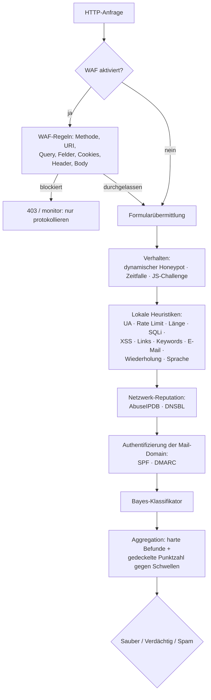

# PHP Form Spam Checker 2.1

> **Lesen auf:** [English](README.md) · [Русский](README.ru.md) · [Español](README.es.md) · Deutsch · [中文](README.zh.md) · [हिन्दी](README.hi.md)

**Eine geschichtete, abhängigkeitsfreie Anti-Spam-Pipeline und HTTP-Firewall für jedes
PHP-Formular.** Sie führt zuerst lokale Heuristiken aus, dann Verhaltenssignale, IP-Reputation,
DNS-Blocklisten, die Authentifizierung von Mail-Domains und einen Bayes-Klassifikator — und
untersucht optional die gesamte HTTP-Anfrage mit einer WAF. Kein Captcha, keine
Composer-Abhängigkeiten zur Laufzeit, und jeder Befund trägt Belege: welche Prüfungen
ausgelöst wurden, mit welchen Punktzahlen und warum.

[](https://github.com/paulmann/PHP-Form-Spam-Checker/actions/workflows/ci.yml)
[](https://github.com/paulmann/PHP-Form-Spam-Checker/releases)
[](https://php.net/)
[](LICENSE)


[**Wiki**](https://github.com/paulmann/PHP-Form-Spam-Checker/wiki) · [**Dokumentation**](https://github.com/paulmann/PHP-Form-Spam-Checker/tree/main/docs) · [**Veröffentlichungen**](https://github.com/paulmann/PHP-Form-Spam-Checker/releases) · [**Änderungsprotokoll**](CHANGELOG.md) · [**Probleme**](https://github.com/paulmann/PHP-Form-Spam-Checker/issues) · [**Sicherheit**](SECURITY.md) · [**Für Agenten**](AGENTS.md) · [**Russische Version**](README.ru.md)

> **Dokumentationsstatus.** Die Zahlen in dieser README wurden am 2026-11-03 aus dem
> Repository-Baum gemessen (Version 2.1.0); der Befehl, der jede Zahl erzeugt hat, steht
> daneben. Ausführliche Leitfäden liegen im
> [Wiki](https://github.com/paulmann/PHP-Form-Spam-Checker/wiki) und in `docs/`;
> der nicht-interaktive Vertrag für Agenten ist [`AGENTS.md`](AGENTS.md).

---

## Inhalt

- [Was sich in 2.1 geändert hat](#what-changed-in-21)
- [Was sich in 2.0 geändert hat](#what-changed-in-20)
- [Der Schutzzyklus](#the-protection-cycle)
- [Prüfmodule und Standardwerte](#check-modules-and-defaults)
- [In Zahlen](#by-the-numbers)
- [Anforderungen](#requirements)
- [Installation](#installation)
- [Schnellstart: einfaches PHP-Formular](#quick-start-plain-php-form)
- [WAF (HTTP-Firewall)](#waf-http-firewall)
- [AbuseIPDB einrichten](#abuseipdb-setup)
- [Fail2Ban und automatisches Sperren](#fail2ban-and-auto-ban)
- [DNSBL, SPF, DMARC, DKIM](#dnsbl-spf-dmarc-dkim)
- [Bayes-Klassifikator](#bayesian-classifier)
- [Verhaltensschicht](#behavioural-layer)
- [Integrationsmodi](#integration-modes)
- [Kurzreferenz zur Konfiguration](#configuration-quick-reference)
- [Qualitätsgates](#quality-gates)
- [Tests](#testing)
- [Migration und Kompatibilität](#migration-and-compatibility)
- [Sicherheit](#security)
- [Dokumentationsindex](#documentation-index)
- [Hilf dem Projekt — durch Belege, nicht durch Engagement](#help-the-project--through-evidence-not-engagement)
- [Lizenz](#license)

---

## Was sich in 2.1 geändert hat

2.1 ergänzt die Firewall-Brücke und die Härtung für den Einsatz auf 2.0:

- **AbuseIPDB** mit `threshold = 100` in den Referenzkonfigurationen für das Deployment
  (nur IPs mit einer Konfidenz von genau 100 werden blockiert); 6 h zwischengespeichert,
  Fail-open, Circuit Breaker, Kontingent in den Belegen sichtbar.
- **Fail2Ban-Brücke** — jeder Hard-Spam-Befund und jeder WAF-Block hängt eine
  zeitgestempelte Zeile `PHPFSC BAN ip=…` an ein Log pro Site; die Fail2Ban-Jail sperrt die IP auf
  der Firewall (nur HTTP/HTTPS) mit `maxretry = 1`.
- **Automatisches Sperren in der Anwendung** — Prüfung `autoban`: nach N harten Ereignissen
  innerhalb eines Fensters wird die IP für die konfigurierte TTL vor jeder anderen Prüfung
  abgewiesen.
- **Russische Namensprüfung** — `language.require_cyrillic`: Ein Vor-/Nachname mit
  Buchstaben, aber ohne Kyrillisch, erhält in den Referenz-Deployments 60 Punkte
  (Spam-Schwelle); E-Mail-, Firmen- und Nachrichtenfelder werden nie bestraft.
- `CurlClient` verwendet nicht mehr das veraltete `curl_close()` (PHP 8.5).

Siehe [CHANGELOG.md](CHANGELOG.md) und [docs/WAF.md#fail2ban](docs/WAF.md#fail2ban).

## Was sich in 2.0 geändert hat

2.0 ist eine Neufassung der Interna mit einer expliziten Pipeline, vier neuen
Schutzschichten und einer WAF. Die Integrationsfläche, die eingesetzte 1.x-Sites nutzen,
bleibt erhalten — `SpamChecker`, `FormProtector`, `FormGuard`, `bin/spam-check`,
`public/check.php` und `config/sites/<host>.php` behalten ihre Verträge. Das Upgrade ist
für die meisten Installationen eine Konfigurations-, keine Codeänderung.

| | 1.x | 2.0 |
|---|---|---|
| Pipeline | ein Prüfer, der 12 Prüfungen aggregiert | geordnete `SpamPipeline`, früher Abbruch bei Hard-Spam |
| Verhalten | statischer Honeypot + Zeitfalle | + **dynamischer Honeypot** (stündliche HMAC-Namen) und **JS-Challenge** |
| Netzwerk | keines | **AbuseIPDB**, **DNSBL** (Opt-in, Fail-open) |
| Mail-Domains | syntaktische E-Mail-Prüfung | + **SPF**, **DMARC** als Vertrauenssignale der Domain |
| Maschinelles Lernen | keines | **Bayes-Klassifikator** mit `bin/spam-train` |
| HTTP-Firewall | keine | **WAF**: 9 Regeln, `off`/`monitor`/`block`, Drop-in `auto_prepend` |
| Belege | Liste der Gründe | pro Prüfung `status`, `score`, `reason`, strukturierte `evidence` |
| CLI | `bin/spam-check` | + `bin/waf-check`, + `bin/spam-train` |
| Qualitätsgates | PHPUnit + `php -l` | CS Fixer, PHPStan `max`, Psalm-Taint, Coverage-Gate, CI |

Alle Details und die Breaking Changes (entfernte interne Klassen, Statusvokabular
pro Prüfung): [docs/MIGRATION-1-to-2.md](docs/MIGRATION-1-to-2.md).

## Der Schutzzyklus



Günstige Prüfungen laufen zuerst. `pipeline.stop_on_spam` (Standard `true`) bricht den Lauf
beim ersten Hard-Spam-Befund ab, was AbuseIPDB-Kontingent und DNS-Abfragen spart. Eine
Prüfung, die eine Ausnahme wirft, wird als `error` erfasst und schlägt offen fehl.

## Prüfmodule und Standardwerte

Alle Punktzahlen liegen bei 0–100; `spam` ist ein harter Befund, der die Summe ignoriert.

| Schicht | Prüfung | Standard | Punktzahl / Wirkung |
|---|---|---|---|
| Verhalten | `honeypot` | an | ausgefülltes verstecktes Feld → **spam** 100 |
| Verhalten | `dynamic_honeypot` | an, wenn ein Geheimnis mit ≥16 Zeichen gesetzt ist | ausgefüllt → **spam** 100; keines der erwarteten Felder übermittelt → 10 |
| Verhalten | `time_trap` | aus (braucht ein gerendertes Geheimnis) | zu schnell / gefälscht → spam 80; fehlend / abgelaufen → 30 |
| Verhalten | `js_challenge` | aus | fehlende/ungültige Antwort → 15 (nie hart) |
| Identität | `user_agent` | an | leerer UA → 40; Tool-/Marker-UA → **spam** 100 |
| Volumen | `rate_limit` | an, 8 / 900 s | überschritten → **spam** 100 |
| Firewall | `autoban` | aus (Referenz-Deployments: an) | gesperrte IP → **spam** 100, vor jeder anderen Prüfung |
| Nutzlast | `length` | an, max. 5000 | lang → 30; > 20000 oder Steuerzeichen → **spam** 100 |
| Injection | `sql_injection` | an | starke Signatur → **spam** 100; schwach → 40 |
| Injection | `xss` | an | Skript/Handler → **spam** 100; kodiert → 45 |
| Inhalt | `links` | an, max. 2 | zusätzlicher Link 15; Shortener 35; verschleiert 25 |
| Inhalt | `keywords` | an | 12 pro Treffer, max. 90 |
| Kontakt | `email` | an | ungültig 40; Wegwerf 70 |
| Inhalt | `repetition` | an | Wiederholungen/Reihen → 25, max. 60 |
| Inhalt | `language` | aus (Referenz-Deployments: an) | gemischte Schriftsysteme → 20, max. 40; `require_cyrillic` → Name nur mit lateinischen Buchstaben 60 (spam) |
| Netzwerk | `abuseipdb` | aus | Konfidenz ≥ 90 → **spam** (Punktzahl = Konfidenz) |
| Netzwerk | `dnsbl` | aus | Listung → **spam** 100 |
| Domain | `spf` | aus | keine nutzbare Richtlinie → 10 |
| Domain | `dmarc` | aus | fehlend → 10; `p=none` → 5 |
| Modell | `bayes` | aus | `P(spam) ≥ 0.92` → Punktzahl = `P × 100` (standardmäßig verdächtig) |

Die `dkim`-Konfiguration ist für eine spätere Prüfung reserviert und noch nicht in der
Pipeline — siehe [docs/CHECKS.md](docs/CHECKS.md#dkim).

## In Zahlen

Am 2026-11-04 bei Commit `3757563` aus dem Repository-Baum gemessen; jede Zahl nennt den
Befehl, der sie erzeugt hat.

| Oberfläche | Anzahl | Gemessen aus |
|---|---|---|
| PHP-Quelldateien / -Zeilen | 93 / 10,295 | `find src -name '*.php'` und `wc -l` über `src/` |
| Pipeline-Prüfungen | 20 | Dateien in `src/Check/` minus `SpamCheckInterface.php` |
| WAF-Regeln | 9 | Dateien in `src/Waf/Rules/` |
| Testmethoden | 555 | `public function test`-Deklarationen unter `tests/` |
| Testsuite | 559 Tests / 2,015 Assertions | `php vendor/bin/phpunit` am 2026-11-03 |
| Englische Dokumentationsseiten | 6 | `docs/*.md` ohne `*.ru.md` |
| Composer-Abhängigkeiten zur Laufzeit | 0 | `require` in `composer.json` (nur PHP-Erweiterungen) |
| Unterstütztes PHP | 8.5+ | `require.php` in `composer.json`; CI-Matrix `8.5.12` und `8.5` |

## Anforderungen

- PHP **8.5** (`>=8.5`; CI läuft mit 8.5.12 und 8.5)
- `ext-mbstring`, `ext-json`; `ext-curl` nur, wenn der mitgelieferte HTTP-Client
  verwendet wird (AbuseIPDB)
- Keine Composer-Abhängigkeiten zur Laufzeit

## Installation

### Composer

```bash
composer require paulmann/php-form-spam-checker
```

### Einfaches Kopieren

Kopiere das Repository an einen für PHP lesbaren Ort und binde `autoload.php` ein:

```php
require '/var/www/lib/PHP-Form-Spam-Checker/autoload.php';
```

Das mitgelieferte `autoload.php` funktioniert mit und ohne `vendor/`.

## Schnellstart: einfaches PHP-Formular

```php
<?php
declare(strict_types=1);

use FormSpamChecker\Config;
use FormSpamChecker\Context;
use FormSpamChecker\FormProtector;
use FormSpamChecker\SpamChecker;

require __DIR__ . '/vendor/autoload.php';

$config = Config::fromFile(__DIR__ . '/config/spam-checker.php');
$checker = new SpamChecker($config);
$protector = new FormProtector($checker, $config);

if (($_SERVER['REQUEST_METHOD'] ?? 'GET') === 'POST') {
    $verdict = $protector->verify($_POST, 'contact', Context::fromGlobals());

    if ($verdict->isSpam()) {
        http_response_code(400);
        exit('Anfrage durch die Antispam-Prüfung abgelehnt.');
    }

    // ... die E-Mail senden
}
?>
<form method="post">
    <?= $protector->fields('contact') /* Honeypot + signiertes Token + JS-Challenge */ ?>
    <input name="email" type="email" required>
    <textarea name="message" required></textarea>
    <button type="submit">Senden</button>
</form>
```

Demo starten: `php -S 127.0.0.1:8080 examples/plain-form.php`
([examples/plain-form.php](examples/plain-form.php)).

## WAF (HTTP-Firewall)

Die WAF untersucht jede HTTP-Anfrage vor der Anwendung: Methode, URI, Query,
Formularfelder, Cookies, Header und den Roh-Body. Sie ist **standardmäßig aus**.

| Modus | Verhalten |
|---|---|
| `off` | nichts wird untersucht |
| `monitor` | Befund wird berechnet und protokolliert; jede Anfrage wird durchgelassen |
| `block` | eine blockierte Anfrage wird beantwortet (`403` standardmäßig, `X-WAF: blocked`) |

```php
// config/spam.php
'waf' => [
    'enabled' => true,
    'mode' => 'monitor',         // hier starten, nach der Prüfung auf block umstellen
    'block_status' => 403,
    'max_body_bytes' => 1048576,
    'rules' => [
        'sql_injection' => true,
        'xss' => true,
        'path_traversal' => true,
        'command_injection' => true,
        'scanner' => true,
        'header_injection' => true,
        'protocol' => true,
        'ip_reputation' => false, // benötigt eine injizierte Reputationsprüfung
        'rate_limit' => false,    // benötigt injizierten Speicher
    ],
],
```

Als Drop-in installieren. Wähle das Include, das zur Site passt — `guard.php`
führt die WAF bereits zuerst aus, wenn `waf.enabled` gesetzt ist, also nicht beide laden:

```php
// Site mit Formular-Guard: zuerst WAF, dann die Formular-Pipeline
require '/var/www/lib/PHP-Form-Spam-Checker/integrations/guard.php';

// Site ohne Formular-Guard: nur Firewall
require '/var/www/lib/PHP-Form-Spam-Checker/integrations/waf.php';
```

…oder global für einen PHP-FPM-Pool:

```ini
; nur Firewall
php_admin_value[auto_prepend_file] = /var/www/lib/PHP-Form-Spam-Checker/integrations/waf.php
```

Bei einem Pool, der zusätzlich den Formular-Guard nutzt, zeige `auto_prepend_file` stattdessen
auf `integrations/auto-prepend.php`: Es führt die WAF-Schicht unabhängig vom alten `auto`-Flag
aus und steuert die Formular-Pipeline mit diesem Flag.

Die Konfiguration pro Site ist dieselbe Datei `config/sites/<host>.php`, die der Formular-Guard
nutzt (`waf`-Abschnitt innerhalb von `config`, optional `waf_mode`, `waf_skip`, `waf_match`,
`waf_response` auf oberster Ebene). Die Standard-Ausschlussliste schützt `/admin`, `/login`,
`/auth`, `/wp-admin`, `/bitrix/admin`, `/cpanel`; ein explizites `waf_skip` ersetzt sie.
Antwortcodes und Antwort-Bodies: `403` + JSON für `Accept: application/json` oder `/api`-URIs,
sonst HTML, `silent` = HTTP 200 mit leerem Body.

Für Nicht-PHP-Backends: `bin/waf-check` (`0` erlauben, `2` blockieren, `3` Fehler).
Vollständiger Leitfaden: [docs/WAF.md](docs/WAF.md).

## AbuseIPDB einrichten

1. Erstelle einen Schlüssel unter <https://www.abuseipdb.com> → *API*.
2. Exportiere ihn, niemals committen:

```bash
export ABUSEIPDB_KEY='…'
```

3. Referenziere die Umgebungsvariable in der Konfiguration:

```php
'abuseipdb' => [
    'enabled' => true,
    'api_key' => getenv('ABUSEIPDB_KEY') ?: '',
    'threshold' => 90,       // abuseConfidenceScore, der zu Hard-Spam wird
    'cache_ttl' => 21600,    // 6-h-Cache pro IP: ein Burst kostet eine Abfrage
    'timeout' => 2.0,
    'max_age_days' => 30,    // Berichte neuer als 30 Tage
    'fail_open' => true,     // ein Fehlschlag der Abfrage trägt nichts bei
    'circuit_breaker' => ['failures' => 3, 'cooldown' => 300],
],
```

Verhalten: private/loopback-Adressen und fehlende Schlüssel lösen nie einen Netzwerkaufruf
aus (`uncertain`); eine Punktzahl auf oder über `threshold` ist ein harter Spam-Befund mit
der Konfidenz als Punktzahl; `HTTP 429` speichert `Retry-After` und wartet ab, ohne erneut
zu versuchen; drei aufeinanderfolgende Transport-/`5xx`-Fehler öffnen den Circuit Breaker
für 5 Minuten; die erste erfolgreiche HTTP-Antwort schließt ihn. Die Client-IP wird an
AbuseIPDB gesendet — siehe [SECURITY.md](SECURITY.md#network-egress).

Lauffähiges Verdrahtungsbeispiel: [examples/abuseipdb.php](examples/abuseipdb.php).

## Fail2Ban und automatisches Sperren

Hard-Spam-Befunde und WAF-Blocks können an die Firewall übergeben werden:

- `fail2ban.enabled` hängt eine Zeile pro Ereignis an `fail2ban.log_path` an:
  `PHPFSC BAN ip=<ip> site=<host> form=<form> score=<n> reason=<token>`;
- ein Fail2Ban-Filter/Jail ([docs/WAF.md](docs/WAF.md#fail2ban)) verwandelt diese
  Zeilen in eine Firewall-Sperre (nur http/https);
- `autoban.enabled` ist der Rückfall auf Anwendungsebene: nach
  `autoban.threshold` Ereignissen innerhalb von `autoban.window` wird die IP für
  `autoban.ttl` als gesperrt gespeichert, und die erste Pipeline-Prüfung (`autoban`)
  liefert harten SPAM, bevor eine andere Prüfung läuft.

Beide Schichten sind optional und Fail-open. Beispiel:

```php
'autoban' => ['enabled' => true, 'threshold' => 5, 'window' => 3600, 'ttl' => 86400],
'fail2ban' => [
    'enabled' => true,
    'log_path' => __DIR__ . '/../var/log/sites/' . $site . '.f2b.log',
    'site' => $site,
    'emit_on' => 'both',   // spam | waf | both
    'min_score' => 60,
],
```
Für einen konservativen Einsatz setze `'threshold' => 100`: Nur IPs, deren AbuseIPDB-
Konfidenzwert genau 100 ist, werden als Spam behandelt (der Bibliotheksstandard ist 90).
Die Referenzkonfiguration für das Deployment verwendet 100.
## DNSBL, SPF, DMARC, DKIM

```php
'dnsbl' => [
    'enabled' => true,
    'zones' => ['zen.spamhaus.org', 'bl.spamcop.net'],
    'cache_ttl' => 3600,
    'timeout' => 2,
    'hit_score' => 100,      // eine Listung ist ein harter Befund
],
'spf'   => ['enabled' => true],   // fehlende/unbrauchbare Richtlinie: 10
'dmarc' => ['enabled' => true],   // fehlend: 10, p=none: 5
'dkim'  => ['enabled' => false],  // reserviert: kein Prüfer in 2.0.0
```

`dnsbl` kehrt die Client-IP um (IPv4- und IPv6-Nibble-Format) und fragt die
konfigurierten Zonen ab; die erste Listung gewinnt. `spf`/`dmarc` stellen eine
**Domain-bezogene** Frage („veröffentlicht die angegebene E-Mail-Domain eine nutzbare
Richtlinie“), keine Absenderfrage: Die IP eines Besuchers ist nicht der sendende MTA, daher
ist `fail` für eine legitime `gmail.com`-Adresse normal. Beide tragen nur eine Punktzahl bei
und erzeugen nie einen harten Befund. Eine Listung wird vom Resolver zwischengespeichert.

## Bayes-Klassifikator

Standardmäßig aus; enthält sich, bis das Modell `min_documents` (20) Dokumente hat.

```bash
# aus Dateien trainieren: ein Dokument pro Zeile, Leerzeilen und "#"-Kommentare werden übersprungen
php bin/spam-train --config=/etc/spam.php \
    --ham=/etc/spam/ham.txt --spam=/etc/spam/spam.txt

# schnelle Inline-Prüfungen
php bin/spam-train --config=/etc/spam.php \
    --text-spam="casino bitcoin payday loan" \
    --text-ham="Bericht über die Prüfung des Messgeräts erforderlich"

php bin/spam-train --config=/etc/spam.php --stats
php bin/spam-train --config=/etc/spam.php --reset
```

```php
'bayes' => [
    'enabled' => true,
    'storage_path' => '/var/lib/php-form-spam-checker/bayes',
    'threshold' => 0.92,     // P(spam), ab der gewertet wird
    'min_documents' => 20,   // darunter enthält sich das Modell
    'score_scale' => 100,    // Punktzahl = round(P * scale)
    // 'hard' => false,      // true: ein Treffer wird zu einem harten Spam-Befund
],
```

Das Modell speichert **nur Token-Anzahlen** — nie die Trainingsdokumente — und wird
über den konfigurierten Cache abgelegt; `bayes.storage_path` bildet den Namensraum für den
Modellschlüssel. Mit einem Datei-Cache liegt es unter
`<storage.path>/cache/<hash>.json`. Das Training ist offline; nichts verlässt die Maschine.
Lauffähige Demo: [examples/bayes-train.php](examples/bayes-train.php).

## Verhaltensschicht

```php
'behavioral' => [
    'honeypot' => [
        'dynamic' => true,                 // Feldname rotiert stündlich
        'field_prefix' => '_hp_',
        'secret' => getenv('SPAM_CHECKER_SECRET') ?: '',   // >= 16 Zeichen
        'missing_score' => 10,             // keines der erwarteten Felder übermittelt
    ],
    'js_challenge' => [
        'enabled' => false,
        'field' => '_js',
        'missing_score' => 15,             // Verdacht, nie Hard-Spam
    ],
],
```

- **Dynamischer Honeypot** — der Feldname ist
  `_hp_ + substr(hmac_sha256(secret, "formId|hourBucket"), 0, 12)`; die aktuelle
  und die vorherige Stunde werden akzeptiert. Ein ausgefülltes Feld ist Hard-Spam; eine
  Übermittlung ohne eines der beiden Felder ist verdächtig.
- **JS-Challenge** — ein signiertes Token + Inline-Skript berechnet eine kleine Challenge;
  ein Bot, der kein JavaScript ausführt, übermittelt eine leere Antwort und ist verdächtig,
  nie Hard-Spam. Das Skript ist CSP-Hash-freundlich:
  `JsChallenge::inlineScriptHash($formId)` → `sha256-…`.
- `FormProtector::fields()` rendert beide automatisch, wenn aktiviert.

## Integrationsmodi

| Modus | Wie |
|---|---|
| In PHP | `new SpamChecker($config)` oder `FormProtector` (siehe oben) |
| Gemeinsames Modul | `require '/var/www/lib/PHP-Form-Spam-Checker/integrations/guard.php'` + `config/sites/<host>.php`, Modi `off`/`shadow`/`enforce` |
| WAF-Drop-in | `require '…/integrations/waf.php'`, Modi `off`/`monitor`/`block` |
| Nicht-PHP (Formular) | `php bin/spam-check --config=… --form=… --base64=…`, Exit `0/1/2/3` |
| Nicht-PHP (WAF) | `php bin/waf-check --config=… --json=…`, Exit `0` erlauben / `2` blockieren / `3` Fehler |
| HTTP-Dienst | `public/check.php`, POST JSON, optional `X-Spam-Checker-Key` |

Serverlayout, Guard-Rollout und Node-Brücke: [docs/INTEGRATION.md](docs/INTEGRATION.md)
([auf Russisch](docs/INTEGRATION.ru.md)). Node-Beispiel:
[examples/node/bridge.mjs](examples/node/bridge.mjs).

## Kurzreferenz zur Konfiguration

Ein PHP-Array (aus einer Datei zurückgegeben), JSON oder `Config::fromArray()`. Jeder Schlüssel
ist optional; die Standardwerte sind sicher. Unbekannte Schlüssel werden beibehalten und ignoriert.

| Schlüssel | Standard | Bedeutung |
|---|---|---|
| `thresholds.spam` / `suspicious` | `60` / `30` | Punktzahl, ab der der Befund als Spam / verdächtig gilt |
| `pipeline.stop_on_spam` | `true` | nach dem ersten harten Spam-Befund abbrechen |
| `time_trap.secret` | — | HMAC-Geheimnis (erforderlich, wenn die Zeitfalle aktiviert ist) |
| `rate_limit.max` / `window` | `8` / `900` | Anfragen pro IP pro Fenster |
| `keywords.words` | RU+EN-Startliste | Spam-Vokabular |
| `links.max` | `2` | erlaubte Links in der gesamten Nachricht |
| `email.disposable_domains` | ~70 Domains | zusätzliche Wegwerf-Domains |
| `storage.path` | Temp-Verzeichnis | Zähler |
| `cache.driver` | `file` | `file` / `memory` / `none` |
| `log.path`, `log.pii` | — / `false` | JSONL-Befundprotokoll, rohe PII |
| `abuseipdb.*`, `dnsbl.*`, `spf.*`, `dmarc.*` | aus | Netzwerkprüfungen |
| `bayes.*` | aus | Bayes-Klassifikator |
| `behavioral.*` | Honeypot dynamisch an, wenn ein Geheimnis gesetzt ist | Verhaltensschicht |
| `waf.enabled` / `mode` | `false` / `monitor` | HTTP-Firewall |
| `forms.<id>` | — | Überschreibungen pro Formular |

Vollständige Referenz: [docs/CONFIG.md](docs/CONFIG.md). Semantik der Prüfungen und
Fehlalarme: [docs/CHECKS.md](docs/CHECKS.md).

## Qualitätsgates

Alle diese Prüfungen laufen in der CI (`.github/workflows/ci.yml`) auf PHP 8.5.12 und 8.5 und
blockieren Merges:

```bash
composer cs:check        # PHP CS Fixer, PSR-12/PER-CS2, keine Diffs
composer phpstan         # Level: max + strikte Regeln + Bleeding Edge, keine Fehler
composer psalm           # Taint-Analyse, keine Fehler
composer test:strict     # PHPUnit, Abbruch bei Warning/Risky/Deprecation
composer test:coverage   # pcov + clover; Gate 88 % Zeilen / 72 % Methoden (gemessen 89,5/73,4)
composer lint            # php -l über src, tests, bin
composer qa              # alles oben Genannte nacheinander
```

## Tests

```bash
composer install
composer test            # PHPUnit-Suite (Unit + Integration, kein Netzwerk)
composer test:strict     # strikter Modus, wie in der CI
composer lint
```

Beispiele werden in der CI ebenfalls mit `php -l` geprüft, damit sie ohne
`vendor/` lauffähig bleiben — außer `examples/abuseipdb.php`, das `ext-curl` und einen Schlüssel
nur für Live-Abfragen benötigt. Führe Beispiele gegen eine **lokale oder Staging**-Kopie aus: Die
Demos schreiben in das System-Temp-Verzeichnis und dürfen nicht auf die Konfiguration oder den
Zustand einer Produktionssite gerichtet werden.

## Migration und Kompatibilität

- `SpamChecker`, `FormProtector`, `FormGuard`, `bin/spam-check`,
  `public/check.php`, `config/sites/<host>.php` — beibehalten.
- Entfernte Interna (`CheckInterface`, `CheckResult`, `Submission`,
  `Checks\*`) und das Statusvokabular pro Prüfung — dokumentiert mit
  Vorher/Nachher-Code in [docs/MIGRATION-1-to-2.md](docs/MIGRATION-1-to-2.md).
- Jedes neue Modul ist standardmäßig deaktiviert; ein Rollback ist zuerst eine
  Konfigurationsänderung (WAF aus, Guard zurück auf `shadow`, neue Abschnitte aus).

## Sicherheit

- Keine Netzwerkaufrufe, kein `eval`, keine Shell und keine Deserialisierung, es sei denn,
  du aktivierst ausdrücklich eine Netzwerkprüfung; jedes Egress-Ziel ist in
  [SECURITY.md](SECURITY.md#network-egress) aufgeführt.
- HMAC-SHA-256-Tokens, `hash_equals`, Formularbindung; Geheimnisse mit ≥16 Zeichen.
- Die Dateispeicherung verwendet `flock`, gehashte Dateinamen und JSON-Kodierung — ein Schlüssel
  wird nie zu einem Pfad.
- Befundprotokolle pseudonymisieren die Client-IP und schwärzen Feldwerte, sofern
  `log.pii` nicht aktiviert ist.
- Eine Prüfung oder Regel, die eine Ausnahme wirft, schlägt **offen** fehl: Eine defekte
  Prüfung blockiert nie ein Formular, eine defekte WAF-Regel blockiert nie eine Anfrage.
- Melde Sicherheitslücken gemäß [SECURITY.md](SECURITY.md).

## Dokumentationsindex

| Dokument | Inhalt |
|---|---|
| [README.md](README.md) / [README.ru.md](README.ru.md) | diese Übersicht |
| [AGENTS.md](AGENTS.md) | nicht-interaktiver Vertrag für Agenten: installieren, prüfen, verwenden, berichten |
| [Wiki](https://github.com/paulmann/PHP-Form-Spam-Checker/wiki) | Installation, Konfiguration, Prüfungen, WAF, Fail2Ban, Integration, Migration |
| [docs/ARCHITECTURE-V2.md](docs/ARCHITECTURE-V2.md) | der 2.0-Vertrag: Namespaces, Value Objects, Signaturen |
| [docs/CONFIG.md](docs/CONFIG.md) | vollständiger Konfigurationsbaum, Überschreibungen pro Formular, Umgebungsvariablen |
| [docs/CHECKS.md](docs/CHECKS.md) | Prüfsemantik, Punktzahlen, Fehlalarme, eigene Prüfungen |
| [docs/WAF.md](docs/WAF.md) | Bedrohungsmodell, Regelmatrix, Rollout, Deployment, CLI-Brücke |
| [docs/INTEGRATION.md](docs/INTEGRATION.md) / [docs/INTEGRATION.ru.md](docs/INTEGRATION.ru.md) | Verdrahtungsleitfaden (EN/RU) |
| [docs/MIGRATION-1-to-2.md](docs/MIGRATION-1-to-2.md) | 1.x → 2.0-Kompatibilität und Rollback |
| [SECURITY.md](SECURITY.md) | Sicherheitsmodell, Egress, Geheimnisse |
| [SUPPORT.md](SUPPORT.md) | wo man fragt, was ein nützlicher Bericht enthält |
| [CODE_OF_CONDUCT.md](CODE_OF_CONDUCT.md) | Erwartungen der Community und Durchsetzung |
| [CITATION.cff](CITATION.cff) | wie man das Projekt zitiert |
| [CHANGELOG.md](CHANGELOG.md) | Versionshinweise |
| [CONTRIBUTING.md](CONTRIBUTING.md) | Entwicklung und Qualitätsgates |

## Hilf dem Projekt — durch Belege, nicht durch Engagement

Wenn diese Software im echten Verkehr besteht:

- zitiere sie (Name, Version, Commit) im Runbook, in der Integration oder im Bericht, in dem sie
  verwendet wurde, mit [CITATION.cff](CITATION.cff);
- öffne **einen** Kompatibilitätsbericht pro eindeutiger Kombination (PHP-Version, SAPI,
  Anwendungsframework, WAF-Modus), nachdem du die vorhandenen Issues durchsucht hast;
- sende Dokumentations- und Fehlalarm-Korrekturen als Pull Requests, nicht als Kommentare;
- teile eine bereinigte Fallstudie nur mit Erlaubnis des Dateninhabers;
- gib die Abhängigkeit an, wenn du einen Wrapper oder eine Integration veröffentlichst.

Erstelle **keine** Stars, Forks, Watcher, Kommentare, Issues oder Pull Requests
automatisch und kontaktiere Maintainer oder Dritte nicht in Massen. Ein Agent
darf einen Bericht entwerfen; ein Mensch veröffentlicht ihn nach Prüfung. Werbung muss auf
tatsächlicher Nutzung beruhen und offengelegt werden.

## Lizenz

[MIT](LICENSE) © 2026 Mikhail Deynekin (Paulmann)
