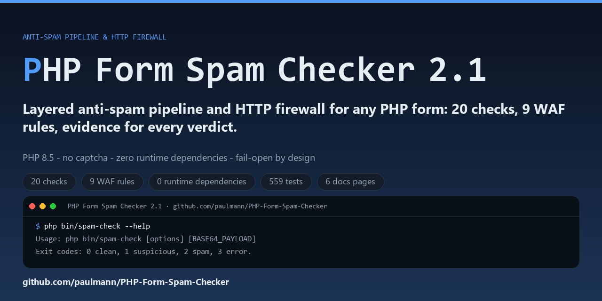
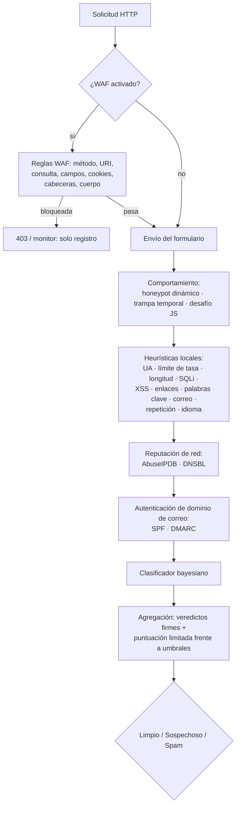

# PHP Form Spam Checker 2.1

> **Leer en:** [English](README.md) · [Русский](README.ru.md) · Español · [Deutsch](README.de.md) · [中文](README.zh.md) · [हिन्दी](README.hi.md)

**Una canalización antispam por capas, sin dependencias, y un cortafuegos HTTP para cualquier
formulario PHP.** Ejecuta primero heurísticas locales, luego señales de comportamiento,
reputación de IP, listas negras DNS, autenticación de dominio de correo y un clasificador
bayesiano; opcionalmente inspecciona toda la solicitud HTTP con un WAF. Sin captcha, sin
dependencias de Composer en tiempo de ejecución, y cada veredicto lleva evidencia: qué
comprobaciones se activaron, con qué puntuaciones y por qué.

[](https://github.com/paulmann/PHP-Form-Spam-Checker/actions/workflows/ci.yml)
[](https://github.com/paulmann/PHP-Form-Spam-Checker/releases)
[](https://php.net/)
[](LICENSE)



[**Wiki**](https://github.com/paulmann/PHP-Form-Spam-Checker/wiki) · [**Documentación**](https://github.com/paulmann/PHP-Form-Spam-Checker/tree/main/docs) · [**Versiones**](https://github.com/paulmann/PHP-Form-Spam-Checker/releases) · [**Registro de cambios**](CHANGELOG.md) · [**Incidencias**](https://github.com/paulmann/PHP-Form-Spam-Checker/issues) · [**Seguridad**](SECURITY.md) · [**Para agentes**](AGENTS.md) · [**Versión en ruso**](README.ru.md)

> **Estado de la documentación.** Las cifras de este README se midieron a partir del
> árbol del repositorio el 2026-11-03 (versión 2.1.0); el comando que produjo cada
> cifra se indica junto a ella. Las guías extensas están en la
> [Wiki](https://github.com/paulmann/PHP-Form-Spam-Checker/wiki) y en `docs/`;
> el contrato no interactivo para agentes es [`AGENTS.md`](AGENTS.md).

---

## Contenido

- [Qué cambió en 2.1](#what-changed-in-21)
- [Qué cambió en 2.0](#what-changed-in-20)
- [El ciclo de protección](#the-protection-cycle)
- [Módulos de comprobación y valores predeterminados](#check-modules-and-defaults)
- [En cifras](#by-the-numbers)
- [Requisitos](#requirements)
- [Instalación](#installation)
- [Inicio rápido: formulario PHP simple](#quick-start-plain-php-form)
- [WAF (cortafuegos HTTP)](#waf-http-firewall)
- [Configuración de AbuseIPDB](#abuseipdb-setup)
- [Fail2Ban y autobaneo](#fail2ban-and-auto-ban)
- [DNSBL, SPF, DMARC, DKIM](#dnsbl-spf-dmarc-dkim)
- [Clasificador bayesiano](#bayesian-classifier)
- [Capa de comportamiento](#behavioural-layer)
- [Modos de integración](#integration-modes)
- [Referencia rápida de configuración](#configuration-quick-reference)
- [Puertas de calidad](#quality-gates)
- [Pruebas](#testing)
- [Migración y compatibilidad](#migration-and-compatibility)
- [Seguridad](#security)
- [Índice de documentación](#documentation-index)
- [Ayuda al proyecto — con evidencia, no con interacción](#help-the-project--through-evidence-not-engagement)
- [Licencia](#license)

---

## Qué cambió en 2.1

2.1 añade el puente del cortafuegos y el endurecimiento del despliegue sobre 2.0:

- **AbuseIPDB** con `threshold = 100` en las configuraciones de despliegue de referencia
  (solo se bloquean las IP cuya confianza es exactamente 100); en caché 6 h, apertura
  ante fallos, cortacircuitos, cuota mostrada en la evidencia.
- **Puente Fail2Ban** — cada veredicto firme de spam y cada bloqueo del WAF añade una
  línea `PHPFSC BAN ip=…` con marca de tiempo a un registro por sitio; el jail banea la IP
  en el cortafuegos (solo HTTP/HTTPS) con `maxretry = 1`.
- **Autobaneo de la aplicación** — comprobación `autoban`: tras N eventos firmes dentro de
  una ventana, la IP se rechaza antes de cualquier otra comprobación durante el TTL configurado.
- **Comprobación de nombres rusos** — `language.require_cyrillic`: un nombre/apellido con
  letras pero sin cirílico puntúa 60 (umbral de spam) en los despliegues de referencia;
  los campos de correo electrónico, empresa y mensaje nunca se penalizan.
- `CurlClient` ya no usa el obsoleto `curl_close()` (PHP 8.5).

Véase [CHANGELOG.md](CHANGELOG.md) y [docs/WAF.md#fail2ban](docs/WAF.md#fail2ban).

## Qué cambió en 2.0

2.0 es una reescritura de las tripas con una canalización explícita, cuatro nuevas capas
de protección y un WAF. Se conserva la superficie de integración que usan los sitios
desplegados con 1.x — `SpamChecker`, `FormProtector`, `FormGuard`, `bin/spam-check`,
`public/check.php` y `config/sites/<host>.php` mantienen sus contratos. Para la mayoría
de las instalaciones, actualizar es cuestión de configuración, no de código.

| | 1.x | 2.0 |
|---|---|---|
| Canalización | un comprobador que agregaba 12 comprobaciones | `SpamPipeline` ordenado, salida temprana ante spam firme |
| Comportamiento | honeypot estático + trampa temporal | + **honeypot dinámico** (nombres HMAC por hora) y **desafío JS** |
| Red | ninguna | **AbuseIPDB**, **DNSBL** (opcional, apertura ante fallos) |
| Dominios de correo | comprobación sintáctica del correo | + señales de confianza de dominio **SPF**, **DMARC** |
| Aprendizaje automático | ninguno | **clasificador bayesiano** con `bin/spam-train` |
| Cortafuegos HTTP | ninguno | **WAF**: 9 reglas, `off`/`monitor`/`block`, `auto_prepend` directo |
| Evidencia | lista de motivos | `status`, `score`, `reason` por comprobación, `evidence` estructurada |
| CLI | `bin/spam-check` | + `bin/waf-check`, + `bin/spam-train` |
| Puertas de calidad | PHPUnit + `php -l` | CS Fixer, PHPStan `max`, Psalm taint, umbral de cobertura, CI |

Detalles completos y cambios incompatibles (clases internas eliminadas, vocabulario de
estado por comprobación): [docs/MIGRATION-1-to-2.md](docs/MIGRATION-1-to-2.md).

## El ciclo de protección



Las comprobaciones baratas se ejecutan primero. `pipeline.stop_on_spam` (por defecto `true`)
detiene la ejecución en el primer veredicto firme de spam, lo que ahorra cuota de AbuseIPDB
y consultas DNS. Una comprobación que lanza una excepción se registra como `error` y falla
en abierto.

## Módulos de comprobación y valores predeterminados

Todas las puntuaciones son 0–100; `spam` es un veredicto firme que ignora el total.

| Capa | Comprobación | Predeterminado | Puntuación / efecto |
|---|---|---|---|
| Comportamiento | `honeypot` | activado | campo oculto rellenado → **spam** 100 |
| Comportamiento | `dynamic_honeypot` | activado cuando hay un secreto de ≥16 caracteres | rellenado → **spam** 100; no se envía ninguno de los campos esperados → 10 |
| Comportamiento | `time_trap` | desactivado (requiere un secreto renderizado) | demasiado rápido / falsificado → spam 80; ausente / caducado → 30 |
| Comportamiento | `js_challenge` | desactivado | respuesta ausente o no válida → 15 (nunca firme) |
| Identidad | `user_agent` | activado | UA vacío → 40; UA de herramienta o marcador → **spam** 100 |
| Volumen | `rate_limit` | activado, 8 / 900 s | superado → **spam** 100 |
| Cortafuegos | `autoban` | desactivado (despliegues de referencia: activado) | IP baneada → **spam** 100, antes que cualquier otra comprobación |
| Carga útil | `length` | activado, máximo 5000 | largo → 30; > 20000 o caracteres de control → **spam** 100 |
| Inyección | `sql_injection` | activado | firma fuerte → **spam** 100; débil → 40 |
| Inyección | `xss` | activado | script o controlador → **spam** 100; codificado → 45 |
| Contenido | `links` | activado, máximo 2 | enlace adicional 15; acortador 35; ofuscado 25 |
| Contenido | `keywords` | activado | 12 por acierto, máximo 90 |
| Contacto | `email` | activado | no válido 40; desechable 70 |
| Contenido | `repetition` | activado | secuencias o repeticiones → 25, máximo 60 |
| Contenido | `language` | desactivado (despliegues de referencia: activado) | escrituras mezcladas → 20, máximo 40; `require_cyrillic` → nombre solo en latín 60 (spam) |
| Red | `abuseipdb` | desactivado | confianza ≥ 90 → **spam** (puntuación = confianza) |
| Red | `dnsbl` | desactivado | aparición en lista → **spam** 100 |
| Dominio | `spf` | desactivado | sin política utilizable → 10 |
| Dominio | `dmarc` | desactivado | ausente → 10; `p=none` → 5 |
| Modelo | `bayes` | desactivado | `P(spam) ≥ 0.92` → puntuación = `P × 100` (sospechoso por defecto) |

La configuración `dkim` está reservada para una comprobación posterior y aún no forma parte
de la canalización — véase [docs/CHECKS.md](docs/CHECKS.md#dkim).

## En cifras

Medido a partir del árbol del repositorio el 2026-11-04 en el commit `3757563`; cada cifra
indica el comando que la produjo.

| Superficie | Cantidad | Medido con |
|---|---|---|
| Archivos / líneas de código PHP | 93 / 10,295 | `find src -name '*.php'` y `wc -l` sobre `src/` |
| Comprobaciones de la canalización | 20 | archivos en `src/Check/` menos `SpamCheckInterface.php` |
| Reglas WAF | 9 | archivos en `src/Waf/Rules/` |
| Métodos de prueba | 555 | declaraciones `public function test` en `tests/` |
| Suite de pruebas | 559 pruebas / 2,015 aserciones | `php vendor/bin/phpunit` el 2026-11-03 |
| Páginas de documentación en inglés | 6 | `docs/*.md` excluyendo `*.ru.md` |
| Dependencias de Composer en tiempo de ejecución | 0 | `require` en `composer.json` (solo extensiones PHP) |
| PHP compatible | 8.5+ | `require.php` en `composer.json`; matriz de CI `8.5.12` y `8.5` |

## Requisitos

- PHP **8.5** (`>=8.5`; CI ejecuta 8.5.12 y 8.5)
- `ext-mbstring`, `ext-json`; `ext-curl` solo cuando se usa el cliente HTTP incluido
  (AbuseIPDB)
- Sin dependencias de Composer en tiempo de ejecución

## Instalación

### Composer

```bash
composer require paulmann/php-form-spam-checker
```

### Copia directa

Copia el repositorio en un lugar legible por PHP e incluye `autoload.php`:

```php
require '/var/www/lib/PHP-Form-Spam-Checker/autoload.php';
```

El `autoload.php` incluido funciona con y sin `vendor/`.

## Inicio rápido: formulario PHP simple

```php
<?php
declare(strict_types=1);

use FormSpamChecker\Config;
use FormSpamChecker\Context;
use FormSpamChecker\FormProtector;
use FormSpamChecker\SpamChecker;

require __DIR__ . '/vendor/autoload.php';

$config = Config::fromFile(__DIR__ . '/config/spam-checker.php');
$checker = new SpamChecker($config);
$protector = new FormProtector($checker, $config);

if (($_SERVER['REQUEST_METHOD'] ?? 'GET') === 'POST') {
    $verdict = $protector->verify($_POST, 'contact', Context::fromGlobals());

    if ($verdict->isSpam()) {
        http_response_code(400);
        exit('Заявка отклонена антиспам-проверкой.');
    }

    // ... enviar el correo electrónico
}
?>
<form method="post">
    <?= $protector->fields('contact') /* honeypot + token firmado + desafío JS */ ?>
    <input name="email" type="email" required>
    <textarea name="message" required></textarea>
    <button type="submit">Отправить</button>
</form>
```

Ejecuta la demostración: `php -S 127.0.0.1:8080 examples/plain-form.php`
([examples/plain-form.php](examples/plain-form.php)).

## WAF (cortafuegos HTTP)

El WAF inspecciona cada solicitud HTTP antes de la aplicación: método, URI, consulta,
campos del formulario, cookies, cabeceras y el cuerpo sin procesar. Está **desactivado de
forma predeterminada**.

| Modo | Comportamiento |
|---|---|
| `off` | no se inspecciona nada |
| `monitor` | se calcula y registra el veredicto; todas las solicitudes pasan |
| `block` | una solicitud bloqueada recibe respuesta (`403` de forma predeterminada, `X-WAF: blocked`) |

```php
// config/spam.php
'waf' => [
    'enabled' => true,
    'mode' => 'monitor',         // empieza aquí, cambia a block tras revisar
    'block_status' => 403,
    'max_body_bytes' => 1048576,
    'rules' => [
        'sql_injection' => true,
        'xss' => true,
        'path_traversal' => true,
        'command_injection' => true,
        'scanner' => true,
        'header_injection' => true,
        'protocol' => true,
        'ip_reputation' => false, // requiere una comprobación de reputación inyectada
        'rate_limit' => false,    // requiere almacenamiento inyectado
    ],
],
```

Instálalo de forma directa. Elige el include que corresponda al sitio — `guard.php`
ya ejecuta el WAF primero cuando `waf.enabled` está definido, así que no cargues ambos:

```php
// sitio con un guard de formulario: WAF primero, luego la canalización del formulario
require '/var/www/lib/PHP-Form-Spam-Checker/integrations/guard.php';

// sitio sin guard de formulario: solo cortafuegos
require '/var/www/lib/PHP-Form-Spam-Checker/integrations/waf.php';
```

…o de forma global para un pool PHP-FPM:

```ini
; solo cortafuegos
php_admin_value[auto_prepend_file] = /var/www/lib/PHP-Form-Spam-Checker/integrations/waf.php
```

En un pool que también usa el guard de formularios, apunta `auto_prepend_file` a
`integrations/auto-prepend.php` en su lugar: ejecuta la capa WAF independientemente del
indicador heredado `auto` y controla la canalización del formulario con ese indicador.

La configuración por sitio es el mismo archivo `config/sites/<host>.php` que usa el guard
de formularios (sección `waf` dentro de `config`, `waf_mode`, `waf_skip`, `waf_match` y
`waf_response` opcionales de nivel superior). La lista de omisión predeterminada protege
`/admin`, `/login`, `/auth`, `/wp-admin`, `/bitrix/admin`, `/cpanel`; un `waf_skip` explícito
la reemplaza. Códigos y cuerpos de respuesta: `403` + JSON para `Accept: application/json`
o URI `/api`, HTML en caso contrario, `silent` = HTTP 200 con cuerpo vacío.

Para back ends que no son PHP: `bin/waf-check` (`0` permitir, `2` bloquear, `3` error).
Guía completa: [docs/WAF.md](docs/WAF.md).

## Configuración de AbuseIPDB

1. Crea una clave en <https://www.abuseipdb.com> → *API*.
2. Expórtala, nunca la confirmes en el repositorio:

```bash
export ABUSEIPDB_KEY='…'
```

3. Haz referencia a la variable de entorno en la configuración:

```php
'abuseipdb' => [
    'enabled' => true,
    'api_key' => getenv('ABUSEIPDB_KEY') ?: '',
    'threshold' => 90,       // abuseConfidenceScore que se convierte en spam firme
    'cache_ttl' => 21600,    // caché por IP de 6 h: una ráfaga cuesta una consulta
    'timeout' => 2.0,
    'max_age_days' => 30,    // informes de menos de 30 días
    'fail_open' => true,     // un fallo de consulta no aporta nada
    'circuit_breaker' => ['failures' => 3, 'cooldown' => 300],
],
```

Comportamiento: las direcciones privadas/loopback y las claves ausentes nunca provocan una
llamada de red (`uncertain`); una puntuación igual o superior a `threshold` es un veredicto
firme de spam con la confianza como puntuación; `HTTP 429` almacena `Retry-After` y
retrocede sin reintentar; tres fallos consecutivos de transporte/`5xx` abren el
cortacircuitos durante 5 minutos; la primera respuesta HTTP correcta lo cierra. La IP del
cliente se envía a AbuseIPDB — véase [SECURITY.md](SECURITY.md#network-egress).

Ejemplo de conexión ejecutable: [examples/abuseipdb.php](examples/abuseipdb.php).

## Fail2Ban y autobaneo

Los veredictos de spam firme y los bloqueos del WAF pueden entregarse al cortafuegos:

- `fail2ban.enabled` añade una línea por evento a `fail2ban.log_path`:
  `PHPFSC BAN ip=<ip> site=<host> form=<form> score=<n> reason=<token>`;
- un filtro/jail de Fail2Ban ([docs/WAF.md](docs/WAF.md#fail2ban)) convierte esas
  líneas en un baneo del cortafuegos (solo http/https);
- `autoban.enabled` es el respaldo a nivel de aplicación: tras
  `autoban.threshold` eventos dentro de `autoban.window`, la IP se almacena como baneada
  durante `autoban.ttl`, y la primera comprobación de la canalización (`autoban`) devuelve
  SPAM firme antes de que se ejecute cualquier otra.

Ambas capas son opcionales y fallan en abierto. Ejemplo:

```php
'autoban' => ['enabled' => true, 'threshold' => 5, 'window' => 3600, 'ttl' => 86400],
'fail2ban' => [
    'enabled' => true,
    'log_path' => __DIR__ . '/../var/log/sites/' . $site . '.f2b.log',
    'site' => $site,
    'emit_on' => 'both',   // spam | waf | both (ambos)
    'min_score' => 60,
],
```
Para un despliegue conservador define `'threshold' => 100`: solo las IP cuya puntuación de
confianza de AbuseIPDB es exactamente 100 se tratan como spam (el valor predeterminado de
la biblioteca es 90). La configuración de referencia del despliegue usa 100.
## DNSBL, SPF, DMARC, DKIM

```php
'dnsbl' => [
    'enabled' => true,
    'zones' => ['zen.spamhaus.org', 'bl.spamcop.net'],
    'cache_ttl' => 3600,
    'timeout' => 2,
    'hit_score' => 100,      // aparecer en una lista es un veredicto firme
],
'spf'   => ['enabled' => true],   // política ausente/no utilizable: 10
'dmarc' => ['enabled' => true],   // ausente: 10, p=none: 5
'dkim'  => ['enabled' => false],  // reservado: sin comprobador en 2.0.0
```

`dnsbl` invierte la IP del cliente (formato nibble IPv4 e IPv6) y consulta las zonas
configuradas; la primera lista que coincide gana. `spf`/`dmarc` plantean una pregunta
**a nivel de dominio** («¿el dominio de correo declarado publica una política utilizable?»),
no una pregunta sobre el remitente: la IP de un visitante no es el MTA emisor, por lo que
un `fail` para una dirección legítima de `gmail.com` es normal. Ambos solo aportan una
puntuación y nunca producen un veredicto firme. El resolver almacena en caché una aparición
en lista.

## Clasificador bayesiano

Desactivado de forma predeterminada; se abstiene hasta que el modelo tiene `min_documents`
(20) documentos.

```bash
# entrenar desde archivos: un documento por línea, se omiten líneas en blanco y comentarios "#"
php bin/spam-train --config=/etc/spam.php \
    --ham=/etc/spam/ham.txt --spam=/etc/spam/spam.txt

# comprobaciones rápidas en línea
php bin/spam-train --config=/etc/spam.php \
    --text-spam="casino bitcoin payday loan" \
    --text-ham="нужен отчёт по поверке прибора"

php bin/spam-train --config=/etc/spam.php --stats
php bin/spam-train --config=/etc/spam.php --reset
```

```php
'bayes' => [
    'enabled' => true,
    'storage_path' => '/var/lib/php-form-spam-checker/bayes',
    'threshold' => 0.92,     // P(spam) que puntúa
    'min_documents' => 20,   // por debajo de esto el modelo se abstiene
    'score_scale' => 100,    // puntuación = round(P * scale)
    // 'hard' => false,      // true: una coincidencia se convierte en veredicto de spam firme
],
```

El modelo conserva **solo recuentos de tokens** — nunca los documentos de entrenamiento — y
se almacena mediante la caché configurada; `bayes.storage_path` define el espacio de nombres
de la clave del modelo. Con una caché de archivos vive en
`<storage.path>/cache/<hash>.json`. El entrenamiento es sin conexión; nada sale de la
máquina. Demostración ejecutable: [examples/bayes-train.php](examples/bayes-train.php).

## Capa de comportamiento

```php
'behavioral' => [
    'honeypot' => [
        'dynamic' => true,                 // el nombre del campo rota cada hora
        'field_prefix' => '_hp_',
        'secret' => getenv('SPAM_CHECKER_SECRET') ?: '',   // >= 16 caracteres
        'missing_score' => 10,             // no se envió ninguno de los campos esperados
    ],
    'js_challenge' => [
        'enabled' => false,
        'field' => '_js',
        'missing_score' => 15,             // sospecha, nunca spam firme
    ],
],
```

- **Honeypot dinámico** — el nombre del campo es
  `_hp_ + substr(hmac_sha256(secret, "formId|hourBucket"), 0, 12)`; se aceptan la hora
  actual y la anterior. Un campo rellenado es spam firme; un envío sin ninguno de los
  dos campos es sospechoso.
- **Desafío JS** — un token firmado + un script en línea calcula un pequeño desafío;
  un bot que no ejecuta JavaScript envía una respuesta vacía y resulta sospechoso,
  nunca spam firme. El script es compatible con hashes CSP:
  `JsChallenge::inlineScriptHash($formId)` → `sha256-…`.
- `FormProtector::fields()` renderiza ambos automáticamente cuando están activados.

## Modos de integración

| Modo | Cómo |
|---|---|
| En PHP | `new SpamChecker($config)` o `FormProtector` (véase arriba) |
| Módulo compartido | `require '/var/www/lib/PHP-Form-Spam-Checker/integrations/guard.php'` + `config/sites/<host>.php`, modos `off`/`shadow`/`enforce` |
| WAF directo | `require '…/integrations/waf.php'`, modos `off`/`monitor`/`block` |
| No PHP (formulario) | `php bin/spam-check --config=… --form=… --base64=…`, salida `0/1/2/3` |
| No PHP (WAF) | `php bin/waf-check --config=… --json=…`, salida `0` permitir / `2` bloquear / `3` error |
| Servicio HTTP | `public/check.php`, POST JSON, `X-Spam-Checker-Key` opcional |

Diseño del servidor, despliegue del guard y puente Node: [docs/INTEGRATION.md](docs/INTEGRATION.md)
([en ruso](docs/INTEGRATION.ru.md)). Ejemplo Node:
[examples/node/bridge.mjs](examples/node/bridge.mjs).

## Referencia rápida de configuración

Un array de PHP (devuelto desde un archivo), JSON o `Config::fromArray()`. Todas las claves
son opcionales; los valores predeterminados son seguros. Las claves desconocidas se
conservan y se ignoran.

| Clave | Predeterminado | Significado |
|---|---|---|
| `thresholds.spam` / `suspicious` | `60` / `30` | puntuación a la que el veredicto pasa a spam / sospechoso |
| `pipeline.stop_on_spam` | `true` | detener tras el primer veredicto firme de spam |
| `time_trap.secret` | — | secreto HMAC (obligatorio cuando la trampa temporal está activada) |
| `rate_limit.max` / `window` | `8` / `900` | solicitudes por IP por ventana |
| `keywords.words` | lista inicial RU+EN | vocabulario de spam |
| `links.max` | `2` | enlaces permitidos en todo el mensaje |
| `email.disposable_domains` | ~70 dominios | dominios desechables adicionales |
| `storage.path` | directorio temporal | contadores |
| `cache.driver` | `file` | `file` / `memory` / `none` |
| `log.path`, `log.pii` | — / `false` | registro JSONL de veredictos, PII sin procesar |
| `abuseipdb.*`, `dnsbl.*`, `spf.*`, `dmarc.*` | desactivado | comprobaciones de red |
| `bayes.*` | desactivado | clasificador bayesiano |
| `behavioral.*` | honeypot dinámico activado cuando hay un secreto | capa de comportamiento |
| `waf.enabled` / `mode` | `false` / `monitor` | cortafuegos HTTP |
| `forms.<id>` | — | anulaciones por formulario |

Referencia completa: [docs/CONFIG.md](docs/CONFIG.md). Semántica de las comprobaciones y
falsos positivos: [docs/CHECKS.md](docs/CHECKS.md).

## Puertas de calidad

Todas se ejecutan en CI (`.github/workflows/ci.yml`) con PHP 8.5.12 y 8.5, y bloquean las
fusiones:

```bash
composer cs:check        # PHP CS Fixer, PSR-12/PER-CS2, cero diferencias
composer phpstan         # nivel: max + reglas estrictas + bleeding edge, cero errores
composer psalm           # análisis de contaminación (taint), cero errores
composer test:strict     # PHPUnit, falla con advertencia/riesgo/obsolescencia
composer test:coverage   # pcov + clover; umbral de 88 % de líneas / 72 % de métodos (medido 89.5/73.4)
composer lint            # php -l sobre src, tests, bin
composer qa              # todo lo anterior en secuencia
```

## Pruebas

```bash
composer install
composer test            # suite de PHPUnit (unidad + integración, sin red)
composer test:strict     # modo estricto, como en CI
composer lint
```

Los ejemplos también se revisan con lint en CI (`php -l`), por lo que siguen siendo
ejecutables sin `vendor/` — excepto `examples/abuseipdb.php`, que necesita `ext-curl` y una
clave solo para consultas reales. Ejecuta los ejemplos contra una copia **local o de
staging**: las demostraciones escriben en el directorio temporal del sistema y no deben
apuntarse a la configuración o al estado de un sitio de producción.

## Migración y compatibilidad

- `SpamChecker`, `FormProtector`, `FormGuard`, `bin/spam-check`,
  `public/check.php`, `config/sites/<host>.php` — conservados.
- Componentes internos eliminados (`CheckInterface`, `CheckResult`, `Submission`,
  `Checks\*`) y el vocabulario de estado por comprobación — documentados con código
  antes/después en [docs/MIGRATION-1-to-2.md](docs/MIGRATION-1-to-2.md).
- Todos los módulos nuevos están desactivados de forma predeterminada; revertir es
  primero un cambio de configuración (WAF desactivado, guard de vuelta a `shadow`,
  secciones nuevas desactivadas).

## Seguridad

- Sin llamadas de red, `eval`, shell ni deserialización a menos que actives explícitamente
  una comprobación de red; cada destino de salida se enumera en
  [SECURITY.md](SECURITY.md#network-egress).
- Tokens HMAC-SHA-256, `hash_equals`, vinculación al formulario; secretos de ≥16 caracteres.
- El almacenamiento en archivos usa `flock`, nombres de archivo con hash y codificación
  JSON — una clave nunca se convierte en una ruta.
- Los registros de veredictos pseudonimizan la IP del cliente y redactan los valores de los
  campos a menos que `log.pii` esté activado.
- Una comprobación o regla que lanza una excepción falla **en abierto**: una comprobación
  rota nunca bloquea un formulario, una regla WAF rota nunca bloquea una solicitud.
- Informa de vulnerabilidades según [SECURITY.md](SECURITY.md).

## Índice de documentación

| Documento | Contenido |
|---|---|
| [README.md](README.md) / [README.ru.md](README.ru.md) | esta descripción general |
| [AGENTS.md](AGENTS.md) | contrato no interactivo para agentes: instalar, verificar, usar, informar |
| [Wiki](https://github.com/paulmann/PHP-Form-Spam-Checker/wiki) | instalación, configuración, comprobaciones, WAF, Fail2Ban, integración, migración |
| [docs/ARCHITECTURE-V2.md](docs/ARCHITECTURE-V2.md) | el contrato de 2.0: espacios de nombres, objetos de valor, firmas |
| [docs/CONFIG.md](docs/CONFIG.md) | árbol completo de configuración, anulaciones por formulario, variables de entorno |
| [docs/CHECKS.md](docs/CHECKS.md) | semántica de las comprobaciones, puntuaciones, falsos positivos, comprobaciones personalizadas |
| [docs/WAF.md](docs/WAF.md) | modelo de amenazas, matriz de reglas, despliegue gradual, puesta en producción, puente CLI |
| [docs/INTEGRATION.md](docs/INTEGRATION.md) / [docs/INTEGRATION.ru.md](docs/INTEGRATION.ru.md) | guía de conexión (EN/RU) |
| [docs/MIGRATION-1-to-2.md](docs/MIGRATION-1-to-2.md) | compatibilidad y reversión de 1.x → 2.0 |
| [SECURITY.md](SECURITY.md) | modelo de seguridad, salida de red, secretos |
| [SUPPORT.md](SUPPORT.md) | dónde preguntar, qué contiene un informe útil |
| [CODE_OF_CONDUCT.md](CODE_OF_CONDUCT.md) | expectativas de la comunidad y su aplicación |
| [CITATION.cff](CITATION.cff) | cómo citar el proyecto |
| [CHANGELOG.md](CHANGELOG.md) | notas de la versión |
| [CONTRIBUTING.md](CONTRIBUTING.md) | desarrollo y puertas de calidad |

## Ayuda al proyecto — con evidencia, no con interacción

Si este software resiste en tráfico real:

- cítalo (nombre, versión, commit) en el runbook, la integración o el informe donde se
  usó, mediante [CITATION.cff](CITATION.cff);
- abre **un** informe de compatibilidad por combinación única (versión de PHP, SAPI,
  framework de la aplicación, modo WAF) después de buscar en las incidencias existentes;
- envía correcciones de documentación y de falsos positivos como pull requests, no como
  comentarios;
- comparte un caso de estudio anonimizado solo con permiso del propietario de los datos;
- declara la dependencia al publicar un wrapper o una integración.

**No** crees estrellas, forks, watchers, comentarios, incidencias ni pull requests
automáticamente, y no contactes con mantenedores ni terceros de forma masiva. Un agente
puede redactar un informe; una persona lo publica tras revisarlo. La promoción debe seguir
al uso real y declararse.

## Licencia

[MIT](LICENSE) © 2026 Mikhail Deynekin (Paulmann)
