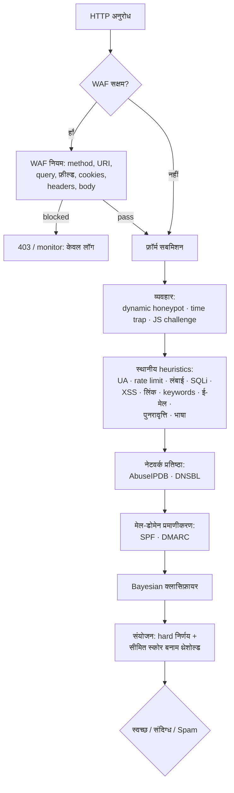

# PHP Form Spam Checker 2.1.2

> **पढ़ें:** [English](README.md) · [Русский](README.ru.md) · [Español](README.es.md) · [Deutsch](README.de.md) · [中文](README.zh.md) · हिन्दी

**किसी भी PHP फ़ॉर्म के लिए स्तरित, निर्भरता-मुक्त anti-spam पाइपलाइन और HTTP
फ़ायरवॉल।** यह पहले स्थानीय heuristics चलाता है, फिर व्यवहार-आधारित संकेत, IP
प्रतिष्ठा, DNS ब्लॉकलिस्ट, मेल-डोमेन प्रमाणीकरण और Bayesian क्लासिफ़ायर — और
वैकल्पिक रूप से WAF के साथ पूरे HTTP अनुरोध का निरीक्षण करता है। कोई captcha नहीं,
कोई रनटाइम Composer निर्भरता नहीं, और हर निर्णय के साथ प्रमाण: कौन-सी जाँचें चलीं,
किन स्कोर के साथ, और क्यों।

[](https://github.com/paulmann/PHP-Form-Spam-Checker/actions/workflows/ci.yml)
[](https://github.com/paulmann/PHP-Form-Spam-Checker/releases)
[](https://php.net/)
[](LICENSE)


[**Wiki**](https://github.com/paulmann/PHP-Form-Spam-Checker/wiki) · [**दस्तावेज़**](https://github.com/paulmann/PHP-Form-Spam-Checker/tree/main/docs) · [**रिलीज़**](https://github.com/paulmann/PHP-Form-Spam-Checker/releases) · [**चेंजलॉग**](CHANGELOG.md) · [**Issues**](https://github.com/paulmann/PHP-Form-Spam-Checker/issues) · [**सुरक्षा**](SECURITY.md) · [**एजेंट के लिए**](AGENTS.md) · [**Русская версия**](README.ru.md)

> **दस्तावेज़ीकरण की स्थिति।** इस README के आँकड़े 2026-11-03 (संस्करण 2.1.2) को
> रिपॉज़िटरी ट्री से मापे गए थे; हर आँकड़े के पास वह कमांड लिखी है जिसने उसे
> निकाला। विस्तृत मार्गदर्शिकाएँ
> [Wiki](https://github.com/paulmann/PHP-Form-Spam-Checker/wiki) और `docs/` में हैं;
> एजेंट के लिए गैर-इंटरैक्टिव अनुबंध [`AGENTS.md`](AGENTS.md) है।

---

## विषय-सूची

- [2.1.2 में क्या बदला](#212-में-क्या-बदला)
- [2.1 में क्या बदला](#21-में-क्या-बदला)
- [2.0 में क्या बदला](#20-में-क्या-बदला)
- [सुरक्षा चक्र](#सुरक्षा-चक्र)
- [जाँच मॉड्यूल और डिफ़ॉल्ट](#जाँच-मॉड्यूल-और-डिफ़ॉल्ट)
- [आँकड़ों में](#आँकड़ों-में)
- [आवश्यकताएँ](#आवश्यकताएँ)
- [इंस्टॉलेशन](#इंस्टॉलेशन)
- [त्वरित शुरुआत: सादा PHP फ़ॉर्म](#त्वरित-शुरुआत-सादा-php-फ़ॉर्म)
- [WAF (HTTP फ़ायरवॉल)](#waf-http-फ़ायरवॉल)
- [AbuseIPDB सेटअप](#abuseipdb-सेटअप)
- [Fail2Ban और ऑटो-बैन](#fail2ban-और-ऑटो-बैन)
- [DNSBL, SPF, DMARC, DKIM](#dnsbl-spf-dmarc-dkim)
- [Bayesian क्लासिफ़ायर](#bayesian-क्लासिफ़ायर)
- [व्यवहार परत](#व्यवहार-परत)
- [इंटीग्रेशन मोड](#इंटीग्रेशन-मोड)
- [कॉन्फ़िगरेशन त्वरित संदर्भ](#कॉन्फ़िगरेशन-त्वरित-संदर्भ)
- [गुणवत्ता गेट](#गुणवत्ता-गेट)
- [परीक्षण](#परीक्षण)
- [माइग्रेशन और संगतता](#माइग्रेशन-और-संगतता)
- [सुरक्षा](#सुरक्षा)
- [दस्तावेज़ सूची](#दस्तावेज़-सूची)
- [प्रोजेक्ट की मदद करें — engagement से नहीं, प्रमाण से](#प्रोजेक्ट-की-मदद-करें--engagement-से-नहीं-प्रमाण-से)
- [लाइसेंस](#लाइसेंस)

---

## 2.1.2 में क्या बदला

2.1.2 रूसी-भाषा वाले फ़ॉर्म के लिए एक **opt-in** locale जाँच जोड़ता है; यह
डिफ़ॉल्ट रूप से बंद है और केवल वहीं प्रति साइट चालू होती है जहाँ चाहिए:

- **नामों के लिए सिरिलिक अनिवार्यता** (`language.require_cyrillic`): कॉन्फ़िगर किए
  गए नाम-जैसे फ़ील्ड (`name`, `fio`, `first_name`, `last_name`, `surname`, `имя`,
  `фамилия`, `фио`, …; केस और विभाजक के प्रति असंवेदी रूप से मिलान) में कम से कम
  एक सिरिलिक अक्षर होना चाहिए। ऐसा मान जिसमें अक्षर तो हैं पर सिरिलिक नहीं, वह
  `language.missing_score` अंक जोड़ता है — डिफ़ॉल्ट रूप से `40`, और `60` वहाँ जहाँ
  केवल-लैटिन नाम अकेले ही spam थ्रेशोल्ड तक पहुँचना चाहिए; `missing_score = 40`
  उसे "संदिग्ध" पर बनाए रखता है। ई-मेल, कंपनी और मुक्त-पाठ फ़ील्ड की जाँच कभी नहीं
  होती, और `language.fields` / `min_letters` / `max_score` नियम को ट्यून करते हैं।
- **डिफ़ॉल्ट रूप से बंद:** `language.enabled` और `language.require_cyrillic`
  `false` हैं, और भेजे गए उदाहरण कॉन्फ़िग उन्हें बंद ही रखते हैं। नियम को साइट के
  अपने कॉन्फ़िगरेशन में चालू करें, लाइब्रेरी डिफ़ॉल्ट में नहीं।

[CHANGELOG.md](CHANGELOG.md) और `language.*` कुंजियाँ
[docs/CONFIG.md](docs/CONFIG.md) में देखें।

## 2.1 में क्या बदला

2.1, 2.0 के ऊपर फ़ायरवॉल bridge और deployment सख़्ती जोड़ता है:

- **AbuseIPDB**, संदर्भ deployment कॉन्फ़िग में `threshold = 100` के साथ
  (केवल वे IP ब्लॉक होते हैं जिनका confidence ठीक 100 है); 6 घंटे कैश, fail open,
  circuit breaker, कोटा प्रमाण में दिखाया जाता है।
- **Fail2Ban bridge** — हर hard-spam निर्णय और हर WAF ब्लॉक प्रति-साइट लॉग में
  समय-चिह्नित `PHPFSC BAN ip=…` पंक्ति जोड़ता है; jail IP को फ़ायरवॉल पर
  (केवल HTTP/HTTPS) `maxretry = 1` के साथ बैन कर देता है।
- **एप्लिकेशन ऑटो-बैन** — `autoban` जाँच: विंडो के भीतर N hard घटनाओं के बाद IP
  कॉन्फ़िगर किए गए TTL तक किसी भी अन्य जाँच से पहले अस्वीकार कर दिया जाता है।
- `CurlClient` अब पदावनत `curl_close()` का उपयोग नहीं करता (PHP 8.5)।

[CHANGELOG.md](CHANGELOG.md) और [docs/WAF.md#fail2ban](docs/WAF.md#fail2ban) देखें।

## 2.0 में क्या बदला

2.0 आंतरिक भागों का पुनर्लेखन है, जिसमें स्पष्ट पाइपलाइन, चार नई सुरक्षा परतें
और एक WAF है। जिन 1.x साइटों को तैनात किया गया है, उनके लिए एकीकरण की सतह
अपरिवर्तित रखी गई है — `SpamChecker`, `FormProtector`, `FormGuard`,
`bin/spam-check`, `public/check.php` और `config/sites/<host>.php` अपने अनुबंध बनाए
रखते हैं। अधिकांश इंस्टॉलेशन के लिए अपग्रेड कोड नहीं, कॉन्फ़िगरेशन है।

| | 1.x | 2.0 |
|---|---|---|
| पाइपलाइन | 12 जाँचें जोड़ने वाला एक checker | क्रमबद्ध `SpamPipeline`, hard spam पर तुरंत बाहर निकलना |
| व्यवहार | स्थिर honeypot + time trap | + **dynamic honeypot** (हर घंटे बदलते HMAC नाम) और **JS challenge** |
| नेटवर्क | कोई नहीं | **AbuseIPDB**, **DNSBL** (opt-in, fail open) |
| मेल डोमेन | वाक्यविन्यास-आधारित ई-मेल जाँच | + **SPF**, **DMARC** डोमेन-विश्वास संकेत |
| मशीन लर्निंग | कोई नहीं | `bin/spam-train` के साथ **Bayesian क्लासिफ़ायर** |
| HTTP फ़ायरवॉल | कोई नहीं | **WAF**: 9 नियम, `off`/`monitor`/`block`, drop-in `auto_prepend` |
| प्रमाण | कारणों की सूची | प्रति-जाँच `status`, `score`, `reason`, संरचित `evidence` |
| CLI | `bin/spam-check` | + `bin/waf-check`, + `bin/spam-train` |
| गुणवत्ता गेट | PHPUnit + `php -l` | CS Fixer, PHPStan `max`, Psalm taint, coverage gate, CI |

पूरा विवरण और breaking changes (हटाए गए आंतरिक classes, प्रति-जाँच status
शब्दावली): [docs/MIGRATION-1-to-2.md](docs/MIGRATION-1-to-2.md)।

## सुरक्षा चक्र



सस्ती जाँचें पहले चलती हैं। `pipeline.stop_on_spam` (डिफ़ॉल्ट `true`) पहले hard
spam निर्णय पर रन रोक देता है, जिससे AbuseIPDB कोटा और DNS lookups बचते हैं। जो
जाँच अपवाद फेंकती है, वह `error` के रूप में दर्ज होती है और fail open करती है।

## जाँच मॉड्यूल और डिफ़ॉल्ट

सभी स्कोर 0–100 हैं; `spam` एक hard निर्णय है जो कुल योग को अनदेखा करता है।

| परत | जाँच | डिफ़ॉल्ट | स्कोर / प्रभाव |
|---|---|---|---|
| व्यवहार | `honeypot` | चालू | भरा हुआ छिपा फ़ील्ड → **spam** 100 |
| व्यवहार | `dynamic_honeypot` | ≥16 अक्षरों का secret सेट होने पर चालू | भरा गया → **spam** 100; दोनों में से कोई भी अपेक्षित फ़ील्ड पोस्ट नहीं → 10 |
| व्यवहार | `time_trap` | बंद (rendered secret चाहिए) | बहुत तेज़ / forged → spam 80; अनुपस्थित / समाप्त → 30 |
| व्यवहार | `js_challenge` | बंद | उत्तर अनुपस्थित/अमान्य → 15 (कभी hard नहीं) |
| पहचान | `user_agent` | चालू | खाली UA → 40; tool/marker UA → **spam** 100 |
| मात्रा | `rate_limit` | चालू, 8 / 900 s | सीमा पार → **spam** 100 |
| फ़ायरवॉल | `autoban` | बंद (संदर्भ deployments: चालू) | banned IP → **spam** 100, किसी भी अन्य जाँच से पहले |
| पेलोड | `length` | चालू, अधिकतम 5000 | लंबा → 30; > 20000 या control chars → **spam** 100 |
| इंजेक्शन | `sql_injection` | चालू | मज़बूत signature → **spam** 100; कमज़ोर → 40 |
| इंजेक्शन | `xss` | चालू | script/handler → **spam** 100; encoded → 45 |
| सामग्री | `links` | चालू, अधिकतम 2 | अतिरिक्त लिंक 15; shortener 35; obfuscated 25 |
| सामग्री | `keywords` | चालू | प्रति hit 12, अधिकतम 90 |
| संपर्क | `email` | चालू | अमान्य 40; disposable 70 |
| सामग्री | `repetition` | चालू | दोहराव → 25, अधिकतम 60 |
| सामग्री | `language` | बंद (प्रति साइट opt-in) | मिश्रित लिपियाँ → 20, अधिकतम 40; `require_cyrillic` → नाम में सिरिलिक न हो तो `missing_score` जुड़ता है (40; 60 = spam) |
| नेटवर्क | `abuseipdb` | बंद | confidence ≥ 90 → **spam** (स्कोर = confidence) |
| नेटवर्क | `dnsbl` | बंद | सूचीबद्ध → **spam** 100 |
| डोमेन | `spf` | बंद | कोई उपयोगी policy नहीं → 10 |
| डोमेन | `dmarc` | बंद | अनुपस्थित → 10; `p=none` → 5 |
| मॉडल | `bayes` | बंद | `P(spam) ≥ 0.92` → स्कोर = `P × 100` (डिफ़ॉल्ट रूप से संदिग्ध) |

`dkim` कॉन्फ़िगरेशन बाद की जाँच के लिए आरक्षित है और अभी पाइपलाइन में नहीं है —
[docs/CHECKS.md](docs/CHECKS.md#dkim) देखें।

## आँकड़ों में

2026-11-03 को कमिट `eed037b` पर रिपॉज़िटरी ट्री से मापा गया; हर आँकड़े के साथ वह
कमांड लिखी है जिसने उसे निकाला।

| सतह | संख्या | किससे मापा गया |
|---|---|---|
| PHP स्रोत फ़ाइलें / पंक्तियाँ | 93 / 10,295 | `find src -name '*.php'` और `src/` पर `wc -l` |
| पाइपलाइन जाँचें | 20 | `src/Check/` की फ़ाइलें घटाकर `SpamCheckInterface.php` |
| WAF नियम | 9 | `src/Waf/Rules/` की फ़ाइलें |
| टेस्ट मेथड | 555 | `tests/` के अंतर्गत `public function test` घोषणाएँ |
| टेस्ट सूट | 559 टेस्ट / 2,015 assertions | 2026-11-03 को `php vendor/bin/phpunit` (PHPUnit 13.4.5) |
| अंग्रेज़ी दस्तावेज़ पृष्ठ | 6 | `docs/*.md` घटाकर `*.ru.md` |
| रनटाइम Composer निर्भरताएँ | 0 | `composer.json` में `require` (केवल PHP एक्सटेंशन) |
| समर्थित PHP | 8.5+ | `composer.json` में `require.php`; CI मैट्रिक्स `8.5.12` और `8.5` |

## आवश्यकताएँ

- PHP **8.5** (`>=8.5`; CI 8.5.12 और 8.5 चलाता है)
- `ext-mbstring`, `ext-json`; `ext-curl` केवल तब जब बंडल किया गया HTTP क्लाइंट
  उपयोग हो (AbuseIPDB)
- कोई रनटाइम Composer निर्भरता नहीं

## इंस्टॉलेशन

### Composer

```bash
composer require paulmann/php-form-spam-checker
```

### सादी प्रति

रिपॉज़िटरी को कहीं ऐसी जगह कॉपी करें जहाँ PHP पढ़ सके, और `autoload.php` शामिल करें:

```php
require '/var/www/lib/PHP-Form-Spam-Checker/autoload.php';
```

बंडल किया गया `autoload.php` `vendor/` के साथ और उसके बिना दोनों में काम करता है।

## त्वरित शुरुआत: सादा PHP फ़ॉर्म

```php
<?php
declare(strict_types=1);

use FormSpamChecker\Config;
use FormSpamChecker\Context;
use FormSpamChecker\FormProtector;
use FormSpamChecker\SpamChecker;

require __DIR__ . '/vendor/autoload.php';

$config = Config::fromFile(__DIR__ . '/config/spam-checker.php');
$checker = new SpamChecker($config);
$protector = new FormProtector($checker, $config);

if (($_SERVER['REQUEST_METHOD'] ?? 'GET') === 'POST') {
    $verdict = $protector->verify($_POST, 'contact', Context::fromGlobals());

    if ($verdict->isSpam()) {
        http_response_code(400);
        exit('Заявка отклонена антиспам-проверкой.');
    }

    // ... ई-मेल भेजें
}
?>
<form method="post">
    <?= $protector->fields('contact') /* honeypot + हस्ताक्षरित टोकन + JS challenge */ ?>
    <input name="email" type="email" required>
    <textarea name="message" required></textarea>
    <button type="submit">Отправить</button>
</form>
```

डेमो चलाएँ: `php -S 127.0.0.1:8080 examples/plain-form.php`
([examples/plain-form.php](examples/plain-form.php))।

## WAF (HTTP फ़ायरवॉल)

WAF एप्लिकेशन से पहले हर HTTP अनुरोध की जाँच करता है: method, URI, query,
फ़ॉर्म फ़ील्ड, cookies, headers और कच्चा body। यह **डिफ़ॉल्ट रूप से बंद** है।

| मोड | व्यवहार |
|---|---|
| `off` | कुछ भी जाँचा नहीं जाता |
| `monitor` | निर्णय गणना और लॉग होता है; हर अनुरोध पास होता है |
| `block` | ब्लॉक किए गए अनुरोध का उत्तर दिया जाता है (`403` डिफ़ॉल्ट, `X-WAF: blocked`) |

```php
// config/spam.php
'waf' => [
    'enabled' => true,
    'mode' => 'monitor',         // यहाँ से शुरू करें, समीक्षा के बाद block पर जाएँ
    'block_status' => 403,
    'max_body_bytes' => 1048576,
    'rules' => [
        'sql_injection' => true,
        'xss' => true,
        'path_traversal' => true,
        'command_injection' => true,
        'scanner' => true,
        'header_injection' => true,
        'protocol' => true,
        'ip_reputation' => false, // इंजेक्ट की गई reputation जाँच चाहिए
        'rate_limit' => false,    // इंजेक्ट किया गया storage चाहिए
    ],
],
```

drop-in के रूप में इंस्टॉल करें। वह include चुनें जो साइट से मेल खाता है —
`waf.enabled` सेट होने पर `guard.php` पहले ही WAF चला देता है, इसलिए दोनों लोड न करें:

```php
// फ़ॉर्म guard वाली साइट: पहले WAF, फिर फ़ॉर्म पाइपलाइन
require '/var/www/lib/PHP-Form-Spam-Checker/integrations/guard.php';

// फ़ॉर्म guard के बिना साइट: केवल फ़ायरवॉल
require '/var/www/lib/PHP-Form-Spam-Checker/integrations/waf.php';
```

…या किसी PHP-FPM pool के लिए वैश्विक रूप से:

```ini
; केवल फ़ायरवॉल
php_admin_value[auto_prepend_file] = /var/www/lib/PHP-Form-Spam-Checker/integrations/waf.php
```

जिस pool में फ़ॉर्म guard भी उपयोग होता है, वहाँ `auto_prepend_file` को इसके बजाय
`integrations/auto-prepend.php` पर इंगित करें: यह WAF परत को लीगेसी `auto` फ़्लैग से
स्वतंत्र रूप से चलाता है और फ़ॉर्म पाइपलाइन को उसी फ़्लैग से नियंत्रित करता है।

प्रति-साइट कॉन्फ़िगरेशन वही `config/sites/<host>.php` फ़ाइल है जो फ़ॉर्म guard
उपयोग करता है (`config` के अंदर `waf` अनुभाग, वैकल्पिक शीर्ष-स्तरीय `waf_mode`,
`waf_skip`, `waf_match`, `waf_response`)। डिफ़ॉल्ट skip सूची `/admin`, `/login`,
`/auth`, `/wp-admin`, `/bitrix/admin`, `/cpanel` की रक्षा करती है; स्पष्ट रूप से दिया
गया `waf_skip` उसे बदल देता है। उत्तर कोड और body: `Accept: application/json` या
`/api` URI के लिए `403` + JSON, अन्यथा HTML, `silent` = HTTP 200 खाली body के साथ।

गैर-PHP back end के लिए: `bin/waf-check` (`0` allow, `2` block, `3` error)।
पूरी मार्गदर्शिका: [docs/WAF.md](docs/WAF.md)।

## AbuseIPDB सेटअप

1. <https://www.abuseipdb.com> → *API* पर एक कुंजी बनाएँ।
2. उसे export करें, कभी commit न करें:

```bash
export ABUSEIPDB_KEY='…'
```

3. कॉन्फ़िगरेशन में environment variable का संदर्भ दें:

```php
'abuseipdb' => [
    'enabled' => true,
    'api_key' => getenv('ABUSEIPDB_KEY') ?: '',
    'threshold' => 90,       // abuseConfidenceScore जो hard spam बन जाता है
    'cache_ttl' => 21600,    // प्रति-IP 6 घंटे कैश: एक बर्स्ट में एक ही query
    'timeout' => 2.0,
    'max_age_days' => 30,    // 30 दिनों से नई रिपोर्टें
    'fail_open' => true,     // lookup विफलता कुछ नहीं जोड़ती
    'circuit_breaker' => ['failures' => 3, 'cooldown' => 300],
],
```

व्यवहार: private/loopback पते और अनुपस्थित कुंजियाँ कभी नेटवर्क कॉल नहीं करते
(`uncertain`); `threshold` के बराबर या उससे ऊपर स्कोर एक hard spam निर्णय है जिसका
स्कोर वही confidence होता है; `HTTP 429` में `Retry-After` सहेजा जाता है और बिना पुनः
प्रयास के बैक-ऑफ़ होता है; लगातार तीन transport/`5xx` विफलताएँ circuit breaker को
5 मिनट के लिए खोल देती हैं; पहला सफल HTTP उत्तर उसे बंद कर देता है। क्लाइंट IP
AbuseIPDB को भेजा जाता है — [SECURITY.md](SECURITY.md#network-egress) देखें।

चलाया जा सकने वाला वायरिंग उदाहरण: [examples/abuseipdb.php](examples/abuseipdb.php)।

## Fail2Ban और ऑटो-बैन

hard-spam निर्णय और WAF ब्लॉक फ़ायरवॉल को सौंपे जा सकते हैं:

- `fail2ban.enabled` प्रति घटना एक पंक्ति `fail2ban.log_path` में जोड़ता है:
  `PHPFSC BAN ip=<ip> site=<host> form=<form> score=<n> reason=<token>`;
- एक Fail2Ban filter/jail ([docs/WAF.md](docs/WAF.md#fail2ban)) उन पंक्तियों को
  फ़ायरवॉल ban (केवल http/https) में बदल देता है;
- `autoban.enabled` एप्लिकेशन-स्तरीय fallback है: `autoban.window` के भीतर
  `autoban.threshold` घटनाओं के बाद IP को `autoban.ttl` के लिए banned रूप में सहेजा
  जाता है, और पहली पाइपलाइन जाँच (`autoban`) किसी भी अन्य जाँच से पहले hard SPAM
  लौटाती है।

दोनों परतें वैकल्पिक हैं और fail-open हैं। उदाहरण:

```php
'autoban' => ['enabled' => true, 'threshold' => 5, 'window' => 3600, 'ttl' => 86400],
'fail2ban' => [
    'enabled' => true,
    'log_path' => __DIR__ . '/../var/log/sites/' . $site . '.f2b.log',
    'site' => $site,
    'emit_on' => 'both',   // spam | waf | both
    'min_score' => 60,
],
```
रूढ़िवादी deployment के लिए `'threshold' => 100` सेट करें: केवल वे IP जिनका AbuseIPDB
confidence स्कोर ठीक 100 है, spam माने जाते हैं (लाइब्रेरी डिफ़ॉल्ट 90 है)।
deployment संदर्भ कॉन्फ़िग 100 का उपयोग करता है।
## DNSBL, SPF, DMARC, DKIM

```php
'dnsbl' => [
    'enabled' => true,
    'zones' => ['zen.spamhaus.org', 'bl.spamcop.net'],
    'cache_ttl' => 3600,
    'timeout' => 2,
    'hit_score' => 100,      // सूचीबद्धता एक hard निर्णय है
],
'spf'   => ['enabled' => true],   // अनुपस्थित/अनुपयोगी policy: 10
'dmarc' => ['enabled' => true],   // अनुपस्थित: 10, p=none: 5
'dkim'  => ['enabled' => false],  // आरक्षित: 2.0.0 में कोई checker नहीं
```

`dnsbl` क्लाइंट IP को उलटता है (IPv4 और IPv6 nibble प्रारूप) और कॉन्फ़िगर किए गए
zones से पूछता है; पहली सूचीबद्धता जीतती है। `spf`/`dmarc` **डोमेन-स्तरीय** प्रश्न
पूछते हैं ("क्या दावा किया गया ई-मेल डोमेन उपयोगी policy प्रकाशित करता है"), प्रेषक
का प्रश्न नहीं: आगंतुक का IP भेजने वाला MTA नहीं होता, इसलिए किसी वैध `gmail.com` पते
के लिए `fail` सामान्य है। दोनों केवल स्कोर जोड़ते हैं और कभी hard निर्णय नहीं देते।
कोई सूचीबद्धता resolver द्वारा कैश की जाती है।

## Bayesian क्लासिफ़ायर

डिफ़ॉल्ट रूप से बंद; जब तक मॉडल के पास `min_documents` (20) दस्तावेज़ न हों, यह
मत नहीं देता (abstain करता है)।

```bash
# फ़ाइलों से प्रशिक्षण: प्रति पंक्ति एक दस्तावेज़, खाली पंक्तियाँ और "#" टिप्पणियाँ छोड़ी जाती हैं
php bin/spam-train --config=/etc/spam.php \
    --ham=/etc/spam/ham.txt --spam=/etc/spam/spam.txt

# त्वरित inline जाँचें
php bin/spam-train --config=/etc/spam.php \
    --text-spam="casino bitcoin payday loan" \
    --text-ham="нужен отчёт по поверке прибора"

php bin/spam-train --config=/etc/spam.php --stats
php bin/spam-train --config=/etc/spam.php --reset
```

```php
'bayes' => [
    'enabled' => true,
    'storage_path' => '/var/lib/php-form-spam-checker/bayes',
    'threshold' => 0.92,     // P(spam) जिस पर स्कोर मिलता है
    'min_documents' => 20,   // इससे कम पर मॉडल abstain करता है
    'score_scale' => 100,    // स्कोर = round(P * scale)
    // 'hard' => false,      // true: मिलान hard spam निर्णय बन जाता है
],
```

मॉडल **केवल token counts** रखता है — प्रशिक्षण दस्तावेज़ कभी नहीं — और कॉन्फ़िगर किए
गए cache के माध्यम से संग्रहीत होता है; `bayes.storage_path` मॉडल कुंजी का namespace
तय करता है। file cache के साथ यह `<storage.path>/cache/<hash>.json` के अंतर्गत रहता
है। प्रशिक्षण ऑफ़लाइन है; कुछ भी मशीन से बाहर नहीं जाता। चलाया जा सकने वाला डेमो:
[examples/bayes-train.php](examples/bayes-train.php)।

## व्यवहार परत

```php
'behavioral' => [
    'honeypot' => [
        'dynamic' => true,                 // फ़ील्ड का नाम हर घंटे बदलता है
        'field_prefix' => '_hp_',
        'secret' => getenv('SPAM_CHECKER_SECRET') ?: '',   // >= 16 अक्षर
        'missing_score' => 10,             // दोनों में से कोई अपेक्षित फ़ील्ड पोस्ट नहीं
    ],
    'js_challenge' => [
        'enabled' => false,
        'field' => '_js',
        'missing_score' => 15,             // संदेह, कभी hard spam नहीं
    ],
],
```

- **Dynamic honeypot** — फ़ील्ड का नाम
  `_hp_ + substr(hmac_sha256(secret, "formId|hourBucket"), 0, 12)` है; वर्तमान और
  पिछला घंटा स्वीकार किए जाते हैं। भरा हुआ फ़ील्ड hard spam है; बिना किसी फ़ील्ड के
  सबमिशन संदिग्ध है।
- **JS challenge** — एक हस्ताक्षरित टोकन + inline स्क्रिप्ट एक छोटी चुनौती गणना
  करती है; जो bot JavaScript नहीं चलाता वह खाली उत्तर भेजता है और संदिग्ध होता है,
  कभी hard-spam नहीं। स्क्रिप्ट CSP-hash अनुकूल है:
  `JsChallenge::inlineScriptHash($formId)` → `sha256-…`.
- चालू होने पर `FormProtector::fields()` दोनों को स्वतः रेंडर करता है।

## इंटीग्रेशन मोड

| मोड | कैसे |
|---|---|
| PHP में | `new SpamChecker($config)` या `FormProtector` (ऊपर देखें) |
| साझा मॉड्यूल | `require '/var/www/lib/PHP-Form-Spam-Checker/integrations/guard.php'` + `config/sites/<host>.php`, मोड `off`/`shadow`/`enforce` |
| WAF drop-in | `require '…/integrations/waf.php'`, मोड `off`/`monitor`/`block` |
| गैर-PHP (फ़ॉर्म) | `php bin/spam-check --config=… --form=… --base64=…`, exit `0/1/2/3` |
| गैर-PHP (WAF) | `php bin/waf-check --config=… --json=…`, exit `0` allow / `2` block / `3` error |
| HTTP सेवा | `public/check.php`, POST JSON, वैकल्पिक `X-Spam-Checker-Key` |

सर्वर लेआउट, guard rollout और Node bridge: [docs/INTEGRATION.md](docs/INTEGRATION.md)
([по-русски](docs/INTEGRATION.ru.md))। Node उदाहरण:
[examples/node/bridge.mjs](examples/node/bridge.mjs)।

## कॉन्फ़िगरेशन त्वरित संदर्भ

एक PHP array (फ़ाइल से लौटाया गया), JSON, या `Config::fromArray()`। हर कुंजी
वैकल्पिक है; डिफ़ॉल्ट सुरक्षित हैं। अज्ञात कुंजियाँ सुरक्षित रखी और अनदेखी की जाती हैं।

| कुंजी | डिफ़ॉल्ट | अर्थ |
|---|---|---|
| `thresholds.spam` / `suspicious` | `60` / `30` | वह स्कोर जिस पर निर्णय spam / संदिग्ध हो जाता है |
| `pipeline.stop_on_spam` | `true` | पहले hard spam निर्णय के बाद रुक जाएँ |
| `time_trap.secret` | — | HMAC secret (time trap चालू होने पर आवश्यक) |
| `rate_limit.max` / `window` | `8` / `900` | प्रति IP प्रति विंडो अनुरोध |
| `keywords.words` | RU+EN प्रारंभिक सूची | spam शब्दावली |
| `links.max` | `2` | पूरे संदेश में अनुमत लिंक |
| `email.disposable_domains` | ~70 डोमेन | अतिरिक्त थ्रोअवे डोमेन |
| `storage.path` | temp dir | काउंटर |
| `cache.driver` | `file` | `file` / `memory` / `none` |
| `log.path`, `log.pii` | — / `false` | JSONL निर्णय लॉग, कच्चा PII |
| `abuseipdb.*`, `dnsbl.*`, `spf.*`, `dmarc.*` | बंद | नेटवर्क जाँचें |
| `bayes.*` | बंद | Bayesian क्लासिफ़ायर |
| `behavioral.*` | secret सेट होने पर honeypot dynamic चालू | व्यवहार परत |
| `waf.enabled` / `mode` | `false` / `monitor` | HTTP फ़ायरवॉल |
| `forms.<id>` | — | प्रति-फ़ॉर्म ओवरराइड |

पूरा संदर्भ: [docs/CONFIG.md](docs/CONFIG.md)। जाँच का अर्थ और false positives:
[docs/CHECKS.md](docs/CHECKS.md)।

## गुणवत्ता गेट

ये सभी CI (`.github/workflows/ci.yml`) में PHP 8.5.12 और 8.5 पर चलते हैं और
merge रोकते हैं:

```bash
composer cs:check        # PHP CS Fixer, PSR-12/PER-CS2, शून्य diff
composer phpstan         # स्तर: max + strict नियम + bleeding edge, शून्य त्रुटि
composer psalm           # taint विश्लेषण, शून्य त्रुटि
composer test:strict     # PHPUnit, warning/risky/deprecation पर विफल
composer test:coverage   # pcov + clover; 88 % line / 72 % method गेट (मापा 89.5/73.4)
composer lint            # src, tests, bin पर php -l
composer qa              # ऊपर के सभी क्रम में
```

## परीक्षण

```bash
composer install
composer test            # PHPUnit सूट (unit + integration, बिना नेटवर्क)
composer test:strict     # strict मोड, CI की तरह
composer lint
```

उदाहरण भी CI में lint होते हैं (`php -l`), इसलिए वे `vendor/` के बिना भी चलने योग्य
रहते हैं — सिवाय `examples/abuseipdb.php`, जिसे `ext-curl` और केवल live lookups के
लिए एक कुंजी चाहिए। उदाहरण **स्थानीय या staging** प्रति पर चलाएँ: डेमो सिस्टम temp
निर्देशिका में लिखते हैं और उन्हें किसी production साइट के कॉन्फ़िग या state की ओर
इंगित नहीं करना चाहिए।

## माइग्रेशन और संगतता

- `SpamChecker`, `FormProtector`, `FormGuard`, `bin/spam-check`,
  `public/check.php`, `config/sites/<host>.php` — यथावत रखे गए।
- हटाए गए आंतरिक भाग (`CheckInterface`, `CheckResult`, `Submission`,
  `Checks\*`) और प्रति-जाँच status शब्दावली — पहले/बाद के कोड के साथ
  [docs/MIGRATION-1-to-2.md](docs/MIGRATION-1-to-2.md) में प्रलेखित।
- हर नया मॉड्यूल डिफ़ॉल्ट रूप से बंद है; रोलबैक पहले एक कॉन्फ़िगरेशन परिवर्तन है
  (WAF बंद, guard वापस `shadow` पर, नए अनुभाग बंद)।

## सुरक्षा

- जब तक आप स्पष्ट रूप से कोई नेटवर्क जाँच चालू न करें, कोई नेटवर्क कॉल, `eval`,
  shell या deserialisation नहीं; हर egress गंतव्य
  [SECURITY.md](SECURITY.md#network-egress) में सूचीबद्ध है।
- HMAC-SHA-256 टोकन, `hash_equals`, फ़ॉर्म बाइंडिंग; ≥16 अक्षरों के secret।
- फ़ाइल संग्रहण `flock`, हैश किए गए फ़ाइल नाम और JSON एन्कोडिंग उपयोग करता है — एक
  कुंजी कभी पथ नहीं बनती।
- जब तक `log.pii` चालू न हो, निर्णय लॉग क्लाइंट IP का छद्मीकरण करते हैं और फ़ील्ड
  मानों को छिपाते हैं।
- अस्वीकृत फ़ॉर्म का रजिस्ट्री ([docs/REJECTED-FORMS.md](docs/REJECTED-FORMS.md))
  अपवाद है: यह पूरा payload **जानबूझकर** संग्रहीत करता है ताकि ब्लॉक किया गया lead
  दोबारा चलाया (replay) जा सके। यह `0700`/`0600` अनुमतियों से सुरक्षित है,
  `rejected.retention_days` से सीमित है, जब तक `--reveal` न दिया जाए व्यक्तिगत डेटा
  masked दिखाता है, जब तक स्पष्ट रूप से कॉन्फ़िगर न हो Cookie/Authorization छोड़
  देता है, और बिना स्पष्ट flag के कभी secrets या दूसरा host replay नहीं करता।
- अपवाद फेंकने वाली जाँच या नियम **fail open** करता है: टूटी जाँच कभी फ़ॉर्म नहीं
  रोकती, टूटा WAF नियम कभी अनुरोध नहीं रोकता।
- भेद्यताएँ [SECURITY.md](SECURITY.md) के अनुसार रिपोर्ट करें।

## दस्तावेज़ सूची

| दस्तावेज़ | सामग्री |
|---|---|
| [README.md](README.md) / [README.ru.md](README.ru.md) | यह अवलोकन |
| [AGENTS.md](AGENTS.md) | एजेंट के लिए गैर-इंटरैक्टिव अनुबंध: इंस्टॉल, सत्यापन, उपयोग, रिपोर्ट |
| [Wiki](https://github.com/paulmann/PHP-Form-Spam-Checker/wiki) | इंस्टॉलेशन, कॉन्फ़िगरेशन, जाँचें, WAF, Fail2Ban, इंटीग्रेशन, माइग्रेशन |
| [docs/ARCHITECTURE-V2.md](docs/ARCHITECTURE-V2.md) | 2.0 अनुबंध: namespaces, value objects, signatures |
| [docs/CONFIG.md](docs/CONFIG.md) | पूरा कॉन्फ़िगरेशन ट्री, प्रति-फ़ॉर्म ओवरराइड, env vars |
| [docs/CHECKS.md](docs/CHECKS.md) | जाँच का अर्थ, स्कोर, false positives, कस्टम जाँचें |
| [docs/WAF.md](docs/WAF.md) | threat model, नियम मैट्रिक्स, rollout, deployment, CLI bridge |
| [docs/REJECTED-FORMS.md](docs/REJECTED-FORMS.md) | अस्वीकृत फ़ॉर्म का रजिस्ट्री: record format, `bin/rejected-forms`, replay, retention |
| [docs/INTEGRATION.md](docs/INTEGRATION.md) / [docs/INTEGRATION.ru.md](docs/INTEGRATION.ru.md) | वायरिंग मार्गदर्शिका (EN/RU) |
| [docs/MIGRATION-1-to-2.md](docs/MIGRATION-1-to-2.md) | 1.x → 2.0 संगतता और रोलबैक |
| [SECURITY.md](SECURITY.md) | सुरक्षा मॉडल, egress, secrets |
| [SUPPORT.md](SUPPORT.md) | कहाँ पूछें, उपयोगी रिपोर्ट में क्या होता है |
| [CODE_OF_CONDUCT.md](CODE_OF_CONDUCT.md) | समुदाय की अपेक्षाएँ और प्रवर्तन |
| [CITATION.cff](CITATION.cff) | प्रोजेक्ट को कैसे उद्धृत करें |
| [CHANGELOG.md](CHANGELOG.md) | रिलीज़ नोट्स |
| [CONTRIBUTING.md](CONTRIBUTING.md) | विकास और गुणवत्ता गेट |

## प्रोजेक्ट की मदद करें — engagement से नहीं, प्रमाण से

यदि यह सॉफ़्टवेयर वास्तविक ट्रैफ़िक में टिकता है:

- जहाँ इसे उपयोग किया गया उस runbook, integration या रिपोर्ट में
  [CITATION.cff](CITATION.cff) का उपयोग करके इसका उद्धरण दें (नाम, संस्करण, कमिट);
- मौजूदा issues खोजने के बाद प्रत्येक अनोखे संयोजन (PHP संस्करण, SAPI,
  एप्लिकेशन फ़्रेमवर्क, WAF मोड) के लिए **एक** संगतता रिपोर्ट खोलें;
- दस्तावेज़ीकरण और false-positive सुधार टिप्पणियों के बजाय pull request के रूप में
  भेजें;
- sanitized केस स्टडी केवल डेटा स्वामी की अनुमति से साझा करें;
- wrapper या integration प्रकाशित करते समय निर्भरता का खुलासा करें।

स्वचालित रूप से stars, forks, watchers, टिप्पणियाँ, issues या pull requests **न**
बनाएँ, और न ही maintainers या तीसरे पक्षों से थोक में संपर्क करें। एक एजेंट रिपोर्ट
का मसौदा बना सकता है; समीक्षा के बाद मनुष्य उसे प्रकाशित करता है। प्रचार वास्तविक
उपयोग के बाद होना चाहिए और उसका खुलासा होना चाहिए।

## लाइसेंस

[MIT](LICENSE) © 2026 Mikhail Deynekin (Paulmann)
