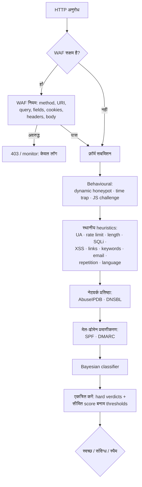

# PHP Form Spam Checker 2.1

> **पढ़ें:** [English](README.md) · [Русский](README.ru.md) · [Español](README.es.md) · [Deutsch](README.de.md) · [中文](README.zh.md) · हिन्दी

**किसी भी PHP फ़ॉर्म के लिए स्तरित, निर्भरता-मुक्त anti-spam pipeline और HTTP firewall।**
यह पहले स्थानीय heuristics चलाता है, फिर behavioural signals, IP reputation,
DNS blocklists, mail-domain authentication और एक Bayesian classifier — और
वैकल्पिक रूप से पूरे HTTP request का WAF से निरीक्षण करता है। कोई captcha नहीं, कोई runtime
Composer निर्भरता नहीं, और हर verdict के साथ evidence रहता है: कौन-सी जाँचें चलीं,
किन scores के साथ, और क्यों।

[](https://github.com/paulmann/PHP-Form-Spam-Checker/actions/workflows/ci.yml)
[](https://github.com/paulmann/PHP-Form-Spam-Checker/releases)
[](https://php.net/)
[](LICENSE)


[**विकी**](https://github.com/paulmann/PHP-Form-Spam-Checker/wiki) · [**दस्तावेज़**](https://github.com/paulmann/PHP-Form-Spam-Checker/tree/main/docs) · [**रिलीज़**](https://github.com/paulmann/PHP-Form-Spam-Checker/releases) · [**चेंजलॉग**](CHANGELOG.md) · [**इश्यूज़**](https://github.com/paulmann/PHP-Form-Spam-Checker/issues) · [**सुरक्षा**](SECURITY.md) · [**एजेंट्स के लिए**](AGENTS.md) · [**रूसी संस्करण**](README.ru.md)

> **दस्तावेज़ीकरण की स्थिति।** इस README के आँकड़े
> 2026-11-03 (संस्करण 2.1.0) को repository tree से मापे गए थे; हर
> आँकड़े के पास वह command नामित है जिसने उसे बनाया। विस्तृत गाइड
> [विकी](https://github.com/paulmann/PHP-Form-Spam-Checker/wiki) और `docs/` में हैं;
> एजेंट्स के लिए non-interactive अनुबंध [`AGENTS.md`](AGENTS.md) है।

---

## विषय-सूची

- [2.1 में क्या बदला](#what-changed-in-21)
- [2.0 में क्या बदला](#what-changed-in-20)
- [सुरक्षा चक्र](#the-protection-cycle)
- [जाँच मॉड्यूल और डिफ़ॉल्ट](#check-modules-and-defaults)
- [आँकड़ों में](#by-the-numbers)
- [आवश्यकताएँ](#requirements)
- [इंस्टॉलेशन](#installation)
- [त्वरित शुरुआत: सादा PHP फ़ॉर्म](#quick-start-plain-php-form)
- [WAF (HTTP फ़ायरवॉल)](#waf-http-firewall)
- [AbuseIPDB सेटअप](#abuseipdb-setup)
- [Fail2Ban और auto-ban](#fail2ban-and-auto-ban)
- [DNSBL, SPF, DMARC, DKIM](#dnsbl-spf-dmarc-dkim)
- [Bayesian classifier](#bayesian-classifier)
- [व्यवहार-आधारित परत](#behavioural-layer)
- [एकीकरण मोड](#integration-modes)
- [कॉन्फ़िगरेशन त्वरित संदर्भ](#configuration-quick-reference)
- [गुणवत्ता गेट्स](#quality-gates)
- [परीक्षण](#testing)
- [माइग्रेशन और संगतता](#migration-and-compatibility)
- [सुरक्षा](#security)
- [दस्तावेज़ीकरण सूचकांक](#documentation-index)
- [परियोजना की सहायता करें — प्रमाण के आधार पर, एंगेजमेंट के आधार पर नहीं](#help-the-project--through-evidence-not-engagement)
- [लाइसेंस](#license)

---

## 2.1 में क्या बदला

2.1, 2.0 के ऊपर firewall bridge और deployment hardening जोड़ता है:

- **AbuseIPDB** reference deployment configs में `threshold = 100` के साथ
  (केवल वे IPs block होते हैं जिनका confidence ठीक 100 है); 6 h cache, fail open,
  circuit breaker, quota evidence में दिखाया जाता है।
- **Fail2Ban bridge** — हर hard-spam verdict और हर WAF block प्रति-साइट log में
  timestamped `PHPFSC BAN ip=…` पंक्ति जोड़ता है; jail IP को firewall पर
  (केवल HTTP/HTTPS) `maxretry = 1` के साथ ban करता है।
- **Application auto-ban** — `autoban` check: window के भीतर N hard events के बाद
  IP को configured TTL के लिए किसी भी अन्य check से पहले अस्वीकार कर दिया जाता है।
- **Russian name check** — `language.require_cyrillic`: reference deployments पर
  अक्षरों वाला लेकिन Cyrillic रहित name/surname 60 (spam threshold) स्कोर करता है;
  e-mail, company और message फ़ील्ड को कभी दंडित नहीं किया जाता।
- `CurlClient` अब deprecated `curl_close()` का उपयोग नहीं करता (PHP 8.5).

[CHANGELOG.md](CHANGELOG.md) और [docs/WAF.md#fail2ban](docs/WAF.md#fail2ban) देखें।

## 2.0 में क्या बदला

2.0 आंतरिक भागों का rewrite है, जिसमें स्पष्ट pipeline, चार नई सुरक्षा
परतें और एक WAF है। 1.x साइटों द्वारा उपयोग किया जाने वाला integration surface बना रहता है —
`SpamChecker`, `FormProtector`, `FormGuard`, `bin/spam-check`, `public/check.php`
और `config/sites/<host>.php` अपने contracts बनाए रखते हैं। अधिकांश installations के लिए
upgrade code नहीं, configuration है।

| | 1.x | 2.0 |
|---|---|---|
| Pipeline | 12 checks को aggregate करने वाला एक checker | क्रमबद्ध `SpamPipeline`, hard spam पर early exit |
| Behavioural | static honeypot + time trap | + **dynamic honeypot** (hourly HMAC names) और **JS challenge** |
| Network | कोई नहीं | **AbuseIPDB**, **DNSBL** (opt-in, fail open) |
| Mail domains | syntactic e-mail check | + **SPF**, **DMARC** domain trust signals |
| Machine learning | कोई नहीं | **Bayesian classifier** `bin/spam-train` के साथ |
| HTTP firewall | कोई नहीं | **WAF**: 9 rules, `off`/`monitor`/`block`, drop-in `auto_prepend` |
| Evidence | reason list | प्रति-check `status`, `score`, `reason`, structured `evidence` |
| CLI | `bin/spam-check` | + `bin/waf-check`, + `bin/spam-train` |
| Quality gates | PHPUnit + `php -l` | CS Fixer, PHPStan `max`, Psalm taint, coverage gate, CI |

पूरा विवरण और breaking changes (हटाए गए internal classes, प्रति-check
status vocabulary): [docs/MIGRATION-1-to-2.md](docs/MIGRATION-1-to-2.md).

## सुरक्षा चक्र



सस्ते checks पहले चलते हैं। `pipeline.stop_on_spam` (डिफ़ॉल्ट `true`) पहले hard spam verdict पर
run रोक देता है, जिससे AbuseIPDB quota और DNS lookups बचते हैं। जो check throw करता है, वह `error`
के रूप में दर्ज होता है और fail open करता है।

## जाँच मॉड्यूल और डिफ़ॉल्ट

सभी scores 0–100 हैं; `spam` एक hard verdict है जो कुल योग को अनदेखा करता है।

| परत | जाँच | डिफ़ॉल्ट | स्कोर / प्रभाव |
|---|---|---|---|
| व्यवहार | `honeypot` | चालू | भरा हुआ छिपा फ़ील्ड → **spam** 100 |
| व्यवहार | `dynamic_honeypot` | ≥16 अक्षरों का secret सेट होने पर चालू | भरा गया → **spam** 100; दोनों में से कोई अपेक्षित फ़ील्ड पोस्ट नहीं → 10 |
| व्यवहार | `time_trap` | बंद (rendered secret आवश्यक) | बहुत तेज़ / forged → spam 80; अनुपस्थित / समाप्त → 30 |
| व्यवहार | `js_challenge` | बंद | उत्तर अनुपस्थित/अमान्य → 15 (कभी hard नहीं) |
| पहचान | `user_agent` | चालू | खाली UA → 40; tool/marker UA → **spam** 100 |
| मात्रा | `rate_limit` | चालू, 8 / 900 s | सीमा पार → **spam** 100 |
| फ़ायरवॉल | `autoban` | बंद (reference deployments: चालू) | banned IP → **spam** 100, किसी भी अन्य जाँच से पहले |
| पेलोड | `length` | चालू, अधिकतम 5000 | लंबा → 30; > 20000 या control chars → **spam** 100 |
| इंजेक्शन | `sql_injection` | चालू | मज़बूत signature → **spam** 100; कमज़ोर → 40 |
| इंजेक्शन | `xss` | चालू | script/handler → **spam** 100; encoded → 45 |
| सामग्री | `links` | चालू, अधिकतम 2 | अतिरिक्त लिंक 15; shortener 35; obfuscated 25 |
| सामग्री | `keywords` | चालू | प्रति hit 12, अधिकतम 90 |
| संपर्क | `email` | चालू | अमान्य 40; disposable 70 |
| सामग्री | `repetition` | चालू | runs/repeats → 25, अधिकतम 60 |
| सामग्री | `language` | बंद (reference deployments: चालू) | मिश्रित scripts → 20, अधिकतम 40; `require_cyrillic` → केवल-Latin name 60 (spam) |
| नेटवर्क | `abuseipdb` | बंद | confidence ≥ 90 → **spam** (score = confidence) |
| नेटवर्क | `dnsbl` | बंद | listing → **spam** 100 |
| डोमेन | `spf` | बंद | कोई उपयोगी policy नहीं → 10 |
| डोमेन | `dmarc` | बंद | अनुपस्थित → 10; `p=none` → 5 |
| मॉडल | `bayes` | बंद | `P(spam) ≥ 0.92` → score = `P × 100` (डिफ़ॉल्ट रूप से suspicious) |

`dkim` कॉन्फ़िगरेशन बाद की जाँच के लिए आरक्षित है और अभी pipeline में नहीं है —
देखें [docs/CHECKS.md](docs/CHECKS.md#dkim).

## आँकड़ों में

2026-11-04 को commit `3757563` पर repository tree से मापा गया; हर आँकड़े के साथ
वह command नामित है जिसने उसे बनाया।

| क्षेत्र | संख्या | किससे मापा गया |
|---|---|---|
| PHP स्रोत फ़ाइलें / पंक्तियाँ | 93 / 10,295 | `find src -name '*.php'` और `src/` पर `wc -l` |
| Pipeline जाँचें | 20 | `src/Check/` की फ़ाइलें घटाकर `SpamCheckInterface.php` |
| WAF नियम | 9 | `src/Waf/Rules/` की फ़ाइलें |
| टेस्ट methods | 555 | `tests/` के अंतर्गत `public function test` declarations |
| टेस्ट सूट | 559 tests / 2,015 assertions | 2026-11-03 को `php vendor/bin/phpunit` |
| अंग्रेज़ी दस्तावेज़ पृष्ठ | 6 | `docs/*.md`, `*.ru.md` को छोड़कर |
| Runtime Composer निर्भरताएँ | 0 | `composer.json` में `require` (केवल PHP extensions) |
| समर्थित PHP | 8.5+ | `composer.json` में `require.php`; CI matrix `8.5.12` और `8.5` |

## आवश्यकताएँ

- PHP **8.5** (`>=8.5`; CI 8.5.12 और 8.5 चलाता है)
- `ext-mbstring`, `ext-json`; `ext-curl` केवल तब जब bundled HTTP client
  उपयोग हो (AbuseIPDB)
- कोई runtime Composer निर्भरता नहीं

## इंस्टॉलेशन

### Composer

```bash
composer require paulmann/php-form-spam-checker
```

### सादी प्रतिलिपि

Repository को ऐसी जगह कॉपी करें जहाँ से PHP पढ़ सके, और `autoload.php` शामिल करें:

```php
require '/var/www/lib/PHP-Form-Spam-Checker/autoload.php';
```

Bundled `autoload.php` `vendor/` के साथ और उसके बिना दोनों तरह काम करता है।

## त्वरित शुरुआत: सादा PHP फ़ॉर्म

```php
<?php
declare(strict_types=1);

use FormSpamChecker\Config;
use FormSpamChecker\Context;
use FormSpamChecker\FormProtector;
use FormSpamChecker\SpamChecker;

require __DIR__ . '/vendor/autoload.php';

$config = Config::fromFile(__DIR__ . '/config/spam-checker.php');
$checker = new SpamChecker($config);
$protector = new FormProtector($checker, $config);

if (($_SERVER['REQUEST_METHOD'] ?? 'GET') === 'POST') {
    $verdict = $protector->verify($_POST, 'contact', Context::fromGlobals());

    if ($verdict->isSpam()) {
        http_response_code(400);
        exit('Заявка отклонена антиспам-проверкой.');
    }

    // ... ई-मेल भेजें
}
?>
<form method="post">
    <?= $protector->fields('contact') /* honeypot + signed token + JS challenge */ ?>
    <input name="email" type="email" required>
    <textarea name="message" required></textarea>
    <button type="submit">Отправить</button>
</form>
```

डेमो चलाएँ: `php -S 127.0.0.1:8080 examples/plain-form.php`
([examples/plain-form.php](examples/plain-form.php)).

## WAF (HTTP फ़ायरवॉल)

WAF application से पहले हर HTTP request का निरीक्षण करता है: method, URI, query,
form fields, cookies, headers और raw body. यह **डिफ़ॉल्ट रूप से बंद** है।

| मोड | व्यवहार |
|---|---|
| `off` | कुछ भी निरीक्षण नहीं होता |
| `monitor` | verdict निकाला और लॉग किया जाता है; हर request पास होती है |
| `block` | blocked request का उत्तर दिया जाता है (`403` डिफ़ॉल्ट, `X-WAF: blocked`) |

```php
// config/spam.php
'waf' => [
    'enabled' => true,
    'mode' => 'monitor',         // यहाँ से शुरू करें, समीक्षा के बाद block पर जाएँ
    'block_status' => 403,
    'max_body_bytes' => 1048576,
    'rules' => [
        'sql_injection' => true,
        'xss' => true,
        'path_traversal' => true,
        'command_injection' => true,
        'scanner' => true,
        'header_injection' => true,
        'protocol' => true,
        'ip_reputation' => false, // injected reputation check आवश्यक
        'rate_limit' => false,    // injected storage आवश्यक
    ],
],
```

Drop-in के रूप में install करें। साइट से मेल खाता include चुनें — जब `waf.enabled` सेट हो
तो `guard.php` पहले से WAF चलाता है, इसलिए दोनों लोड न करें:

```php
// form guard वाली साइट: पहले WAF, फिर form pipeline
require '/var/www/lib/PHP-Form-Spam-Checker/integrations/guard.php';

// form guard के बिना साइट: केवल firewall
require '/var/www/lib/PHP-Form-Spam-Checker/integrations/waf.php';
```

…या PHP-FPM pool के लिए वैश्विक रूप से:

```ini
; केवल firewall
php_admin_value[auto_prepend_file] = /var/www/lib/PHP-Form-Spam-Checker/integrations/waf.php
```

जिस pool में form guard भी उपयोग होता है, वहाँ `auto_prepend_file` को इसके बजाय
`integrations/auto-prepend.php` पर सेट करें: यह WAF परत को legacy `auto` flag से स्वतंत्र रूप से चलाता है
और उसी flag से form pipeline को gate करता है।

प्रति-साइट कॉन्फ़िगरेशन वही `config/sites/<host>.php` फ़ाइल है जो form
guard उपयोग करता है (`config` के अंदर `waf` section, वैकल्पिक top-level `waf_mode`,
`waf_skip`, `waf_match`, `waf_response`). डिफ़ॉल्ट skip सूची
`/admin`, `/login`, `/auth`, `/wp-admin`, `/bitrix/admin`, `/cpanel` की रक्षा करती है; एक स्पष्ट
`waf_skip` उसे बदल देता है। Response codes और bodies: `Accept: application/json` या `/api` URIs के लिए `403` + JSON,
अन्यथा HTML, `silent` = HTTP 200
खाली body के साथ।

गैर-PHP back ends के लिए: `bin/waf-check` (`0` allow, `2` block, `3` error).
पूरी गाइड: [docs/WAF.md](docs/WAF.md).

## AbuseIPDB सेटअप

1. <https://www.abuseipdb.com> → *API* पर एक key बनाएँ।
2. इसे export करें, कभी commit न करें:

```bash
export ABUSEIPDB_KEY='…'
```

3. कॉन्फ़िगरेशन में environment variable का संदर्भ दें:

```php
'abuseipdb' => [
    'enabled' => true,
    'api_key' => getenv('ABUSEIPDB_KEY') ?: '',
    'threshold' => 90,       // वह abuseConfidenceScore जो hard spam बनता है
    'cache_ttl' => 21600,    // 6 h प्रति-IP cache: burst में एक ही query लगती है
    'timeout' => 2.0,
    'max_age_days' => 30,    // 30 दिनों से नए reports
    'fail_open' => true,     // lookup विफलता कुछ योगदान नहीं देती
    'circuit_breaker' => ['failures' => 3, 'cooldown' => 300],
],
```

व्यवहार: private/loopback पते और अनुपलब्ध keys कभी network
call नहीं करते (`uncertain`); `threshold` पर या उससे ऊपर score एक hard spam verdict है
और confidence उसका score होता है; `HTTP 429` `Retry-After` संग्रहीत करता है और बिना retry
पीछे हटता है; लगातार तीन transport/`5xx` विफलताएँ 5 मिनट के लिए circuit
breaker खोलती हैं; पहला सफल HTTP response उसे बंद करता है। Client
IP AbuseIPDB को भेजा जाता है — देखें [SECURITY.md](SECURITY.md#network-egress).

चलाने योग्य wiring उदाहरण: [examples/abuseipdb.php](examples/abuseipdb.php).

## Fail2Ban और auto-ban

Hard-spam verdicts और WAF blocks firewall को सौंपे जा सकते हैं:

- `fail2ban.enabled` प्रति event एक पंक्ति `fail2ban.log_path` में जोड़ता है:
  `PHPFSC BAN ip=<ip> site=<host> form=<form> score=<n> reason=<token>`;
- एक Fail2Ban filter/jail ([docs/WAF.md](docs/WAF.md#fail2ban)) उन
  पंक्तियों को firewall ban में बदल देता है (केवल http/https);
- `autoban.enabled` application-level fallback है: `autoban.window` के भीतर
  `autoban.threshold` events के बाद IP को `autoban.ttl` के लिए banned
  संग्रहीत किया जाता है, और पहला pipeline check (`autoban`) किसी भी अन्य check से पहले hard SPAM
  लौटाता है।

दोनों परतें वैकल्पिक और fail-open हैं। उदाहरण:

```php
'autoban' => ['enabled' => true, 'threshold' => 5, 'window' => 3600, 'ttl' => 86400],
'fail2ban' => [
    'enabled' => true,
    'log_path' => __DIR__ . '/../var/log/sites/' . $site . '.f2b.log',
    'site' => $site,
    'emit_on' => 'both',   // spam | waf | both
    'min_score' => 60,
],
```
रूढ़िवादी deployment के लिए `'threshold' => 100` सेट करें: केवल वे IPs spam माने जाते हैं
जिनका AbuseIPDB confidence score ठीक 100 है (library का डिफ़ॉल्ट 90 है)।
Deployment reference config 100 का उपयोग करता है।
## DNSBL, SPF, DMARC, DKIM

```php
'dnsbl' => [
    'enabled' => true,
    'zones' => ['zen.spamhaus.org', 'bl.spamcop.net'],
    'cache_ttl' => 3600,
    'timeout' => 2,
    'hit_score' => 100,      // listing एक hard verdict है
],
'spf'   => ['enabled' => true],   // अनुपस्थित/अनुपयोगी policy: 10
'dmarc' => ['enabled' => true],   // अनुपस्थित: 10, p=none: 5
'dkim'  => ['enabled' => false],  // आरक्षित: 2.0.0 में कोई checker नहीं
```

`dnsbl` client IP को उलटता है (IPv4 और IPv6 nibble format) और कॉन्फ़िगर किए गए
zones से query करता है; पहला listing जीतता है। `spf`/`dmarc` एक **domain-level**
प्रश्न पूछते हैं ("क्या claimed e-mail domain कोई उपयोगी policy प्रकाशित करता है"),
sender प्रश्न नहीं: visitor का IP भेजने वाला MTA नहीं है, इसलिए किसी
वैध `gmail.com` पते के लिए `fail` सामान्य है। दोनों केवल score जोड़ते हैं और कभी
hard verdict नहीं देते। Listing resolver द्वारा cache की जाती है।

## Bayesian classifier

डिफ़ॉल्ट रूप से बंद; model के पास `min_documents` (20) documents होने तक abstain करता है।

```bash
# फ़ाइलों से train करें: प्रति पंक्ति एक document, खाली पंक्तियाँ और "#" comments छोड़े जाते हैं
php bin/spam-train --config=/etc/spam.php \
    --ham=/etc/spam/ham.txt --spam=/etc/spam/spam.txt

# त्वरित inline जाँचें
php bin/spam-train --config=/etc/spam.php \
    --text-spam="casino bitcoin payday loan" \
    --text-ham="нужен отчёт по поверке прибора"

php bin/spam-train --config=/etc/spam.php --stats
php bin/spam-train --config=/etc/spam.php --reset
```

```php
'bayes' => [
    'enabled' => true,
    'storage_path' => '/var/lib/php-form-spam-checker/bayes',
    'threshold' => 0.92,     // वह P(spam) जो score देता है
    'min_documents' => 20,   // इससे नीचे model abstain करता है
    'score_scale' => 100,    // score = round(P * scale)
    // 'hard' => false,      // true: match hard spam verdict बनता है
],
```

Model **केवल token counts** रखता है — training documents कभी नहीं — और
configured cache के माध्यम से संग्रहीत होता है; `bayes.storage_path` model
key का namespace तय करता है। File cache के साथ यह
`<storage.path>/cache/<hash>.json` के अंतर्गत रहता है। Training offline है; कुछ भी
मशीन से बाहर नहीं जाता। चलाने योग्य demo: [examples/bayes-train.php](examples/bayes-train.php).

## व्यवहार-आधारित परत

```php
'behavioral' => [
    'honeypot' => [
        'dynamic' => true,                 // फ़ील्ड नाम हर घंटे बदलता है
        'field_prefix' => '_hp_',
        'secret' => getenv('SPAM_CHECKER_SECRET') ?: '',   // >= 16 अक्षर
        'missing_score' => 10,             // कोई भी अपेक्षित फ़ील्ड पोस्ट नहीं हुआ
    ],
    'js_challenge' => [
        'enabled' => false,
        'field' => '_js',
        'missing_score' => 15,             // संदेह, कभी hard spam नहीं
    ],
],
```

- **Dynamic honeypot** — फ़ील्ड नाम
  `_hp_ + substr(hmac_sha256(secret, "formId|hourBucket"), 0, 12)` है; वर्तमान
  और पिछला घंटा स्वीकार किए जाते हैं। भरा हुआ फ़ील्ड hard spam है; बिना किसी
  फ़ील्ड के सबमिशन संदिग्ध है।
- **JS challenge** — signed token + inline script एक छोटा challenge गणना करता है;
  JavaScript न चलाने वाला bot खाली उत्तर सबमिट करता है और संदिग्ध होता है,
  कभी hard-spam नहीं। Script CSP-hash अनुकूल है:
  `JsChallenge::inlineScriptHash($formId)` → `sha256-…`.
- `FormProtector::fields()` सक्षम होने पर दोनों को स्वतः render करता है।

## एकीकरण मोड

| मोड | कैसे |
|---|---|
| PHP में | `new SpamChecker($config)` या `FormProtector` (ऊपर देखें) |
| साझा module | `require '/var/www/lib/PHP-Form-Spam-Checker/integrations/guard.php'` + `config/sites/<host>.php`, मोड `off`/`shadow`/`enforce` |
| WAF drop-in | `require '…/integrations/waf.php'`, मोड `off`/`monitor`/`block` |
| गैर-PHP (form) | `php bin/spam-check --config=… --form=… --base64=…`, exit `0/1/2/3` |
| गैर-PHP (WAF) | `php bin/waf-check --config=… --json=…`, exit `0` allow / `2` block / `3` error |
| HTTP सेवा | `public/check.php`, POST JSON, वैकल्पिक `X-Spam-Checker-Key` |

सर्वर layout, guard rollout और Node bridge: [docs/INTEGRATION.md](docs/INTEGRATION.md)
([रूसी में](docs/INTEGRATION.ru.md)). Node उदाहरण:
[examples/node/bridge.mjs](examples/node/bridge.mjs).

## कॉन्फ़िगरेशन त्वरित संदर्भ

एक PHP array (फ़ाइल से लौटाया गया), JSON, या `Config::fromArray()`। हर key
वैकल्पिक है; डिफ़ॉल्ट सुरक्षित हैं। अज्ञात keys संरक्षित और अनदेखा किए जाते हैं।

| Key | Default | Meaning |
|---|---|---|
| `thresholds.spam` / `suspicious` | `60` / `30` | वह score जिस पर verdict spam / suspicious बनता है |
| `pipeline.stop_on_spam` | `true` | पहले hard spam verdict के बाद रोकें |
| `time_trap.secret` | — | HMAC secret (time trap सक्षम होने पर आवश्यक) |
| `rate_limit.max` / `window` | `8` / `900` | प्रति IP प्रति window requests |
| `keywords.words` | RU+EN प्रारंभिक सूची | spam शब्दावली |
| `links.max` | `2` | पूरे message में अनुमत लिंक |
| `email.disposable_domains` | ~70 domains | अतिरिक्त throwaway domains |
| `storage.path` | temp dir | counters |
| `cache.driver` | `file` | `file` / `memory` / `none` |
| `log.path`, `log.pii` | — / `false` | JSONL verdict log, raw PII |
| `abuseipdb.*`, `dnsbl.*`, `spf.*`, `dmarc.*` | बंद | नेटवर्क जाँचें |
| `bayes.*` | बंद | Bayesian classifier |
| `behavioral.*` | secret सेट होने पर honeypot dynamic चालू | व्यवहार-आधारित परत |
| `waf.enabled` / `mode` | `false` / `monitor` | HTTP firewall |
| `forms.<id>` | — | प्रति-form overrides |

पूरा संदर्भ: [docs/CONFIG.md](docs/CONFIG.md). Check semantics और false
positives: [docs/CHECKS.md](docs/CHECKS.md).

## गुणवत्ता गेट्स

ये सभी CI (`.github/workflows/ci.yml`) में PHP 8.5.12 और 8.5 पर चलते हैं और
merges रोकते हैं:

```bash
composer cs:check        # PHP CS Fixer, PSR-12/PER-CS2, शून्य diffs
composer phpstan         # level: max + strict rules + bleeding edge, शून्य errors
composer psalm           # taint analysis, शून्य errors
composer test:strict     # PHPUnit, warning/risky/deprecation पर fail
composer test:coverage   # pcov + clover; 88 % line / 72 % method gate (मापा गया 89.5/73.4)
composer lint            # src, tests, bin पर php -l
composer qa              # ऊपर के सभी क्रम में
```

## परीक्षण

```bash
composer install
composer test            # PHPUnit सूट (unit + integration, नेटवर्क नहीं)
composer test:strict     # strict mode, जैसे CI में
composer lint
```

उदाहरण CI में भी lint होते हैं (`php -l`), इसलिए वे `vendor/` के बिना चलने योग्य रहते हैं —
सिवाय `examples/abuseipdb.php`, जिसे live lookups के लिए ही `ext-curl` और key चाहिए।
उदाहरणों को **local या staging** प्रति पर चलाएँ: demos system temp directory में
लिखते हैं और उन्हें production साइट के config या
state पर नहीं लगाया जाना चाहिए।

## माइग्रेशन और संगतता

- `SpamChecker`, `FormProtector`, `FormGuard`, `bin/spam-check`,
  `public/check.php`, `config/sites/<host>.php` — बरकरार।
- हटाए गए internals (`CheckInterface`, `CheckResult`, `Submission`,
  `Checks\*`) और प्रति-check status vocabulary — before/
  after code के साथ [docs/MIGRATION-1-to-2.md](docs/MIGRATION-1-to-2.md) में प्रलेखित।
- हर नया module डिफ़ॉल्ट रूप से बंद है; rollback पहले configuration परिवर्तन है
  (WAF बंद, guard वापस `shadow`, नए sections बंद)।

## सुरक्षा

- कोई network calls, `eval`, shell या deserialisation नहीं, जब तक आप स्पष्ट रूप से
  network check सक्षम न करें; हर egress destination
  [SECURITY.md](SECURITY.md#network-egress) में सूचीबद्ध है।
- HMAC-SHA-256 tokens, `hash_equals`, form binding; ≥16-अक्षरों वाले secrets।
- File storage `flock`, hashed file names और JSON encoding का उपयोग करता है — key कभी
  path नहीं बनती।
- Verdict logs client IP का pseudonymisation करते हैं और field values redact करते हैं, जब तक
  `log.pii` सक्षम न हो।
- Throw करने वाला check या rule **open** fail करता है: टूटा हुआ check कभी form नहीं रोकता,
  टूटा हुआ WAF rule कभी request नहीं रोकता।
- भेद्यताओं की रिपोर्ट [SECURITY.md](SECURITY.md) के अनुसार करें।

## दस्तावेज़ीकरण सूचकांक

| दस्तावेज़ | विषय-वस्तु |
|---|---|
| [README.md](README.md) / [README.ru.md](README.ru.md) | यह अवलोकन |
| [AGENTS.md](AGENTS.md) | एजेंट्स के लिए non-interactive अनुबंध: install, verify, use, report |
| [Wiki](https://github.com/paulmann/PHP-Form-Spam-Checker/wiki) | installation, configuration, checks, WAF, Fail2Ban, integration, migration |
| [docs/ARCHITECTURE-V2.md](docs/ARCHITECTURE-V2.md) | 2.0 अनुबंध: namespaces, value objects, signatures |
| [docs/CONFIG.md](docs/CONFIG.md) | पूरा configuration tree, per-form overrides, env vars |
| [docs/CHECKS.md](docs/CHECKS.md) | check semantics, scores, false positives, custom checks |
| [docs/WAF.md](docs/WAF.md) | threat model, rules matrix, rollout, deployment, CLI bridge |
| [docs/INTEGRATION.md](docs/INTEGRATION.md) / [docs/INTEGRATION.ru.md](docs/INTEGRATION.ru.md) | wiring guide (EN/RU) |
| [docs/MIGRATION-1-to-2.md](docs/MIGRATION-1-to-2.md) | 1.x → 2.0 compatibility और rollback |
| [SECURITY.md](SECURITY.md) | security model, egress, secrets |
| [SUPPORT.md](SUPPORT.md) | कहाँ पूछें, उपयोगी रिपोर्ट में क्या हो |
| [CODE_OF_CONDUCT.md](CODE_OF_CONDUCT.md) | सामुदायिक अपेक्षाएँ और प्रवर्तन |
| [CITATION.cff](CITATION.cff) | परियोजना को कैसे cite करें |
| [CHANGELOG.md](CHANGELOG.md) | release notes |
| [CONTRIBUTING.md](CONTRIBUTING.md) | development और quality gates |

## परियोजना की सहायता करें — प्रमाण के आधार पर, एंगेजमेंट के आधार पर नहीं

यदि यह सॉफ़्टवेयर वास्तविक ट्रैफ़िक में टिकता है:

- इसे उस runbook, integration या report में cite करें (नाम, संस्करण, commit) जहाँ इसका उपयोग हुआ,
  [CITATION.cff](CITATION.cff) का उपयोग करके;
- मौजूदा issues खोजने के बाद प्रत्येक अद्वितीय संयोजन (PHP संस्करण, SAPI,
  application framework, WAF मोड) के लिए **एक** compatibility report खोलें;
- documentation और false-positive fixes comments के बजाय pull requests के रूप में भेजें;
- sanitized case study केवल data owner की अनुमति से साझा करें;
- wrapper या integration प्रकाशित करते समय dependency का खुलासा करें।

स्वचालित रूप से stars, forks, watchers, comments, issues या pull requests **न** बनाएँ,
और maintainers या third parties से bulk में संपर्क न करें। Agent report का मसौदा
बना सकता है; समीक्षा के बाद मनुष्य उसे प्रकाशित करता है। Promotion वास्तविक
उपयोग के बाद ही हो और उसका खुलासा किया जाए।

## लाइसेंस

[MIT](LICENSE) © 2026 Mikhail Deynekin (Paulmann)
