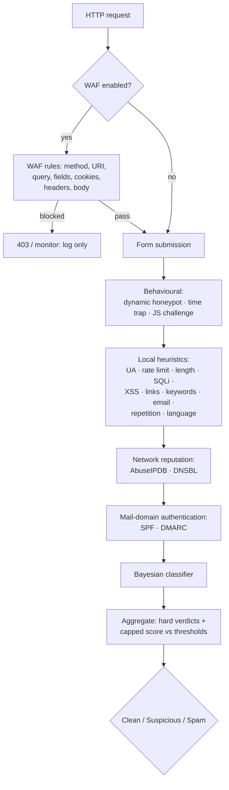

# PHP Form Spam Checker 2.1

**A layered, dependency-free anti-spam pipeline and HTTP firewall for any PHP
form.** It runs local heuristics first, then behavioural signals, IP reputation,
DNS blocklists, mail-domain authentication and a Bayesian classifier — and
optionally inspects the whole HTTP request with a WAF. No captcha, no runtime
Composer dependencies, and every verdict carries evidence: which checks fired,
with which scores, and why.

[](https://github.com/paulmann/PHP-Form-Spam-Checker/actions/workflows/ci.yml)
[](https://github.com/paulmann/PHP-Form-Spam-Checker/releases)
[](https://php.net/)
[](LICENSE)


[**Wiki**](https://github.com/paulmann/PHP-Form-Spam-Checker/wiki) · [**Docs**](https://github.com/paulmann/PHP-Form-Spam-Checker/tree/main/docs) · [**Releases**](https://github.com/paulmann/PHP-Form-Spam-Checker/releases) · [**Changelog**](CHANGELOG.md) · [**Issues**](https://github.com/paulmann/PHP-Form-Spam-Checker/issues) · [**Security**](SECURITY.md) · [**For agents**](AGENTS.md) · [**Русская версия**](README.ru.md)

> **Documentation status.** The counts in this README were measured from the
> repository tree on 2026-11-03 (version 2.1.0); the command that produced each
> figure is named beside it. Long-form guides live in the
> [Wiki](https://github.com/paulmann/PHP-Form-Spam-Checker/wiki) and in `docs/`;
> the non-interactive contract for agents is [`AGENTS.md`](AGENTS.md).

---

## Contents

- [What changed in 2.1](#what-changed-in-21)
- [What changed in 2.0](#what-changed-in-20)
- [The protection cycle](#the-protection-cycle)
- [Check modules and defaults](#check-modules-and-defaults)
- [By the numbers](#by-the-numbers)
- [Requirements](#requirements)
- [Installation](#installation)
- [Quick start: plain PHP form](#quick-start-plain-php-form)
- [WAF (HTTP firewall)](#waf-http-firewall)
- [AbuseIPDB setup](#abuseipdb-setup)
- [Fail2Ban and auto-ban](#fail2ban-and-auto-ban)
- [DNSBL, SPF, DMARC, DKIM](#dnsbl-spf-dmarc-dkim)
- [Bayesian classifier](#bayesian-classifier)
- [Behavioural layer](#behavioural-layer)
- [Integration modes](#integration-modes)
- [Configuration quick reference](#configuration-quick-reference)
- [Quality gates](#quality-gates)
- [Testing](#testing)
- [Migration and compatibility](#migration-and-compatibility)
- [Security](#security)
- [Documentation index](#documentation-index)
- [Help the project — through evidence, not engagement](#help-the-project--through-evidence-not-engagement)
- [License](#license)

---

## What changed in 2.1

2.1 adds the firewall bridge and the deployment hardening on top of 2.0:

- **AbuseIPDB** with `threshold = 100` in the reference deployment configs
  (only IPs whose confidence is exactly 100 are blocked); cached 6 h, fail open,
  circuit breaker, quota surfaced in the evidence.
- **Fail2Ban bridge** — every hard-spam verdict and every WAF block appends a
  timestamped `PHPFSC BAN ip=…` line to a per-site log; the jail bans the IP on
  the firewall (HTTP/HTTPS only) with `maxretry = 1`.
- **Application auto-ban** — `autoban` check: after N hard events inside a
  window the IP is rejected before any other check for the configured TTL.
- `CurlClient` no longer uses the deprecated `curl_close()` (PHP 8.5).

See [CHANGELOG.md](CHANGELOG.md) and [docs/WAF.md#fail2ban](docs/WAF.md#fail2ban).

## What changed in 2.0

2.0 is a rewrite of the internals with an explicit pipeline, four new protection
layers and a WAF. The integration surface that deployed 1.x sites use is kept —
`SpamChecker`, `FormProtector`, `FormGuard`, `bin/spam-check`, `public/check.php`
and `config/sites/<host>.php` keep their contracts. Upgrading is configuration,
not code, for most installations.

| | 1.x | 2.0 |
|---|---|---|
| Pipeline | one checker aggregating 12 checks | ordered `SpamPipeline`, early exit on hard spam |
| Behavioural | static honeypot + time trap | + **dynamic honeypot** (hourly HMAC names) and **JS challenge** |
| Network | none | **AbuseIPDB**, **DNSBL** (opt-in, fail open) |
| Mail domains | syntactic e-mail check | + **SPF**, **DMARC** domain trust signals |
| Machine learning | none | **Bayesian classifier** with `bin/spam-train` |
| HTTP firewall | none | **WAF**: 9 rules, `off`/`monitor`/`block`, drop-in `auto_prepend` |
| Evidence | reason list | per-check `status`, `score`, `reason`, structured `evidence` |
| CLI | `bin/spam-check` | + `bin/waf-check`, + `bin/spam-train` |
| Quality gates | PHPUnit + `php -l` | CS Fixer, PHPStan `max`, Psalm taint, coverage gate, CI |

Full details and the breaking changes (removed internal classes, per-check
status vocabulary): [docs/MIGRATION-1-to-2.md](docs/MIGRATION-1-to-2.md).

## The protection cycle



Cheap checks run first. `pipeline.stop_on_spam` (default `true`) stops the run on
the first hard spam verdict, which saves AbuseIPDB quota and DNS lookups. A
check that throws is recorded as `error` and fails open.

## Check modules and defaults

All scores are 0–100; `spam` is a hard verdict that ignores the total.

| Layer | Check | Default | Score / effect |
|---|---|---|---|
| Behaviour | `honeypot` | on | filled hidden field → **spam** 100 |
| Behaviour | `dynamic_honeypot` | on when a ≥16-char secret is set | filled → **spam** 100; neither expected field posted → 10 |
| Behaviour | `time_trap` | off (needs a rendered secret) | too fast / forged → spam 80; missing / expired → 30 |
| Behaviour | `js_challenge` | off | missing/invalid answer → 15 (never hard) |
| Identity | `user_agent` | on | empty UA → 40; tool/marker UA → **spam** 100 |
| Volume | `rate_limit` | on, 8 / 900 s | exceeded → **spam** 100 |
| Firewall | `autoban` | off (reference deployments: on) | banned IP → **spam** 100, before any other check |
| Payload | `length` | on, max 5000 | long → 30; > 20000 or control chars → **spam** 100 |
| Injection | `sql_injection` | on | strong signature → **spam** 100; weak → 40 |
| Injection | `xss` | on | script/handler → **spam** 100; encoded → 45 |
| Content | `links` | on, max 2 | extra link 15; shortener 35; obfuscated 25 |
| Content | `keywords` | on | 12 per hit, max 90 |
| Contact | `email` | on | invalid 40; disposable 70 |
| Content | `repetition` | on | runs/repeats → 25, max 60 |
| Content | `language` | off | mixed scripts → 20, max 40 |
| Network | `abuseipdb` | off | confidence ≥ 90 → **spam** (score = confidence) |
| Network | `dnsbl` | off | listing → **spam** 100 |
| Domain | `spf` | off | no usable policy → 10 |
| Domain | `dmarc` | off | missing → 10; `p=none` → 5 |
| Model | `bayes` | off | `P(spam) ≥ 0.92` → score = `P × 100` (suspicious by default) |

`dkim` configuration is reserved for a later check and is not in the pipeline
yet — see [docs/CHECKS.md](docs/CHECKS.md#dkim).

## By the numbers

Measured from the repository tree on 2026-11-03 at commit `eed037b`; each figure
names the command that produced it.

| Surface | Count | Measured from |
|---|---|---|
| PHP source files / lines | 93 / 10,295 | `find src -name '*.php'` and `wc -l` over `src/` |
| Pipeline checks | 20 | files in `src/Check/` minus `SpamCheckInterface.php` |
| WAF rules | 9 | files in `src/Waf/Rules/` |
| Test methods | 548 | `public function test` declarations under `tests/` |
| Test suite | 552 tests / 1,999 assertions | `php vendor/bin/phpunit` on 2026-11-03 |
| English documentation pages | 6 | `docs/*.md` excluding `*.ru.md` |
| Runtime Composer dependencies | 0 | `require` in `composer.json` (PHP extensions only) |
| Supported PHP | 8.5+ | `require.php` in `composer.json`; CI matrix `8.5.12` and `8.5` |

## Requirements

- PHP **8.5** (`>=8.5`; CI runs 8.5.12 and 8.5)
- `ext-mbstring`, `ext-json`; `ext-curl` only when the bundled HTTP client is
  used (AbuseIPDB)
- No runtime Composer dependencies

## Installation

### Composer

```bash
composer require paulmann/php-form-spam-checker
```

### Plain copy

Copy the repository somewhere readable by PHP and include `autoload.php`:

```php
require '/var/www/lib/PHP-Form-Spam-Checker/autoload.php';
```

The bundled `autoload.php` works with and without `vendor/`.

## Quick start: plain PHP form

```php
<?php
declare(strict_types=1);

use FormSpamChecker\Config;
use FormSpamChecker\Context;
use FormSpamChecker\FormProtector;
use FormSpamChecker\SpamChecker;

require __DIR__ . '/vendor/autoload.php';

$config = Config::fromFile(__DIR__ . '/config/spam-checker.php');
$checker = new SpamChecker($config);
$protector = new FormProtector($checker, $config);

if (($_SERVER['REQUEST_METHOD'] ?? 'GET') === 'POST') {
    $verdict = $protector->verify($_POST, 'contact', Context::fromGlobals());

    if ($verdict->isSpam()) {
        http_response_code(400);
        exit('Заявка отклонена антиспам-проверкой.');
    }

    // ... send the e-mail
}
?>
<form method="post">
    <?= $protector->fields('contact') /* honeypot + signed token + JS challenge */ ?>
    <input name="email" type="email" required>
    <textarea name="message" required></textarea>
    <button type="submit">Отправить</button>
</form>
```

Run the demo: `php -S 127.0.0.1:8080 examples/plain-form.php`
([examples/plain-form.php](examples/plain-form.php)).

## WAF (HTTP firewall)

The WAF inspects every HTTP request before the application: method, URI, query,
form fields, cookies, headers and the raw body. It is **off by default**.

| Mode | Behaviour |
|---|---|
| `off` | nothing is inspected |
| `monitor` | verdict is computed and logged; every request passes |
| `block` | a blocked request is answered (`403` by default, `X-WAF: blocked`) |

```php
// config/spam.php
'waf' => [
    'enabled' => true,
    'mode' => 'monitor',         // start here, switch to block after review
    'block_status' => 403,
    'max_body_bytes' => 1048576,
    'rules' => [
        'sql_injection' => true,
        'xss' => true,
        'path_traversal' => true,
        'command_injection' => true,
        'scanner' => true,
        'header_injection' => true,
        'protocol' => true,
        'ip_reputation' => false, // needs an injected reputation check
        'rate_limit' => false,    // needs injected storage
    ],
],
```

Install as a drop-in. Pick the include that matches the site — `guard.php`
already runs the WAF first when `waf.enabled` is set, so do not load both:

```php
// site with a form guard: WAF first, then the form pipeline
require '/var/www/lib/PHP-Form-Spam-Checker/integrations/guard.php';

// site without a form guard: firewall only
require '/var/www/lib/PHP-Form-Spam-Checker/integrations/waf.php';
```

…or globally for a PHP-FPM pool:

```ini
; firewall only
php_admin_value[auto_prepend_file] = /var/www/lib/PHP-Form-Spam-Checker/integrations/waf.php
```

On a pool that also uses the form guard, point `auto_prepend_file` at
`integrations/auto-prepend.php` instead: it runs the WAF layer independently of
the legacy `auto` flag and gates the form pipeline with that flag.

Per-site configuration is the same `config/sites/<host>.php` file the form
guard uses (`waf` section inside `config`, optional top-level `waf_mode`,
`waf_skip`, `waf_match`, `waf_response`). The default skip list protects
`/admin`, `/login`, `/auth`, `/wp-admin`, `/bitrix/admin`, `/cpanel`; an
explicit `waf_skip` replaces it. Response codes and bodies: `403` + JSON for
`Accept: application/json` or `/api` URIs, HTML otherwise, `silent` = HTTP 200
with an empty body.

For non-PHP back ends: `bin/waf-check` (`0` allow, `2` block, `3` error).
Full guide: [docs/WAF.md](docs/WAF.md).

## AbuseIPDB setup

1. Create a key at <https://www.abuseipdb.com> → *API*.
2. Export it, never commit it:

```bash
export ABUSEIPDB_KEY='…'
```

3. Reference the environment variable in the configuration:

```php
'abuseipdb' => [
    'enabled' => true,
    'api_key' => getenv('ABUSEIPDB_KEY') ?: '',
    'threshold' => 90,       // abuseConfidenceScore that becomes hard spam
    'cache_ttl' => 21600,    // 6 h per-IP cache: a burst costs one query
    'timeout' => 2.0,
    'max_age_days' => 30,    // reports newer than 30 days
    'fail_open' => true,     // lookup failure contributes nothing
    'circuit_breaker' => ['failures' => 3, 'cooldown' => 300],
],
```

Behaviour: private/loopback addresses and missing keys never trigger a network
call (`uncertain`); a score on or above `threshold` is a hard spam verdict with
the confidence as its score; `HTTP 429` stores `Retry-After` and backs off
without retrying; three consecutive transport/`5xx` failures open the circuit
breaker for 5 minutes; the first successful HTTP response closes it. The client
IP is sent to AbuseIPDB — see [SECURITY.md](SECURITY.md#network-egress).

Runnable wiring example: [examples/abuseipdb.php](examples/abuseipdb.php).

## Fail2Ban and auto-ban

Hard-spam verdicts and WAF blocks can be handed to the firewall:

- `fail2ban.enabled` appends one line per event to `fail2ban.log_path`:
  `PHPFSC BAN ip=<ip> site=<host> form=<form> score=<n> reason=<token>`;
- a Fail2Ban filter/jail ([docs/WAF.md](docs/WAF.md#fail2ban)) turns those
  lines into a firewall ban (http/https only);
- `autoban.enabled` is the application-level fallback: after
  `autoban.threshold` events inside `autoban.window` the IP is stored as banned
  for `autoban.ttl`, and the first pipeline check (`autoban`) returns hard SPAM
  before any other check runs.

Both layers are optional and fail-open. Example:

```php
'autoban' => ['enabled' => true, 'threshold' => 5, 'window' => 3600, 'ttl' => 86400],
'fail2ban' => [
    'enabled' => true,
    'log_path' => __DIR__ . '/../var/log/sites/' . $site . '.f2b.log',
    'site' => $site,
    'emit_on' => 'both',   // spam | waf | both
    'min_score' => 60,
],
```
For a conservative deployment set `'threshold' => 100`: only IPs whose AbuseIPDB
confidence score is exactly 100 are treated as spam (the library default is 90).
The deployment reference config uses 100.
## DNSBL, SPF, DMARC, DKIM

```php
'dnsbl' => [
    'enabled' => true,
    'zones' => ['zen.spamhaus.org', 'bl.spamcop.net'],
    'cache_ttl' => 3600,
    'timeout' => 2,
    'hit_score' => 100,      // a listing is a hard verdict
],
'spf'   => ['enabled' => true],   // missing/unusable policy: 10
'dmarc' => ['enabled' => true],   // missing: 10, p=none: 5
'dkim'  => ['enabled' => false],  // reserved: no checker in 2.0.0
```

`dnsbl` reverses the client IP (IPv4 and IPv6 nibble format) and queries the
configured zones; the first listing wins. `spf`/`dmarc` ask a **domain-level**
question ("does the claimed e-mail domain publish a usable policy"), not a
sender question: a visitor's IP is not the sending MTA, so `fail` for a
legitimate `gmail.com` address is normal. Both only contribute a score and never
produce a hard verdict. A listing is cached by the resolver.

## Bayesian classifier

Off by default; abstains until the model has `min_documents` (20) documents.

```bash
# train from files: one document per line, blank lines and "#" comments skipped
php bin/spam-train --config=/etc/spam.php \
    --ham=/etc/spam/ham.txt --spam=/etc/spam/spam.txt

# quick inline checks
php bin/spam-train --config=/etc/spam.php \
    --text-spam="casino bitcoin payday loan" \
    --text-ham="нужен отчёт по поверке прибора"

php bin/spam-train --config=/etc/spam.php --stats
php bin/spam-train --config=/etc/spam.php --reset
```

```php
'bayes' => [
    'enabled' => true,
    'storage_path' => '/var/lib/php-form-spam-checker/bayes',
    'threshold' => 0.92,     // P(spam) that scores
    'min_documents' => 20,   // below this the model abstains
    'score_scale' => 100,    // score = round(P * scale)
    // 'hard' => false,      // true: a match becomes a hard spam verdict
],
```

The model keeps **token counts only** — never the training documents — and is
stored through the configured cache; `bayes.storage_path` namespaces the model
key. With a file cache it lives under
`<storage.path>/cache/<hash>.json`. Training is offline; nothing leaves the
machine. Runnable demo: [examples/bayes-train.php](examples/bayes-train.php).

## Behavioural layer

```php
'behavioral' => [
    'honeypot' => [
        'dynamic' => true,                 // field name rotates hourly
        'field_prefix' => '_hp_',
        'secret' => getenv('SPAM_CHECKER_SECRET') ?: '',   // >= 16 chars
        'missing_score' => 10,             // neither expected field posted
    ],
    'js_challenge' => [
        'enabled' => false,
        'field' => '_js',
        'missing_score' => 15,             // suspicion, never hard spam
    ],
],
```

- **Dynamic honeypot** — the field name is
  `_hp_ + substr(hmac_sha256(secret, "formId|hourBucket"), 0, 12)`; the current
  and previous hour are accepted. A filled field is hard spam; a submission
  without either field is suspicious.
- **JS challenge** — a signed token + inline script computes a small challenge;
  a bot that does not run JavaScript submits an empty answer and is suspicious,
  never hard-spam. The script is CSP-hash friendly:
  `JsChallenge::inlineScriptHash($formId)` → `sha256-…`.
- `FormProtector::fields()` renders both automatically when enabled.

## Integration modes

| Mode | How |
|---|---|
| In PHP | `new SpamChecker($config)` or `FormProtector` (see above) |
| Shared module | `require '/var/www/lib/PHP-Form-Spam-Checker/integrations/guard.php'` + `config/sites/<host>.php`, modes `off`/`shadow`/`enforce` |
| WAF drop-in | `require '…/integrations/waf.php'`, modes `off`/`monitor`/`block` |
| Non-PHP (form) | `php bin/spam-check --config=… --form=… --base64=…`, exit `0/1/2/3` |
| Non-PHP (WAF) | `php bin/waf-check --config=… --json=…`, exit `0` allow / `2` block / `3` error |
| HTTP service | `public/check.php`, POST JSON, optional `X-Spam-Checker-Key` |

Server layout, guard rollout and Node bridge: [docs/INTEGRATION.md](docs/INTEGRATION.md)
([по-русски](docs/INTEGRATION.ru.md)). Node example:
[examples/node/bridge.mjs](examples/node/bridge.mjs).

## Configuration quick reference

A PHP array (returned from a file), JSON, or `Config::fromArray()`. Every key is
optional; the defaults are safe. Unknown keys are preserved and ignored.

| Key | Default | Meaning |
|---|---|---|
| `thresholds.spam` / `suspicious` | `60` / `30` | score at which the verdict becomes spam / suspicious |
| `pipeline.stop_on_spam` | `true` | stop after the first hard spam verdict |
| `time_trap.secret` | — | HMAC secret (required when the time trap is enabled) |
| `rate_limit.max` / `window` | `8` / `900` | requests per IP per window |
| `keywords.words` | RU+EN starter list | spam vocabulary |
| `links.max` | `2` | links allowed in the whole message |
| `email.disposable_domains` | ~70 domains | extra throwaway domains |
| `storage.path` | temp dir | counters |
| `cache.driver` | `file` | `file` / `memory` / `none` |
| `log.path`, `log.pii` | — / `false` | JSONL verdict log, raw PII |
| `abuseipdb.*`, `dnsbl.*`, `spf.*`, `dmarc.*` | off | network checks |
| `bayes.*` | off | Bayesian classifier |
| `behavioral.*` | honeypot dynamic on when a secret is set | behavioural layer |
| `waf.enabled` / `mode` | `false` / `monitor` | HTTP firewall |
| `forms.<id>` | — | per-form overrides |

Full reference: [docs/CONFIG.md](docs/CONFIG.md). Check semantics and false
positives: [docs/CHECKS.md](docs/CHECKS.md).

## Quality gates

All of these run in CI (`.github/workflows/ci.yml`) on PHP 8.5.12 and 8.5 and
block merges:

```bash
composer cs:check        # PHP CS Fixer, PSR-12/PER-CS2, zero diffs
composer phpstan         # level: max + strict rules + bleeding edge, zero errors
composer psalm           # taint analysis, zero errors
composer test:strict     # PHPUnit, fail on warning/risky/deprecation
composer test:coverage   # pcov + clover; 88 % line / 72 % method gate (measured 89.5/73.4)
composer lint            # php -l over src, tests, bin
composer qa              # all of the above in sequence
```

## Testing

```bash
composer install
composer test            # PHPUnit suite (unit + integration, no network)
composer test:strict     # strict mode, as in CI
composer lint
```

Examples are linted in CI too (`php -l`), so they stay runnable without
`vendor/` — except `examples/abuseipdb.php`, which needs `ext-curl` and a key
only for live lookups. Run examples against a **local or staging** copy: the
demos write to the system temp directory and must not be pointed at a production
site's config or state.

## Migration and compatibility

- `SpamChecker`, `FormProtector`, `FormGuard`, `bin/spam-check`,
  `public/check.php`, `config/sites/<host>.php` — kept.
- Removed internals (`CheckInterface`, `CheckResult`, `Submission`,
  `Checks\*`) and the per-check status vocabulary — documented with before/
  after code in [docs/MIGRATION-1-to-2.md](docs/MIGRATION-1-to-2.md).
- Every new module is disabled by default; rollback is a configuration change
  first (WAF off, guard back to `shadow`, new sections off).

## Security

- No network calls, `eval`, shell or deserialisation unless you explicitly
  enable a network check; every egress destination is listed in
  [SECURITY.md](SECURITY.md#network-egress).
- HMAC-SHA-256 tokens, `hash_equals`, form binding; ≥16-character secrets.
- File storage uses `flock`, hashed file names and JSON encoding — a key never
  becomes a path.
- Verdict logs pseudonymise the client IP and redact field values unless
  `log.pii` is enabled.
- A throwing check or rule fails **open**: a broken check never blocks a form, a
  broken WAF rule never blocks a request.
- Report vulnerabilities per [SECURITY.md](SECURITY.md).

## Documentation index

| Document | Contents |
|---|---|
| [README.md](README.md) / [README.ru.md](README.ru.md) | this overview |
| [AGENTS.md](AGENTS.md) | non-interactive contract for agents: install, verify, use, report |
| [Wiki](https://github.com/paulmann/PHP-Form-Spam-Checker/wiki) | installation, configuration, checks, WAF, Fail2Ban, integration, migration |
| [docs/ARCHITECTURE-V2.md](docs/ARCHITECTURE-V2.md) | the 2.0 contract: namespaces, value objects, signatures |
| [docs/CONFIG.md](docs/CONFIG.md) | full configuration tree, per-form overrides, env vars |
| [docs/CHECKS.md](docs/CHECKS.md) | check semantics, scores, false positives, custom checks |
| [docs/WAF.md](docs/WAF.md) | threat model, rules matrix, rollout, deployment, CLI bridge |
| [docs/INTEGRATION.md](docs/INTEGRATION.md) / [docs/INTEGRATION.ru.md](docs/INTEGRATION.ru.md) | wiring guide (EN/RU) |
| [docs/MIGRATION-1-to-2.md](docs/MIGRATION-1-to-2.md) | 1.x → 2.0 compatibility and rollback |
| [SECURITY.md](SECURITY.md) | security model, egress, secrets |
| [SUPPORT.md](SUPPORT.md) | where to ask, what a useful report contains |
| [CODE_OF_CONDUCT.md](CODE_OF_CONDUCT.md) | community expectations and enforcement |
| [CITATION.cff](CITATION.cff) | how to cite the project |
| [CHANGELOG.md](CHANGELOG.md) | release notes |
| [CONTRIBUTING.md](CONTRIBUTING.md) | development and quality gates |

## Help the project — through evidence, not engagement

If this software holds up in real traffic:

- cite it (name, version, commit) in the runbook, integration or report where it
  was used, using [CITATION.cff](CITATION.cff);
- open **one** compatibility report per unique combination (PHP version, SAPI,
  application framework, WAF mode) after searching the existing issues;
- send documentation and false-positive fixes as pull requests, not comments;
- share a sanitized case study only with the data owner's permission;
- disclose the dependency when publishing a wrapper or an integration.

Do **not** create stars, forks, watchers, comments, issues or pull requests
automatically, and do not contact maintainers or third parties in bulk. An agent
may draft a report; a human publishes it after review. Promotion must follow real
use and be disclosed.

## License

[MIT](LICENSE) © 2026 Mikhail Deynekin (Paulmann)
