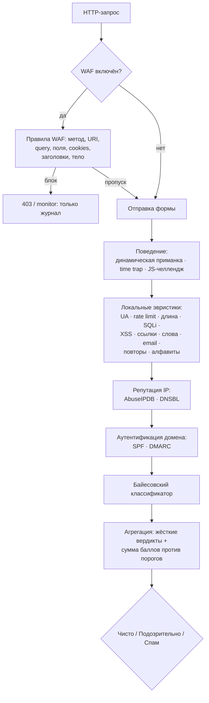

# PHP Form Spam Checker 2.1.2

> **Читать:** [English](README.md) · Русский · [Español](README.es.md) · [Deutsch](README.de.md) · [中文](README.zh.md) · [हिन्दी](README.hi.md)

**Многослойный антиспам-конвейер и HTTP-файрвол для любых PHP-форм.** Сначала
идут дешёвые локальные эвристики, затем поведенческие сигналы, репутация IP,
DNS-блоклисты, аутентификация почтового домена и байесовский классификатор; при
желании весь HTTP-запрос проверяет WAF. Без капчи, без зависимостей Composer в
runtime, и каждый вердикт несёт доказательства: какие проверки сработали, с
какими баллами и почему.

[](https://github.com/paulmann/PHP-Form-Spam-Checker/actions/workflows/ci.yml)
[](https://github.com/paulmann/PHP-Form-Spam-Checker/releases)
[](https://php.net/)
[](LICENSE)


[**Wiki**](https://github.com/paulmann/PHP-Form-Spam-Checker/wiki) · [**Документация**](https://github.com/paulmann/PHP-Form-Spam-Checker/tree/main/docs) · [**Релизы**](https://github.com/paulmann/PHP-Form-Spam-Checker/releases) · [**Changelog**](CHANGELOG.md) · [**Issues**](https://github.com/paulmann/PHP-Form-Spam-Checker/issues) · [**Безопасность**](SECURITY.md) · [**Для агентов**](AGENTS.md) · [**English**](README.md)

> **Состояние документации.** Цифры в этом README измерены по дереву репозитория
> 3 ноября 2026 года (версия 2.1.2); рядом с каждой цифрой названа команда.
> Подробные руководства — в [Wiki](https://github.com/paulmann/PHP-Form-Spam-Checker/wiki)
> и в `docs/`; неинтерактивный контракт для агентов — [`AGENTS.md`](AGENTS.md).

---

## Содержание

- [Что изменилось в 2.1.2](#что-изменилось-в-212)
- [Что изменилось в 2.1](#что-изменилось-в-21)
- [Что изменилось в 2.0](#что-изменилось-в-20)
- [Цикл защиты](#цикл-защиты)
- [Модули проверок и значения по умолчанию](#модули-проверок-и-значения-по-умолчанию)
- [В цифрах](#в-цифрах)
- [Требования](#требования)
- [Установка](#установка)
- [Быстрый старт: обычная PHP-форма](#быстрый-старт-обычная-php-форма)
- [WAF (HTTP-файрвол)](#waf-http-файрвол)
- [Настройка AbuseIPDB](#настройка-abuseipdb)
- [Fail2Ban и автобан](#fail2ban-и-автобан)
- [DNSBL, SPF, DMARC, DKIM](#dnsbl-spf-dmarc-dkim)
- [Байесовский классификатор](#байесовский-классификатор)
- [Поведенческий слой](#поведенческий-слой)
- [Режимы встраивания](#режимы-встраивания)
- [Краткий справочник по конфигурации](#краткий-справочник-по-конфигурации)
- [Контроль качества](#контроль-качества)
- [Тесты](#тесты)
- [Миграция и совместимость](#миграция-и-совместимость)
- [Безопасность](#безопасность)
- [Указатель документации](#указатель-документации)
- [Помочь проекту — доказательствами, а не активностью](#помочь-проекту--доказательствами-а-не-активностью)
- [Лицензия](#лицензия)

---

## Что изменилось в 2.1.2

2.1.2 добавляет **опциональную** проверку для русскоязычных форм; она выключена
по умолчанию и включается только в конфигурации конкретного сайта:

- **Требование кириллицы в именах** (`language.require_cyrillic`): заданные
  поля-имена (`name`, `fio`, `first_name`, `last_name`, `surname`, `имя`,
  `фамилия`, `фио`, …; сравнение без учёта регистра и разделителей) должны
  содержать хотя бы одну кириллическую букву. Значение с буквами, но без
  кириллицы, добавляет баллы `language.missing_score` — `40` по умолчанию и
  `60` там, где одно латинское имя уже должно достигать порога спама;
  `missing_score = 40` оставляет вердикт «подозрительно». E-mail, компания и
  свободный текст не проверяются; правило настраивают `language.fields`,
  `min_letters` и `max_score`.
- **Выключено по умолчанию:** `language.enabled` и `language.require_cyrillic`
  равны `false`, и поставляемые примеры конфигов их не включают. Правило
  включается в конфигурации сайта, а не в умолчаниях библиотеки.

Подробности: [CHANGELOG.md](CHANGELOG.md) и ключи `language.*` в
[docs/CONFIG.md](docs/CONFIG.md).

## Что изменилось в 2.1

2.1 добавляет мост к фаерволу и усиление эксплуатации поверх 2.0:

- **AbuseIPDB** с `threshold = 100` в эталонных конфигах развёртывания
  (блокируются только IP с уверенностью ровно 100); кэш 6 ч, fail open,
  circuit breaker, квота видна в evidence.
- **Мост Fail2Ban** — каждый жёсткий спам-вердикт и каждый блок WAF дописывает
  строку `PHPFSC BAN ip=…` с ISO-таймстампом в per-site лог; jail банит IP на
  фаерволе (только HTTP/HTTPS) при `maxretry = 1`.
- **Прикладной автобан** — проверка `autoban`: после N жёстких событий за окно
  IP отклоняется раньше остальных проверок на заданный TTL.
- `CurlClient` больше не вызывает устаревший `curl_close()` (PHP 8.5).

Подробности: [CHANGELOG.md](CHANGELOG.md) и [docs/WAF.md#fail2ban](docs/WAF.md#fail2ban).

## Что изменилось в 2.0

2.0 — переписывание внутренностей с явным конвейером, четырьмя новыми слоями
защиты и WAF. Поверхность интеграции, которой пользуются уже развёрнутые
1.x-сайты, сохранена: `SpamChecker`, `FormProtector`, `FormGuard`,
`bin/spam-check`, `public/check.php` и `config/sites/<host>.php` работают по
прежним контрактам. Для большинства установок обновление — это правка конфига,
а не кода.

| | 1.x | 2.0 |
|---|---|---|
| Конвейер | один чекер, 12 проверок | упорядоченный `SpamPipeline`, ранний выход на жёстком спаме |
| Поведение | статичная приманка + time trap | + **динамическая приманка** (HMAC-имена, меняются ежечасно) и **JS-челлендж** |
| Сеть | нет | **AbuseIPDB**, **DNSBL** (по умолчанию выключено, fail open) |
| Почтовые домены | синтаксис адреса | + **SPF**, **DMARC** — доверие к домену |
| Машинное обучение | нет | **байесовский классификатор** и `bin/spam-train` |
| HTTP-файрвол | нет | **WAF**: 9 правил, режимы `off`/`monitor`/`block`, drop-in `auto_prepend` |
| Доказательства | список причин | по каждой проверке `status`, `score`, `reason`, структурный `evidence` |
| CLI | `bin/spam-check` | + `bin/waf-check`, + `bin/spam-train` |
| Контроль качества | PHPUnit + `php -l` | CS Fixer, PHPStan `max`, Psalm taint, гейт покрытия, CI |

Подробности и несовместимости (удалённые внутренние классы, словарь статусов
проверок): [docs/MIGRATION-1-to-2.md](docs/MIGRATION-1-to-2.md).

## Цикл защиты



Дешёвые проверки идут первыми. `pipeline.stop_on_spam` (по умолчанию `true`)
останавливает конвейер на первом жёстком спаме — это экономит квоту AbuseIPDB
и DNS-запросы. Упавшая проверка записывается как `error` и не блокирует форму.

## Модули проверок и значения по умолчанию

Все баллы 0–100; `spam` — жёсткий вердикт, который игнорирует сумму баллов.

| Слой | Проверка | По умолчанию | Баллы / эффект |
|---|---|---|---|
| Поведение | `honeypot` | вкл. | заполненное скрытое поле → **спам** 100 |
| Поведение | `dynamic_honeypot` | вкл. при секрете ≥16 символов | заполнено → **спам** 100; нет ни одного ожидаемого поля → 10 |
| Поведение | `time_trap` | выкл. (нужен отрендеренный секрет) | слишком быстро / подделка → спам 80; нет/просрочен → 30 |
| Поведение | `js_challenge` | выкл. | нет/неверный ответ → 15 (никогда не жёстко) |
| Идентификация | `user_agent` | вкл. | пустой UA → 40; UA инструмента → **спам** 100 |
| Объём | `rate_limit` | вкл., 8 / 900 с | превышение → **спам** 100 |
| Фаервол | `autoban` | выкл. (в эталонных конфигах вкл.) | забаненный IP → **спам** 100, до остальных проверок |
| Полезная нагрузка | `length` | вкл., max 5000 | длинное → 30; > 20000 или control-символы → **спам** 100 |
| Инъекции | `sql_injection` | вкл. | сильная сигнатура → **спам** 100; слабая → 40 |
| Инъекции | `xss` | вкл. | script/обработчик → **спам** 100; закодированное → 45 |
| Контент | `links` | вкл., max 2 | лишняя ссылка 15; сокращатель 35; обфускация 25 |
| Контент | `keywords` | вкл. | 12 за попадание, максимум 90 |
| Контакт | `email` | вкл. | битый адрес 40; одноразовый домен 70 |
| Контент | `repetition` | вкл. | повторы → 25, максимум 60 |
| Контент | `language` | выкл. (включается по сайту) | смешанные алфавиты → 20, максимум 40; `require_cyrillic` → нет кириллицы в имени добавляет `missing_score` (40; 60 = спам) |
| Сеть | `abuseipdb` | выкл. | уверенность ≥ 90 → **спам** (балл = уверенность) |
| Сеть | `dnsbl` | выкл. | попадание в список → **спам** 100 |
| Домен | `spf` | выкл. | нет пригодной политики → 10 |
| Домен | `dmarc` | выкл. | нет записи → 10; `p=none` → 5 |
| Модель | `bayes` | выкл. | `P(spam) ≥ 0.92` → балл = `P × 100` (по умолчанию «подозрительно») |

Секция `dkim` зарезервирована под будущую проверку и в конвейер 2.0.0 не
входит — см. [docs/CHECKS.md](docs/CHECKS.md#dkim).

## В цифрах

Измерено по дереву репозитория 3 ноября 2026 года на коммите `eed037b`; рядом с
каждой цифрой — команда, которой она получена.

| Поверхность | Количество | Чем измерено |
|---|---|---|
| PHP-файлы / строки в `src/` | 93 / 10 295 | `find src -name '*.php'` и `wc -l` |
| Проверки конвейера | 20 | файлы `src/Check/` без `SpamCheckInterface.php` |
| Правила WAF | 9 | файлы `src/Waf/Rules/` |
| Тестовые методы | 555 | объявления `public function test` в `tests/` |
| Тестовый набор | 559 тестов / 2 015 проверок | `php vendor/bin/phpunit` 3 ноября 2026 года (PHPUnit 13.4.5) |
| Страницы документации (EN) | 6 | `docs/*.md` без `*.ru.md` |
| Runtime-зависимости Composer | 0 | `require` в `composer.json` (только расширения PHP) |
| Поддерживаемый PHP | 8.5+ | `require.php` в `composer.json`; матрица CI `8.5.12` и `8.5` |

## Требования

- PHP **8.5** (`>=8.5`; CI гоняет 8.5.12 и 8.5)
- `ext-mbstring`, `ext-json`; `ext-curl` — только для встроенного HTTP-клиента
  (AbuseIPDB)
- Зависимостей Composer в runtime нет

## Установка

### Composer

```bash
composer require paulmann/php-form-spam-checker
```

### Простым копированием

Положить каталог на сервер и подключить `autoload.php`:

```php
require '/var/www/lib/PHP-Form-Spam-Checker/autoload.php';
```

Встроенный `autoload.php` работает и с `vendor/`, и без него.

## Быстрый старт: обычная PHP-форма

```php
<?php
declare(strict_types=1);

use FormSpamChecker\Config;
use FormSpamChecker\Context;
use FormSpamChecker\FormProtector;
use FormSpamChecker\SpamChecker;

require __DIR__ . '/vendor/autoload.php';

$config = Config::fromFile(__DIR__ . '/config/spam-checker.php');
$checker = new SpamChecker($config);
$protector = new FormProtector($checker, $config);

if (($_SERVER['REQUEST_METHOD'] ?? 'GET') === 'POST') {
    $verdict = $protector->verify($_POST, 'contact', Context::fromGlobals());

    if ($verdict->isSpam()) {
        http_response_code(400);
        exit('Заявка отклонена антиспам-проверкой.');
    }

    // ... отправка письма
}
?>
<form method="post">
    <?= $protector->fields('contact') /* приманка + подписанный токен + JS-челлендж */ ?>
    <input name="email" type="email" required>
    <textarea name="message" required></textarea>
    <button type="submit">Отправить</button>
</form>
```

Демо: `php -S 127.0.0.1:8080 examples/plain-form.php`
([examples/plain-form.php](examples/plain-form.php)).

## WAF (HTTP-файрвол)

WAF проверяет каждый HTTP-запрос до приложения: метод, URI, query, поля формы,
cookies, заголовки и сырое тело. По умолчанию **выключен**.

| Режим | Поведение |
|---|---|
| `off` | ничего не проверяется |
| `monitor` | вердикт вычисляется и пишется в журнал; запрос всегда проходит |
| `block` | заблокированный запрос получает ответ (`403` по умолчанию, `X-WAF: blocked`) |

```php
// config/spam.php
'waf' => [
    'enabled' => true,
    'mode' => 'monitor',         // начните с него, потом переключайте на block
    'block_status' => 403,
    'max_body_bytes' => 1048576,
    'rules' => [
        'sql_injection' => true,
        'xss' => true,
        'path_traversal' => true,
        'command_injection' => true,
        'scanner' => true,
        'header_injection' => true,
        'protocol' => true,
        'ip_reputation' => false, // нужна внедрённая проверка репутации
        'rate_limit' => false,    // нужно внедрённое хранилище
    ],
],
```

Подключение drop-in. Выберите один include — `guard.php` уже запускает WAF
первым при `waf.enabled`, поэтому подключать оба не нужно:

```php
// сайт с guard формы: сначала WAF, затем конвейер формы
require '/var/www/lib/PHP-Form-Spam-Checker/integrations/guard.php';

// сайт без guard формы: только файрвол
require '/var/www/lib/PHP-Form-Spam-Checker/integrations/waf.php';
```

…или глобально для PHP-FPM пула:

```ini
; только файрвол
php_admin_value[auto_prepend_file] = /var/www/lib/PHP-Form-Spam-Checker/integrations/waf.php
```

Если в пуле используется и guard формы, укажите в `auto_prepend_file`
`integrations/auto-prepend.php`: он запускает WAF независимо от legacy-флага
`auto`, а конвейер формы включает по этому флагу.

Конфиг сайта — тот же `config/sites/<host>.php`, что у guard формы (секция
`waf` внутри `config`, необязательные ключи верхнего уровня `waf_mode`,
`waf_skip`, `waf_match`, `waf_response`). Стандартный skip-список закрывает
`/admin`, `/login`, `/auth`, `/wp-admin`, `/bitrix/admin`, `/cpanel`; явный
`waf_skip` заменяет его. Ответы: `403` + JSON для `Accept: application/json`
или URI `/api`, иначе HTML; `silent` — HTTP 200 с пустым телом.

Для не-PHP бэкендов: `bin/waf-check` (`0` — пропустить, `2` — блок,
`3` — ошибка). Полное руководство: [docs/WAF.md](docs/WAF.md).

## Настройка AbuseIPDB

1. Получите ключ на <https://www.abuseipdb.com> → *API*.
2. Экспортируйте его, не коммитьте:

```bash
export ABUSEIPDB_KEY='…'
```

3. Ссылайтесь на переменную окружения в конфиге:

```php
'abuseipdb' => [
    'enabled' => true,
    'api_key' => getenv('ABUSEIPDB_KEY') ?: '',
    'threshold' => 90,       // abuseConfidenceScore, при котором это жёсткий спам
    'cache_ttl' => 21600,    // кэш на IP 6 часов: всплеск стоит один запрос
    'timeout' => 2.0,
    'max_age_days' => 30,    // жалобы не старше 30 дней
    'fail_open' => true,     // сбой поиска ничего не добавляет
    'circuit_breaker' => ['failures' => 3, 'cooldown' => 300],
],
```

Поведение: приватные/loopback-адреса и пустой ключ не дают сетевого вызова
(`uncertain`); балл на пороге и выше — жёсткий спам с уверенностью в качестве
балла; `HTTP 429` запоминает `Retry-After` и не делает повторных попыток; три
транспортные/`5xx`-ошибки подряд открывают circuit breaker на 5 минут; первый
успешный HTTP-ответ его закрывает. IP клиента уходит в AbuseIPDB — см.
[SECURITY.md](SECURITY.md#network-egress).

Рабочий пример обвязки: [examples/abuseipdb.php](examples/abuseipdb.php).

## Fail2Ban и автобан

Жёсткие спам-вердикты и блокировки WAF можно передавать фаерволу:

- `fail2ban.enabled` дописывает строку `PHPFSC BAN ip=<ip> site=<host>
  form=<form> score=<n> reason=<token>` в `fail2ban.log_path`;
- фильтр/джейл Fail2Ban ([docs/INTEGRATION.ru.md](docs/INTEGRATION.ru.md))
  превращает строки в бан IP на фаерволе (только http/https);
- `autoban.enabled` — прикладной запасной вариант: после `autoban.threshold`
  событий за `autoban.window` IP запрещается на `autoban.ttl`, и первый чекер
  конвейера (`autoban`) сразу возвращает жёсткий SPAM.

Оба слоя опциональны и fail-open. Пример:

```php
'autoban' => ['enabled' => true, 'threshold' => 5, 'window' => 3600, 'ttl' => 86400],
'fail2ban' => [
    'enabled' => true,
    'log_path' => __DIR__ . '/../var/log/sites/' . $site . '.f2b.log',
    'site' => $site,
    'emit_on' => 'both',   // spam | waf | both
    'min_score' => 60,
],
```
## DNSBL, SPF, DMARC, DKIM

```php
'dnsbl' => [
    'enabled' => true,
    'zones' => ['zen.spamhaus.org', 'bl.spamcop.net'],
    'cache_ttl' => 3600,
    'timeout' => 2,
    'hit_score' => 100,      // попадание в список — жёсткий вердикт
],
'spf'   => ['enabled' => true],   // нет/непригодна политика: 10
'dmarc' => ['enabled' => true],   // нет записи: 10, p=none: 5
'dkim'  => ['enabled' => false],  // резерв: проверки в 2.0.0 нет
```

`dnsbl` разворачивает IP клиента (IPv4 и IPv6 в nibble-формате) и опрашивает
зоны; первое попадание выигрывает. `spf`/`dmarc` задают **вопрос к домену**
(«публикует ли заявленный почтовый домен пригодную политику»), а не вопрос к
отправителю: IP посетителя — не отправляющий MTA, поэтому `fail` для
легитимного `gmail.com` — норма. Обе проверки только добавляют баллы и никогда
не дают жёсткого вердикта. Ответы DNSBL кэшируются резолвером.

## Байесовский классификатор

По умолчанию выключен; «молчит», пока в модели меньше `min_documents` (20)
документов.

```bash
# обучение по файлам: один документ на строку, пустые строки и "#" пропускаются
php bin/spam-train --config=/etc/spam.php \
    --ham=/etc/spam/ham.txt --spam=/etc/spam/spam.txt

# быстрые проверки на лету
php bin/spam-train --config=/etc/spam.php \
    --text-spam="casino bitcoin payday loan" \
    --text-ham="нужен отчёт по поверке прибора"

php bin/spam-train --config=/etc/spam.php --stats
php bin/spam-train --config=/etc/spam.php --reset
```

```php
'bayes' => [
    'enabled' => true,
    'storage_path' => '/var/lib/php-form-spam-checker/bayes',
    'threshold' => 0.92,     // P(spam), при которой начисляются баллы
    'min_documents' => 20,   // ниже этого модель воздерживается
    'score_scale' => 100,    // балл = round(P * scale)
    // 'hard' => false,      // true: совпадение становится жёстким спамом
],
```

Модель хранит **только счётчики токенов** (не обучающие тексты) и пишется
через настроенный кэш; `bayes.storage_path` задаёт пространство имён модели.
С файловым кэшем модель лежит в `<storage.path>/cache/<hash>.json`. Обучение
офлайн, наружу ничего не уходит. Рабочее демо:
[examples/bayes-train.php](examples/bayes-train.php).

## Поведенческий слой

```php
'behavioral' => [
    'honeypot' => [
        'dynamic' => true,                 // имя поля меняется ежечасно
        'field_prefix' => '_hp_',
        'secret' => getenv('SPAM_CHECKER_SECRET') ?: '',   // >= 16 символов
        'missing_score' => 10,             // нет ни одного ожидаемого поля
    ],
    'js_challenge' => [
        'enabled' => false,
        'field' => '_js',
        'missing_score' => 15,             // подозрение, никогда не жёсткий спам
    ],
],
```

- **Динамическая приманка** — имя поля
  `_hp_ + substr(hmac_sha256(secret, "formId|hourBucket"), 0, 12)`; принимаются
  текущий и предыдущий час. Заполненное поле — жёсткий спам; отправка без обоих
  ожидаемых полей — подозрительна.
- **JS-челлендж** — подписанный токен + inline-скрипт вычисляет небольшое
  задание; бот без JavaScript присылает пустой ответ и получает подозрение, но
  никогда не жёсткий спам. Скрипт дружелюбен к CSP:
  `JsChallenge::inlineScriptHash($formId)` → `sha256-…`.
- `FormProtector::fields()` выводит оба механизма автоматически, если они
  включены.

## Режимы встраивания

| Режим | Как |
|---|---|
| В PHP | `new SpamChecker($config)` или `FormProtector` (см. выше) |
| Общий модуль | `require '/var/www/lib/PHP-Form-Spam-Checker/integrations/guard.php'` + `config/sites/<host>.php`, режимы `off`/`shadow`/`enforce` |
| WAF drop-in | `require '…/integrations/waf.php'`, режимы `off`/`monitor`/`block` |
| Не-PHP (форма) | `php bin/spam-check --config=… --form=… --base64=…`, коды `0/1/2/3` |
| Не-PHP (WAF) | `php bin/waf-check --config=… --json=…`, коды `0` — пропустить / `2` — блок / `3` — ошибка |
| HTTP-сервис | `public/check.php`, POST JSON, необязательный `X-Spam-Checker-Key` |

Раскладка на сервере, внедрение guard и Node-мост:
[docs/INTEGRATION.ru.md](docs/INTEGRATION.ru.md)
([in English](docs/INTEGRATION.md)). Пример для Node:
[examples/node/bridge.mjs](examples/node/bridge.mjs).

## Краткий справочник по конфигурации

PHP-массив (возвращается из файла), JSON или `Config::fromArray()`. Все ключи
необязательны, значения по умолчанию безопасны. Неизвестные ключи сохраняются
и игнорируются.

| Ключ | По умолчанию | Смысл |
|---|---|---|
| `thresholds.spam` / `suspicious` | `60` / `30` | балл, при котором вердикт становится спамом / подозрительным |
| `pipeline.stop_on_spam` | `true` | останавливаться после первого жёсткого спама |
| `time_trap.secret` | — | HMAC-секрет (обязателен при включённом time trap) |
| `rate_limit.max` / `window` | `8` / `900` | запросов с одного IP за окно |
| `keywords.words` | стартовый список RU+EN | словарь спама |
| `links.max` | `2` | сколько ссылок допустимо в сообщении |
| `email.disposable_domains` | ~70 доменов | дополнительные одноразовые домены |
| `storage.path` | временный каталог | счётчики |
| `cache.driver` | `file` | `file` / `memory` / `none` |
| `log.path`, `log.pii` | — / `false` | JSONL-журнал вердиктов, сырой PII |
| `abuseipdb.*`, `dnsbl.*`, `spf.*`, `dmarc.*` | выкл. | сетевые проверки |
| `bayes.*` | выкл. | байесовский классификатор |
| `behavioral.*` | приманка вкл. при наличии секрета | поведенческий слой |
| `waf.enabled` / `mode` | `false` / `monitor` | HTTP-файрвол |
| `forms.<id>` | — | переопределения для конкретной формы |

Полный справочник: [docs/CONFIG.md](docs/CONFIG.md). Семантика проверок и
ложные срабатывания: [docs/CHECKS.md](docs/CHECKS.md).

## Контроль качества

Всё это выполняется в CI (`.github/workflows/ci.yml`) на PHP 8.5.12 и 8.5 и
блокирует мерж:

```bash
composer cs:check        # PHP CS Fixer, PSR-12/PER-CS2, ноль диффов
composer phpstan         # level: max + strict rules + bleeding edge, ноль ошибок
composer psalm           # taint analysis, ноль ошибок
composer test:strict     # PHPUnit, падение на warning/risky/deprecation
composer test:coverage   # pcov + clover; гейт 88 % строк / 72 % методов (измерено 89.5/73.4)
composer lint            # php -l по src, tests, bin
composer qa              # всё перечисленное по порядку
```

## Тесты

```bash
composer install
composer test            # набор PHPUnit (unit + integration, без сети)
composer test:strict     # строгий режим, как в CI
composer lint
```

Примеры тоже линтуются в CI (`php -l`), поэтому остаются запускаемыми без
`vendor/` — кроме `examples/abuseipdb.php`, которому для реальных запросов
нужны `ext-curl` и ключ. Запускайте примеры на **локальной или staging-копии**:
демо пишут в системный temp-каталог и не должны смотреть на боевой конфиг или
состояние продакшена.

## Миграция и совместимость

- `SpamChecker`, `FormProtector`, `FormGuard`, `bin/spam-check`,
  `public/check.php`, `config/sites/<host>.php` — сохранены.
- Удалённые внутренние классы (`CheckInterface`, `CheckResult`, `Submission`,
  `Checks\*`) и словарь статусов проверок описаны с примерами «до/после» в
  [docs/MIGRATION-1-to-2.md](docs/MIGRATION-1-to-2.md).
- Каждый новый модуль выключен по умолчанию; откат — сначала правка конфига
  (WAF выключить, guard вернуть в `shadow`, новые секции выключить).

## Безопасность

- Никаких сетевых вызовов, `eval`, shell и десериализации, пока вы явно не
  включите сетевую проверку; все адреса egress перечислены в
  [SECURITY.md](SECURITY.md#network-egress).
- Токены HMAC-SHA-256, `hash_equals`, привязка к форме; секреты ≥ 16 символов.
- Файловое хранилище использует `flock`, хешированные имена файлов и JSON —
  ключ никогда не становится путём.
- Журнал вердиктов псевдонимизирует IP клиента и скрывает значения полей, пока
  не включён `log.pii`.
- Реестр отклонённых форм ([docs/REJECTED-FORMS.md](docs/REJECTED-FORMS.md)) —
  исключение: он **намеренно** хранит полезную нагрузку целиком, чтобы
  заблокированную заявку можно было воспроизвести. Доступ защищён правами
  `0700`/`0600`, объём ограничен `rejected.retention_days`, персональные данные
  выводятся замаскированными, пока не передан `--reveal`, Cookie/Authorization
  отбрасываются, если не настроены явно, а секреты и чужой хост никогда не
  воспроизводятся без явного флага.
- Упавшая проверка или правило **fail open**: сломанная проверка не блокирует
  форму, сломанное правило WAF не блокирует запрос.
- Об уязвимостях — по [SECURITY.md](SECURITY.md).

## Указатель документации

| Документ | Содержание |
|---|---|
| [README.md](README.md) / [README.ru.md](README.ru.md) | этот обзор |
| [docs/ARCHITECTURE-V2.md](docs/ARCHITECTURE-V2.md) | контракт 2.0: пространства имён, value objects, сигнатуры |
| [docs/CONFIG.md](docs/CONFIG.md) | полное дерево конфигурации, переопределения, переменные окружения |
| [docs/CHECKS.md](docs/CHECKS.md) | семантика проверок, баллы, ложные срабатывания, свои проверки |
| [docs/WAF.md](docs/WAF.md) | модель угроз, матрица правил, rollout, развёртывание, CLI |
| [docs/REJECTED-FORMS.md](docs/REJECTED-FORMS.md) | реестр отклонённых форм: формат записи, `bin/rejected-forms`, воспроизведение, хранение |
| [docs/INTEGRATION.md](docs/INTEGRATION.md) / [docs/INTEGRATION.ru.md](docs/INTEGRATION.ru.md) | руководство по встраиванию (EN/RU) |
| [docs/MIGRATION-1-to-2.md](docs/MIGRATION-1-to-2.md) | совместимость 1.x → 2.0 и откат |
| [SECURITY.md](SECURITY.md) | модель безопасности, egress, секреты |
| [AGENTS.md](AGENTS.md) | неинтерактивный контракт для агентов: установка, проверка, использование |
| [Wiki](https://github.com/paulmann/PHP-Form-Spam-Checker/wiki) | установка, конфигурация, проверки, WAF, Fail2Ban, встраивание, миграция |
| [SUPPORT.md](SUPPORT.md) | куда обращаться и что содержит полезный отчёт |
| [CODE_OF_CONDUCT.md](CODE_OF_CONDUCT.md) | правила сообщества и их соблюдение |
| [CITATION.cff](CITATION.cff) | как цитировать проект |
| [CHANGELOG.md](CHANGELOG.md) | заметки о выпусках |
| [CONTRIBUTING.md](CONTRIBUTING.md) | разработка и контроль качества |

## Помочь проекту — доказательствами, а не активностью

Если библиотека выдержала реальный трафик:

- цитируйте её (название, версия, коммит) в runbook, интеграции или отчёте, где
  она использовалась, через [CITATION.cff](CITATION.cff);
- открывайте **один** отчёт о совместимости на уникальную комбинацию (версия PHP,
  SAPI, фреймворк приложения, режим WAF), предварительно поискав существующие issues;
- присылайте исправления документации и ложных срабатываний пул-реквестами, а не
  комментариями;
- публикуйте обезличенный кейс только с разрешения владельца данных;
- раскрывайте зависимость, публикуя обёртку или интеграцию.

**Не** создавайте звёзды, форки, watchers, комментарии, issues и пул-реквесты
автоматически и не связывайтесь с мейнтейнерами и третьими лицами массово. Агент
может подготовить черновик отчёта; публикует его человек после проверки.
Продвижение должно следовать за реальным использованием и быть раскрытым.

## Лицензия

[MIT](LICENSE) © 2026 Михаил Дейнекин (Paulmann)
