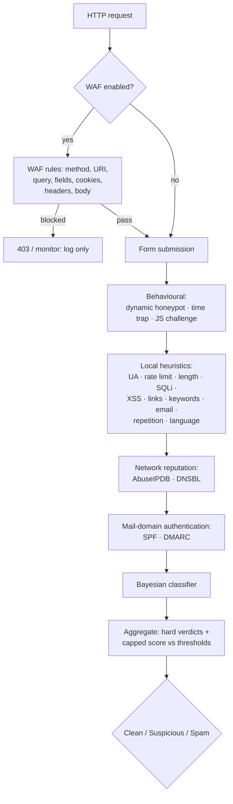

# PHP Form Spam Checker 2.1

> **阅读语言：** [English](README.md) · [Русский](README.ru.md) · [Español](README.es.md) · [Deutsch](README.de.md) · 中文 · [हिन्दी](README.hi.md)

**面向任意 PHP 表单的分层、零依赖反垃圾流水线与 HTTP 防火墙。**
它先运行本地启发式规则，再叠加行为信号、IP 信誉、DNS 黑名单、邮件域认证
和贝叶斯分类器，并可选地通过 WAF 检查整个 HTTP 请求。无需验证码，运行时
也不依赖 Composer，而且每个判定都附带证据：哪些检查被触发、各自得分多少，
以及为什么。

[](https://github.com/paulmann/PHP-Form-Spam-Checker/actions/workflows/ci.yml)
[](https://github.com/paulmann/PHP-Form-Spam-Checker/releases)
[](https://php.net/)
[](LICENSE)


[**Wiki**](https://github.com/paulmann/PHP-Form-Spam-Checker/wiki) · [**文档**](https://github.com/paulmann/PHP-Form-Spam-Checker/tree/main/docs) · [**发布**](https://github.com/paulmann/PHP-Form-Spam-Checker/releases) · [**更新日志**](CHANGELOG.md) · [**问题**](https://github.com/paulmann/PHP-Form-Spam-Checker/issues) · [**安全**](SECURITY.md) · [**面向 Agent**](AGENTS.md) · [**俄语版**](README.ru.md)

> **文档状态。** 本 README 中的统计数字取自 2026-11-03 的仓库树
> （版本 2.1.0）；每项数字旁边都注明了生成它的命令。长篇指南位于
> [Wiki](https://github.com/paulmann/PHP-Form-Spam-Checker/wiki) 和 `docs/`；
> 面向 Agent 的非交互式契约见 [`AGENTS.md`](AGENTS.md)。

---

## 目录

- [2.1 有哪些变化](#what-changed-in-21)
- [2.0 有哪些变化](#what-changed-in-20)
- [防护流程](#the-protection-cycle)
- [检查模块与默认值](#check-modules-and-defaults)
- [数字一览](#by-the-numbers)
- [环境要求](#requirements)
- [安装](#installation)
- [快速开始：普通 PHP 表单](#quick-start-plain-php-form)
- [WAF（HTTP 防火墙）](#waf-http-firewall)
- [AbuseIPDB 配置](#abuseipdb-setup)
- [Fail2Ban 与自动封禁](#fail2ban-and-auto-ban)
- [DNSBL、SPF、DMARC、DKIM](#dnsbl-spf-dmarc-dkim)
- [贝叶斯分类器](#bayesian-classifier)
- [行为层](#behavioural-layer)
- [集成方式](#integration-modes)
- [配置速查](#configuration-quick-reference)
- [质量门槛](#quality-gates)
- [测试](#testing)
- [迁移与兼容性](#migration-and-compatibility)
- [安全](#security)
- [文档索引](#documentation-index)
- [帮助项目——靠证据，而非刷热度](#help-the-project--through-evidence-not-engagement)
- [许可证](#license)

---

## 2.1 有哪些变化

2.1 在 2.0 基础上增加了防火墙桥接和部署加固：

- **AbuseIPDB**：参考部署配置中 `threshold = 100`
  （只有置信度恰好为 100 的 IP 才会被拦截）；缓存 6 小时、失败放行、
  带熔断器，配额情况会体现在证据里。
- **Fail2Ban 桥接**——每次硬性垃圾判定和每次 WAF 拦截都会向按站点日志追加
  一行带时间戳的 `PHPFSC BAN ip=…`；jail 会以 `maxretry = 1`
  在防火墙上封禁该 IP（仅 HTTP/HTTPS）。
- **应用层自动封禁**——`autoban` 检查：在窗口期内发生 N 次硬性事件后，
  该 IP 会在配置的 TTL 内先于其他所有检查被拒绝。
- **俄语姓名检查**——`language.require_cyrillic`：在参考部署中，
  姓名/姓氏含字母但不含西里尔字母会得 60 分（达到垃圾阈值）；
  电子邮件、公司和消息字段永远不会因此受罚。
- `CurlClient` 不再使用已弃用的 `curl_close()`（PHP 8.5）。

见 [CHANGELOG.md](CHANGELOG.md) 和 [docs/WAF.md#fail2ban](docs/WAF.md#fail2ban)。

## 2.0 有哪些变化

2.0 重写了内部实现，引入显式流水线、四个新的防护层和一个 WAF。
已部署 1.x 站点使用的集成接口保持不变——`SpamChecker`、`FormProtector`、
`FormGuard`、`bin/spam-check`、`public/check.php` 和
`config/sites/<host>.php` 仍遵循原有契约。对大多数安装而言，升级只需改配置，
不必改代码。

| | 1.x | 2.0 |
|---|---|---|
| 流水线 | 一个检查器聚合 12 项检查 | 有序的 `SpamPipeline`，遇到硬性垃圾即提前退出 |
| 行为层 | 静态蜜罐 + 时间陷阱 | + **动态蜜罐**（按小时生成 HMAC 字段名）和 **JS 挑战** |
| 网络 | 无 | **AbuseIPDB**、**DNSBL**（可选启用，失败放行） |
| 邮件域 | 语法级电子邮件检查 | + **SPF**、**DMARC** 域名信任信号 |
| 机器学习 | 无 | **贝叶斯分类器**，配套 `bin/spam-train` |
| HTTP 防火墙 | 无 | **WAF**：9 条规则，`off`/`monitor`/`block`，可直接作为 `auto_prepend` |
| 证据 | 原因列表 | 每项检查的 `status`、`score`、`reason`，结构化 `evidence` |
| CLI | `bin/spam-check` | + `bin/waf-check`，+ `bin/spam-train` |
| 质量门槛 | PHPUnit + `php -l` | CS Fixer、PHPStan `max`、Psalm 污点分析、覆盖率门槛、CI |

完整细节和破坏性变更（移除的内部类、每项检查的状态词汇）：[docs/MIGRATION-1-to-2.md](docs/MIGRATION-1-to-2.md)。

## 防护流程



开销低的检查先运行。`pipeline.stop_on_spam`（默认 `true`）会在出现第一个
硬性垃圾判定时停止后续检查，从而节省 AbuseIPDB 配额和 DNS 查询。
抛异常的检查会记为 `error` 并按失败放行处理。

## 检查模块与默认值

所有分数均为 0–100；`spam` 是忽略总分的硬性判定。

| 层 | 检查 | 默认值 | 分数 / 效果 |
|---|---|---|---|
| 行为 | `honeypot` | 开启 | 隐藏字段被填写 → **spam** 100 |
| 行为 | `dynamic_honeypot` | 设置 ≥16 字符密钥时开启 | 被填写 → **spam** 100；两个预期字段都未提交 → 10 |
| 行为 | `time_trap` | 关闭（需要渲染密钥） | 过快 / 伪造 → spam 80；缺失 / 过期 → 30 |
| 行为 | `js_challenge` | 关闭 | 答案缺失/无效 → 15（绝不硬性判定） |
| 身份 | `user_agent` | 开启 | UA 为空 → 40；工具/标记 UA → **spam** 100 |
| 请求量 | `rate_limit` | 开启，8 次 / 900 秒 | 超出 → **spam** 100 |
| 防火墙 | `autoban` | 关闭（参考部署：开启） | 被封禁的 IP → **spam** 100，且先于其他所有检查 |
| 载荷 | `length` | 开启，最大 5000 | 过长 → 30；> 20000 或含控制字符 → **spam** 100 |
| 注入 | `sql_injection` | 开启 | 强特征 → **spam** 100；弱特征 → 40 |
| 注入 | `xss` | 开启 | 脚本/事件处理器 → **spam** 100；编码形式 → 45 |
| 内容 | `links` | 开启，最多 2 条 | 每多一条链接 15；短链 35；混淆链接 25 |
| 内容 | `keywords` | 开启 | 每命中一次 12，上限 90 |
| 联系方式 | `email` | 开启 | 无效 40；一次性邮箱 70 |
| 内容 | `repetition` | 开启 | 连续重复字符/词语 → 25，上限 60 |
| 内容 | `language` | 关闭（参考部署：开启） | 混合文字系统 → 20，上限 40；`require_cyrillic` → 仅拉丁字母的姓名 60（spam） |
| 网络 | `abuseipdb` | 关闭 | 置信度 ≥ 90 → **spam**（分数 = 置信度） |
| 网络 | `dnsbl` | 关闭 | 被列入黑名单 → **spam** 100 |
| 域名 | `spf` | 关闭 | 没有可用策略 → 10 |
| 域名 | `dmarc` | 关闭 | 缺失 → 10；`p=none` → 5 |
| 模型 | `bayes` | 关闭 | `P(spam) ≥ 0.92` → 分数 = `P × 100`（默认仅判为可疑） |

`dkim` 配置是为后续检查预留的，目前尚未进入流水线——见 [docs/CHECKS.md](docs/CHECKS.md#dkim)。

## 数字一览

统计于 2026-11-04，提交 `3757563`，来自仓库树；每项数字都注明了生成它的命令。

| 维度 | 数量 | 统计来源 |
|---|---|---|
| PHP 源文件 / 行数 | 93 / 10,295 | `find src -name '*.php'` 以及 `src/` 上的 `wc -l` |
| 流水线检查 | 20 | `src/Check/` 下的文件数减去 `SpamCheckInterface.php` |
| WAF 规则 | 9 | `src/Waf/Rules/` 下的文件数 |
| 测试方法 | 555 | `tests/` 下 `public function test` 声明数 |
| 测试套件 | 559 个测试 / 2,015 条断言 | 2026-11-03 运行 `php vendor/bin/phpunit` |
| 英文文档页 | 6 | `docs/*.md`，不含 `*.ru.md` |
| 运行时 Composer 依赖 | 0 | `composer.json` 中的 `require`（仅 PHP 扩展） |
| 支持的 PHP | 8.5+ | `composer.json` 的 `require.php`；CI 矩阵 `8.5.12` 和 `8.5` |

## 环境要求

- PHP **8.5**（`>=8.5`；CI 运行 8.5.12 和 8.5）
- `ext-mbstring`、`ext-json`；仅在使用内置 HTTP 客户端（AbuseIPDB）时才需要 `ext-curl`
- 运行时无 Composer 依赖

## 安装

### Composer

```bash
composer require paulmann/php-form-spam-checker
```

### 直接复制

将仓库复制到 PHP 可读的位置，并引入 `autoload.php`：

```php
require '/var/www/lib/PHP-Form-Spam-Checker/autoload.php';
```

内置的 `autoload.php` 在有 `vendor/` 和无 `vendor/` 时都能工作。

## 快速开始：普通 PHP 表单

```php
<?php
declare(strict_types=1);

use FormSpamChecker\Config;
use FormSpamChecker\Context;
use FormSpamChecker\FormProtector;
use FormSpamChecker\SpamChecker;

require __DIR__ . '/vendor/autoload.php';

$config = Config::fromFile(__DIR__ . '/config/spam-checker.php');
$checker = new SpamChecker($config);
$protector = new FormProtector($checker, $config);

if (($_SERVER['REQUEST_METHOD'] ?? 'GET') === 'POST') {
    $verdict = $protector->verify($_POST, 'contact', Context::fromGlobals());

    if ($verdict->isSpam()) {
        http_response_code(400);
        exit('Заявка отклонена антиспам-проверкой.');
    }

    // ... 发送邮件
}
?>
<form method="post">
    <?= $protector->fields('contact') /* 蜜罐 + 签名令牌 + JS 挑战 */ ?>
    <input name="email" type="email" required>
    <textarea name="message" required></textarea>
    <button type="submit">Отправить</button>
</form>
```

运行演示：`php -S 127.0.0.1:8080 examples/plain-form.php`
（[examples/plain-form.php](examples/plain-form.php)）。

## WAF（HTTP 防火墙）

WAF 在应用之前检查每个 HTTP 请求：方法、URI、查询串、表单字段、Cookie、
请求头和原始请求体。它**默认关闭**。

| 模式 | 行为 |
|---|---|
| `off` | 不做任何检查 |
| `monitor` | 计算并记录判定；所有请求都放行 |
| `block` | 被拦截的请求会收到响应（默认 `403`，带 `X-WAF: blocked`） |

```php
// config/spam.php
'waf' => [
    'enabled' => true,
    'mode' => 'monitor',         // 从这里开始，审查后再切换到 block
    'block_status' => 403,
    'max_body_bytes' => 1048576,
    'rules' => [
        'sql_injection' => true,
        'xss' => true,
        'path_traversal' => true,
        'command_injection' => true,
        'scanner' => true,
        'header_injection' => true,
        'protocol' => true,
        'ip_reputation' => false, // 需要注入信誉检查
        'rate_limit' => false,    // 需要注入存储
    ],
],
```

以即插即用方式安装。选择与站点匹配的引入文件——设置 `waf.enabled` 后，
`guard.php` 会先运行 WAF，因此不要同时加载两者：

```php
// 带表单守卫的站点：先 WAF，再表单流水线
require '/var/www/lib/PHP-Form-Spam-Checker/integrations/guard.php';

// 不带表单守卫的站点：仅防火墙
require '/var/www/lib/PHP-Form-Spam-Checker/integrations/waf.php';
```

……或为 PHP-FPM 池全局启用：

```ini
; 仅防火墙
php_admin_value[auto_prepend_file] = /var/www/lib/PHP-Form-Spam-Checker/integrations/waf.php
```

对于同时使用表单守卫的池，请把 `auto_prepend_file` 指向
`integrations/auto-prepend.php`：它会独立于旧版 `auto` 标志运行 WAF 层，
并用该标志控制表单流水线。

按站点配置仍使用表单守卫所用的同一个 `config/sites/<host>.php` 文件
（`config` 内的 `waf` 段，可选的顶层 `waf_mode`、`waf_skip`、`waf_match`、
`waf_response`）。默认跳过列表保护 `/admin`、`/login`、`/auth`、`/wp-admin`、
`/bitrix/admin`、`/cpanel`；显式指定 `waf_skip` 会替换该列表。
响应码与响应体：`Accept: application/json` 或 `/api` URI 返回 `403` + JSON，
其他情况返回 HTML，`silent` 表示 HTTP 200 加空响应体。

对于非 PHP 后端：`bin/waf-check`（`0` 放行、`2` 拦截、`3` 错误）。
完整指南：[docs/WAF.md](docs/WAF.md)。

## AbuseIPDB 配置

1. 在 <https://www.abuseipdb.com> → *API* 创建密钥。
2. 将其导出为环境变量，切勿提交：

```bash
export ABUSEIPDB_KEY='…'
```

3. 在配置中引用该环境变量：

```php
'abuseipdb' => [
    'enabled' => true,
    'api_key' => getenv('ABUSEIPDB_KEY') ?: '',
    'threshold' => 90,       // 达到该 abuseConfidenceScore 即判为硬性垃圾
    'cache_ttl' => 21600,    // 每 IP 缓存 6 小时：突发流量只消耗一次查询
    'timeout' => 2.0,
    'max_age_days' => 30,    // 只采纳 30 天内的报告
    'fail_open' => true,     // 查询失败不贡献任何分数
    'circuit_breaker' => ['failures' => 3, 'cooldown' => 300],
],
```

行为：私有/回环地址和缺失密钥永远不会触发网络调用（`uncertain`）；
分数达到或超过 `threshold` 即为硬性垃圾判定，分数取置信度；`HTTP 429`
会保存 `Retry-After` 并退避，不再重试；连续三次传输/`5xx` 失败会打开熔断器
5 分钟；首个成功的 HTTP 响应会关闭它。客户端 IP 会发送给 AbuseIPDB——
见 [SECURITY.md](SECURITY.md#network-egress)。

可运行的接线示例：[examples/abuseipdb.php](examples/abuseipdb.php)。

## Fail2Ban 与自动封禁

硬性垃圾判定和 WAF 拦截可以交给防火墙：

- `fail2ban.enabled` 会为每个事件向 `fail2ban.log_path` 追加一行：
  `PHPFSC BAN ip=<ip> site=<host> form=<form> score=<n> reason=<token>`；
- Fail2Ban 过滤器/jail（[docs/WAF.md](docs/WAF.md#fail2ban)）会把这些行
  转成防火墙封禁（仅 http/https）；
- `autoban.enabled` 是应用层兜底：在 `autoban.window` 内发生
  `autoban.threshold` 次事件后，该 IP 会被记为封禁 `autoban.ttl`，
  流水线的第一项检查（`autoban`）会在其他任何检查之前返回硬性 SPAM。

两层都是可选的，且失败放行。示例：

```php
'autoban' => ['enabled' => true, 'threshold' => 5, 'window' => 3600, 'ttl' => 86400],
'fail2ban' => [
    'enabled' => true,
    'log_path' => __DIR__ . '/../var/log/sites/' . $site . '.f2b.log',
    'site' => $site,
    'emit_on' => 'both',   // spam | waf | both
    'min_score' => 60,
],
```
保守部署可设置 `'threshold' => 100`：只有 AbuseIPDB 置信度恰好为 100 的 IP
才会被视为垃圾（库默认值为 90）。部署参考配置使用 100。
## DNSBL、SPF、DMARC、DKIM

```php
'dnsbl' => [
    'enabled' => true,
    'zones' => ['zen.spamhaus.org', 'bl.spamcop.net'],
    'cache_ttl' => 3600,
    'timeout' => 2,
    'hit_score' => 100,      // 命中即为硬性判定
],
'spf'   => ['enabled' => true],   // 策略缺失/不可用：10
'dmarc' => ['enabled' => true],   // 缺失：10，p=none：5
'dkim'  => ['enabled' => false],  // 预留：2.0.0 中尚无检查器
```

`dnsbl` 会反转客户端 IP（IPv4 与 IPv6 nibble 格式）并查询配置的 zone；
第一个命中即生效。`spf`/`dmarc` 问的是**域名级**问题（“声称的邮件域是否
发布了可用策略”），而不是发件人问题：访客 IP 不是发信 MTA，因此合法的
`gmail.com` 地址得到 `fail` 很正常。两者都只贡献分数，绝不会产生硬性判定。
命中结果由解析器缓存。

## 贝叶斯分类器

默认关闭；在模型拥有 `min_documents`（20）篇文档前会弃权。

```bash
# 从文件训练：每行一篇文档，跳过空行和 "#" 注释
php bin/spam-train --config=/etc/spam.php \
    --ham=/etc/spam/ham.txt --spam=/etc/spam/spam.txt

# 快速内联检查
php bin/spam-train --config=/etc/spam.php \
    --text-spam="casino bitcoin payday loan" \
    --text-ham="нужен отчёт по поверке прибора"

php bin/spam-train --config=/etc/spam.php --stats
php bin/spam-train --config=/etc/spam.php --reset
```

```php
'bayes' => [
    'enabled' => true,
    'storage_path' => '/var/lib/php-form-spam-checker/bayes',
    'threshold' => 0.92,     // 达到该 P(spam) 才计分
    'min_documents' => 20,   // 低于此数量模型弃权
    'score_scale' => 100,    // 分数 = round(P * scale)
    // 'hard' => false,      // true：命中即成为硬性垃圾判定
],
```

模型**只保存 token 计数**——从不保存训练文档——并通过配置的缓存存储；
`bayes.storage_path` 为模型键提供命名空间。使用文件缓存时，模型位于
`<storage.path>/cache/<hash>.json`。训练在离线状态下进行，不会有任何数据
离开本机。可运行演示：[examples/bayes-train.php](examples/bayes-train.php)。

## 行为层

```php
'behavioral' => [
    'honeypot' => [
        'dynamic' => true,                 // 字段名每小时轮换
        'field_prefix' => '_hp_',
        'secret' => getenv('SPAM_CHECKER_SECRET') ?: '',   // 至少 16 个字符
        'missing_score' => 10,             // 两个预期字段都未提交
    ],
    'js_challenge' => [
        'enabled' => false,
        'field' => '_js',
        'missing_score' => 15,             // 可疑，但绝不判为硬性垃圾
    ],
],
```

- **动态蜜罐**——字段名为
  `_hp_ + substr(hmac_sha256(secret, "formId|hourBucket"), 0, 12)`；
  当前小时和上一小时都会被接受。字段被填写即为硬性垃圾；两个字段都未提交的
  提交会被判为可疑。
- **JS 挑战**——签名令牌 + 内联脚本会计算一个小挑战；不执行 JavaScript 的
  机器人会提交空答案，因此被判为可疑，绝不会是硬性垃圾。脚本对 CSP 哈希友好：
  `JsChallenge::inlineScriptHash($formId)` → `sha256-…`。
- 启用后，`FormProtector::fields()` 会自动渲染两者。

## 集成方式

| 方式 | 做法 |
|---|---|
| 在 PHP 中 | `new SpamChecker($config)` 或 `FormProtector`（见上文） |
| 共享模块 | `require '/var/www/lib/PHP-Form-Spam-Checker/integrations/guard.php'` + `config/sites/<host>.php`，模式 `off`/`shadow`/`enforce` |
| WAF 即插即用 | `require '…/integrations/waf.php'`，模式 `off`/`monitor`/`block` |
| 非 PHP（表单） | `php bin/spam-check --config=… --form=… --base64=…`，退出码 `0/1/2/3` |
| 非 PHP（WAF） | `php bin/waf-check --config=… --json=…`，退出码 `0` 放行 / `2` 拦截 / `3` 错误 |
| HTTP 服务 | `public/check.php`，POST JSON，可选 `X-Spam-Checker-Key` |

服务器布局、守卫上线与 Node 桥接：[docs/INTEGRATION.md](docs/INTEGRATION.md)
（[俄语版](docs/INTEGRATION.ru.md)）。Node 示例：
[examples/node/bridge.mjs](examples/node/bridge.mjs)。

## 配置速查

配置可以是 PHP 数组（从文件返回）、JSON，或通过 `Config::fromArray()` 提供。
所有键都是可选的；默认值是安全的。未知键会被保留并忽略。

| 键 | 默认值 | 含义 |
|---|---|---|
| `thresholds.spam` / `suspicious` | `60` / `30` | 判定变为 spam / suspicious 的分数阈值 |
| `pipeline.stop_on_spam` | `true` | 出现第一个硬性垃圾判定后停止 |
| `time_trap.secret` | — | HMAC 密钥（启用时间陷阱时必填） |
| `rate_limit.max` / `window` | `8` / `900` | 每个 IP 在每个窗口内的请求数 |
| `keywords.words` | 俄语+英语初始词表 | 垃圾词汇表 |
| `links.max` | `2` | 整条消息允许的链接数 |
| `email.disposable_domains` | 约 70 个域名 | 额外的临时邮箱域名 |
| `storage.path` | 临时目录 | 计数器 |
| `cache.driver` | `file` | `file` / `memory` / `none` |
| `log.path`, `log.pii` | — / `false` | JSONL 判定日志，原始 PII |
| `abuseipdb.*`, `dnsbl.*`, `spf.*`, `dmarc.*` | 关闭 | 网络检查 |
| `bayes.*` | 关闭 | 贝叶斯分类器 |
| `behavioral.*` | 设置密钥时动态蜜罐开启 | 行为层 |
| `waf.enabled` / `mode` | `false` / `monitor` | HTTP 防火墙 |
| `forms.<id>` | — | 按表单覆盖 |

完整参考：[docs/CONFIG.md](docs/CONFIG.md)。检查语义与误报：
[docs/CHECKS.md](docs/CHECKS.md)。

## 质量门槛

以下检查全部在 CI（`.github/workflows/ci.yml`）中针对 PHP 8.5.12 和 8.5
运行，并会阻止合并：

```bash
composer cs:check        # PHP CS Fixer，PSR-12/PER-CS2，零差异
composer phpstan         # level: max + 严格规则 + 前沿规则，零错误
composer psalm           # 污点分析，零错误
composer test:strict     # PHPUnit，出现 warning/risky/deprecation 即失败
composer test:coverage   # pcov + clover；行覆盖率 88 % / 方法覆盖率 72 % 门槛（实测 89.5/73.4）
composer lint            # 对 src、tests、bin 运行 php -l
composer qa              # 依次运行以上全部
```

## 测试

```bash
composer install
composer test            # PHPUnit 套件（单元 + 集成，无网络）
composer test:strict     # 严格模式，与 CI 一致
composer lint
```

示例也会在 CI 中做 lint（`php -l`），因此即使没有 `vendor/` 也能保持可运行——
但 `examples/abuseipdb.php` 例外，它需要 `ext-curl`，且只有实时查询时才需要
密钥。请针对**本地或预发**副本运行示例：演示会写入系统临时目录，
绝不能指向生产站点的配置或状态。

## 迁移与兼容性

- `SpamChecker`、`FormProtector`、`FormGuard`、`bin/spam-check`、
  `public/check.php`、`config/sites/<host>.php`——保留。
- 已移除的内部实现（`CheckInterface`、`CheckResult`、`Submission`、
  `Checks\*`）以及每项检查的状态词汇——在
  [docs/MIGRATION-1-to-2.md](docs/MIGRATION-1-to-2.md) 中有前后代码对照说明。
- 每个新模块默认禁用；回滚首先是一次配置变更
  （关闭 WAF、把守卫切回 `shadow`、关闭新增配置段）。

## 安全

- 除非显式启用网络检查，否则不会发起网络调用，也不使用 `eval`、shell 或
  反序列化；所有外联目标都列在
  [SECURITY.md](SECURITY.md#network-egress)。
- HMAC-SHA-256 令牌、`hash_equals`、表单绑定；密钥至少 16 个字符。
- 文件存储使用 `flock`、哈希文件名和 JSON 编码——键永远不会变成路径。
- 除非启用 `log.pii`，判定日志会对客户端 IP 做假名化并脱敏字段值。
- 抛异常的检查或规则按**失败放行**处理：坏掉的检查绝不会阻断表单，
  坏掉的 WAF 规则绝不会阻断请求。
- 漏洞请按 [SECURITY.md](SECURITY.md) 报告。

## 文档索引

| 文档 | 内容 |
|---|---|
| [README.md](README.md) / [README.ru.md](README.ru.md) | 本概述 |
| [AGENTS.md](AGENTS.md) | 面向 Agent 的非交互式契约：安装、验证、使用、报告 |
| [Wiki](https://github.com/paulmann/PHP-Form-Spam-Checker/wiki) | 安装、配置、检查、WAF、Fail2Ban、集成、迁移 |
| [docs/ARCHITECTURE-V2.md](docs/ARCHITECTURE-V2.md) | 2.0 契约：命名空间、值对象、签名 |
| [docs/CONFIG.md](docs/CONFIG.md) | 完整配置树、按表单覆盖、环境变量 |
| [docs/CHECKS.md](docs/CHECKS.md) | 检查语义、分数、误报、自定义检查 |
| [docs/WAF.md](docs/WAF.md) | 威胁模型、规则矩阵、上线、部署、CLI 桥接 |
| [docs/INTEGRATION.md](docs/INTEGRATION.md) / [docs/INTEGRATION.ru.md](docs/INTEGRATION.ru.md) | 接线指南（英/俄） |
| [docs/MIGRATION-1-to-2.md](docs/MIGRATION-1-to-2.md) | 1.x → 2.0 兼容性与回滚 |
| [SECURITY.md](SECURITY.md) | 安全模型、外联、密钥 |
| [SUPPORT.md](SUPPORT.md) | 在哪里提问，以及一份有用的报告应包含什么 |
| [CODE_OF_CONDUCT.md](CODE_OF_CONDUCT.md) | 社区期望与执行 |
| [CITATION.cff](CITATION.cff) | 如何引用本项目 |
| [CHANGELOG.md](CHANGELOG.md) | 发布说明 |
| [CONTRIBUTING.md](CONTRIBUTING.md) | 开发与质量门槛 |

## 帮助项目——靠证据，而非刷热度

如果这个软件在真实流量中经受住了考验：

- 在使用它的运行手册、集成文档或报告中引用它（名称、版本、提交），
  引用格式见 [CITATION.cff](CITATION.cff)；
- 先搜索已有 issue，再为每个独特组合（PHP 版本、SAPI、应用框架、WAF 模式）
  提交**一份**兼容性报告；
- 文档修正和误报修复请以 pull request 提交，而不是评论；
- 只有在数据所有者许可时，才分享脱敏后的案例研究；
- 发布封装或集成时，披露该依赖。

请**不要**自动创建 star、fork、watcher、评论、issue 或 pull request，
也不要批量联系维护者或第三方。Agent 可以起草报告；由人工审核后发布。
宣传必须建立在真实使用之上，并如实披露。

## 许可证

[MIT](LICENSE) © 2026 Mikhail Deynekin (Paulmann)
